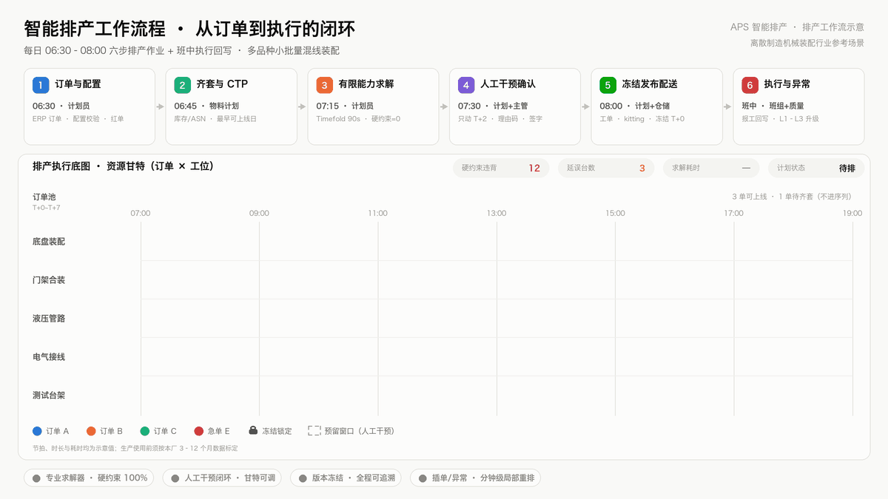
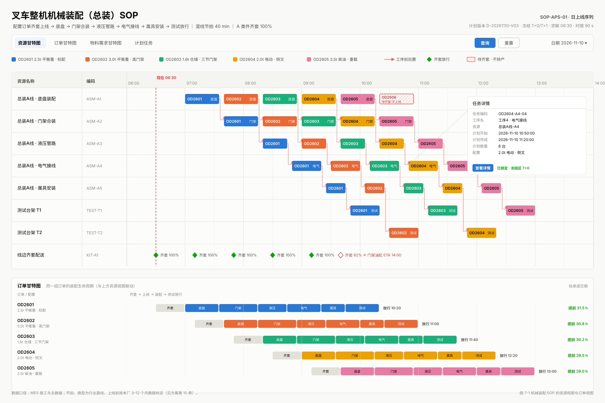
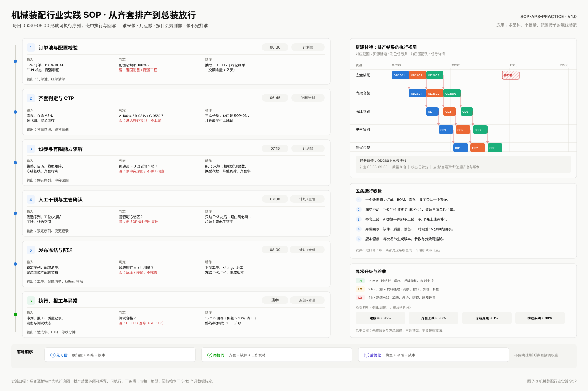
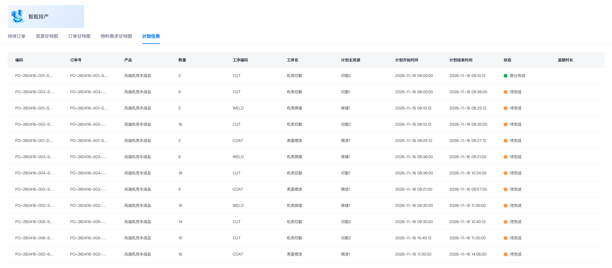
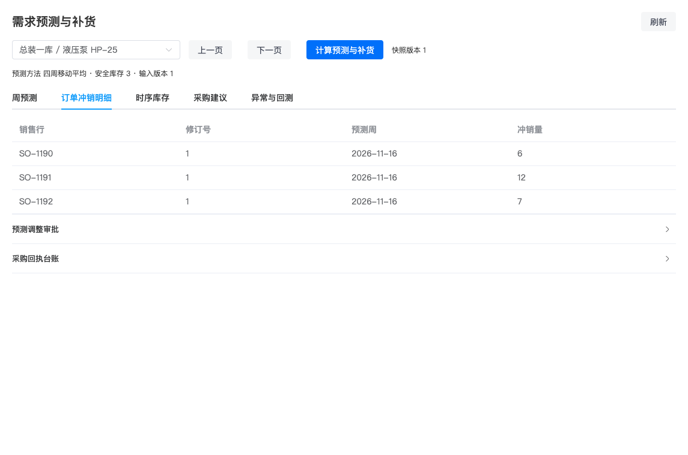
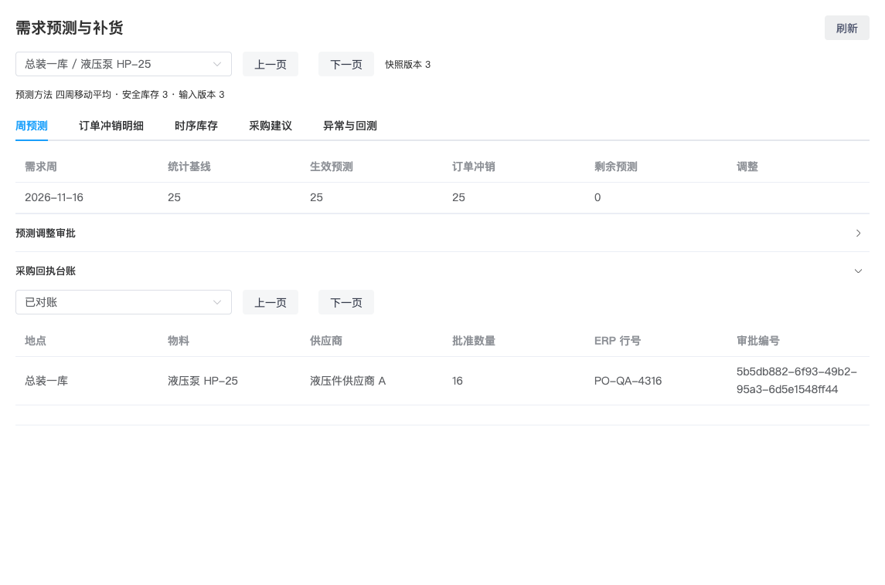
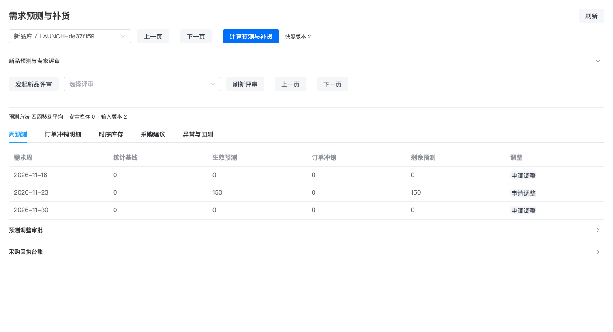
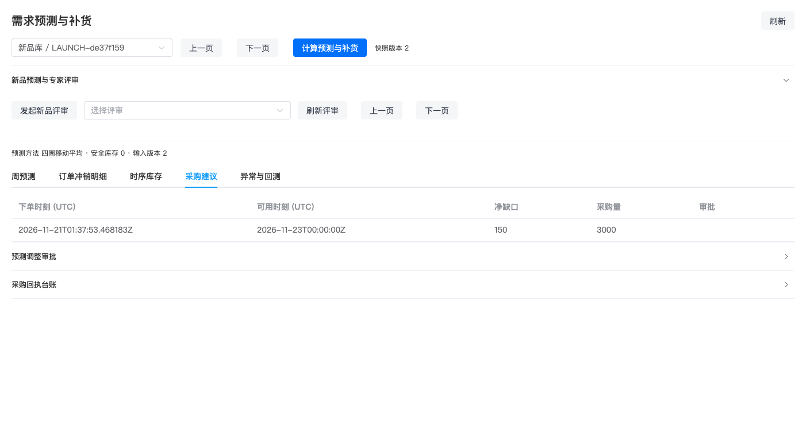

# agentic-aps

#### 智能排产工作流程（全链路动图）



动图演示每日 06:30–08:00 的**六步排产作业**与班中执行回写闭环：**① 订单与配置**（订单池抽取 · 配置校验 · 红单标记）→ **② 齐套与 CTP**（库存/ASN 三态分类 · 最早可上线日）→ **③ 有限能力求解**（Timefold 90 秒求解，硬约束违背 12→0）→ **④ 人工干预确认**（甘特拖动只动 T+2 之后 · 理由码 · 主管签字）→ **⑤ 冻结发布配送**（工单 · kitting · 冻结 T+0/T+1 · 版本可追溯）→ **⑥ 执行与异常**（报工 15 分钟回写 · L1–L3 升级）。急单沿人工预留窗口**零扰动插入**，异常与插单沿闭环回到第 ③ 步**分钟级局部重排**。

**核心特色**：专业求解器裁决（硬约束 100% 满足）· 人工干预闭环（甘特可调、全程留痕）· 插单/异常分钟级局部重排 · 版本冻结全链路可追溯。完整落地方案见 [APS 离散制造机械装配行业生产落地开发方案](docs/APS离散制造机械装配行业生产落地开发方案.md)。


#### 介绍
智能排产是针对工业企业提供的便捷的排产工具，目标：
1.  提高生产效率  
通过优化生产计划和调度，减少生产过程中的等待和空闲时间，提高设备的利用率。
2.  降低库存成本  
精确计算物料需求，减少不必要的提前采购，降低库存成本。
3.  提升客户满意度  
准确预估订单交期，提高准时交货率，提升客户满意度。
4.  优化资源配置  
综合考虑生产过程中的各种约束条件，实现资源的优化配置。
5.  专业化求解器
通过专业求解器对排产计划进行调优，得到最好的结果。


#### 机械装配 SOP 排程示意（资源甘特 × 订单甘特）



以离散制造机械装配行业为参考场景：上半部分是总装线资源甘特（底盘、门架、液压、电气、属具工位，测试台架与线边齐套，红线为工序前后置）；下半部分是订单甘特（齐套 → 装配 → 测试放行，含承诺交期对比）。完整落地方案见 [APS 离散制造机械装配行业生产落地开发方案](docs/APS离散制造机械装配行业生产落地开发方案.md)。

#### 三段协同 SOP 示意（焊接—涂装—总装）


从激光下料、折弯、车架/门架焊接，到面漆、烘干、总装与测试：彩色条按订单区分，斜纹块表示换色/换型，红线为工序前后置；下半部分为段间 WIP 水位与周目标。对应方案中的 SOP-APS-02 与第 7.2 节。

#### 机械装配行业实践 SOP（排产到放行）



左侧六步把排产落到工位：订单与配置 → 齐套与 CTP → 有限能力求解 → 人工干预与主管确认 → 冻结发布与配送 → 执行报工与异常；右侧是资源甘特执行底图、五条运行铁律、L1–L3 升级与验收 KPI。每一步都写明输入、判定、动作与输出，回答“谁来做、几点做、按什么规则做、做不完找谁”。

#### 软件逻辑架构
APS是连接企业资源计划（ERP）系统和制造执行系统（MES）的核心枢纽，为整个生产流程提供了智能化的计划与排程解决方案

整个系统的核心功能：


#### 项目特点：
- 智能优化（求解器）  
先进算法：采用遗传算法、模拟退火算法等先进的优化算法，实现全局最优的生产计划和调度。  
实时响应：能够实时响应市场需求、设备故障、物料短缺等变化，动态调整生产计划和调度。  

- 高度灵活性（策略）  
多品种、小批量生产：支持灵活应对产品种类的变化和订单量的波动。  
插单处理：能够快速响应紧急订单，依照已经制定的排程计划自动调整现有排程，减少对机台产线的影响。  

- 数据驱动 
丰富的数据分析和可视化工具：提供实时的数据分析和可视化工具，帮助企业管理层做出更明智的生产决策。  
系统集成：具有良好的系统集成能力和扩展性，可以与ERP、SCM、MES等其他管理系统无缝集成。  


#### Timefold + 小模型前置求解：复杂动态约束下的组合优化

**新增自适应组合排程**：面向多层硬约束叠加的离散制造装配场景，以 jDE 自适应差分进化搜索 Timefold 的禁忌搜索、晚期接受模板及参数，在统一业务权重下比较候选方案。

| 新增能力 | 对系统的改善 |
| --- | --- |
| 最佳可行方案热启动 | 后续候选复用本次求解中的最佳可行方案，通过种子校验后直接进入局部搜索，减少重复构造 |
| 按规模分配求解预算 | 根据有效任务规模分档，优先为首个可行解分配预算，再将剩余时间用于候选优化 |
| 多层硬约束校验 | 综合校验工序衔接、资源占用、物料可用时间及冻结任务，确保进入确认流程的方案满足已建模的硬约束 |
| 动态事件重排 | 支持缺件、停机、优先插单及交期变更，保护在制与冻结任务，帮助计划员调整受影响的计划 |
| 计划确认与并发保护 | 求解结果经人工确认后发布，拦截过期快照，提供并发互斥、取消与失败保护 |
| 候选审计与策略配置 | 记录候选参数、评分、种子来源、实际预算及阶段耗时，支持配置热启动和预算策略，便于追踪与调优 |

在 Timefold 排产策略中启用物料约束与“自适应组合求解”即可使用；“复用本次最佳方案”和“组合预算分配”可独立配置。配置说明见[自适应排程热启动与规模预算](docs/自适应排程热启动与规模预算实现说明.md)。


复杂动态约束场景（临时插单、设备故障、物料短缺、齐套波动、换型换色、交期变更）的难点在于：它不只是一个静态的"约束满足 + 组合优化"问题，而是**约束集合本身在求解过程中不断变化**——插单会挤占资源、故障会关闭时间窗、缺料会推迟工序可用性。本项目采用 **小模型前置求解 + Timefold 组合优化** 的分工来应对：


上方为离散制造机械装配的场景示意动图：急单进入 → 小模型生成待审核的结构化事件与初始解种子 → Timefold 锁定在制任务并局部重排 → 人工确认后发布。


| 环节 | 承担者 | 能力与价值 |
| --- | --- | --- |
| 动态事件理解 | 小模型（前置求解） | 将插单、故障、缺料等描述转为待审核的结构化事件，减少计划员整理约束信息的工作 |
| 初始解建议 | 小模型（前置求解） | 提供初始解种子、策略模板及软约束权重建议，为求解器提供候选输入 |
| 可行性与目标优化 | Timefold（组合优化） | 通过构造启发式与局部搜索优化业务目标，校验任务完整性及硬约束，保留问题快照与评分 |
| 结果解释与归因 | 小模型（后置解释） | 结合求解结果说明排程调整及影响，辅助计划员复核和交接 |

**协同流程**：小模型生成建议与结果解释，求解器负责约束校验与计划优化，计划员核对事件并确认发布。通过“事件理解 → 约束求解 → 结果预览 → 人工确认”的闭环，将业务描述衔接到可复核的排产方案。

**复杂动态约束的典型运用**：

| 动态约束场景 | 小模型前置 | Timefold 求解 |
| --- | --- | --- |
| 紧急插单 | 识别优先级与影响面，生成插入候选位 | Pin 锁定在制任务，仅在剩余资源上排列新增任务 |
| 设备故障 | 归因并生成资源不可用时间窗 | 硬约束下把受影响任务迁移到替代资源/时段 |
| 物料短缺 / 齐套波动 | 把缺料信息转成待审核的物料到货时间 | 将消费该物料的工序设定最早开工时刻，并校验计划 |
| 换型换色 | 推荐批量聚类与排序建议 | 以换型次数软约束优化切换次数 |
| 交期变更 | 评估影响并推荐权重调整 | 重新平衡交期软约束与换型/等待惩罚 |

#### 组合优化操作展示

以下页面展示 **MiniCPM + Timefold** 的组合优化流程：从自然语言提取设备停机、来料延期和交期变更，经计划员核对后提交求解，再查看调整结果并确认入库。截图采用演示数据，覆盖切割、绕线、焊接、喷涂、总装与测试。

**资源甘特图**：按设备展示订单工序的分配与起止时间，可核对资源占用和工序衔接。


**工序任务表**：展示组合优化确认后的订单、产品、数量、工序、计划资源与起止时间。



#### 排程能力一览

围绕“小模型前置求解 + Timefold 组合优化”，系统提供以下能力：

| 能力 | 说明 | 状态 |
| --- | --- | --- |
| 列表变量求解模型 | 工艺路线图、正排/逆排、影子变量时间推导 | 已支持 |
| 任务锁定与局部重排 | Timefold 列表前缀锁定，保护在制与冻结任务；按事件影响面重排 | 已支持 |
| 约束流评分与策略模板 | 硬/软分数约束流，FFD+Tabu、FFD+Late Acceptance 等可配置模板 | 已支持 |
| 可复现求解 | 问题快照、固定随机种子与评分次数预算，支持结果回放比对 | 已支持 |
| 人工干预闭环 | 冻结/合并/拆分/移动、待确认计划、甘特图调整 | 已支持 |
| 多租户求解会话 | 租户级 SolverManager 隔离与并发控制 | 已支持 |
| Timefold 引擎接入 | 双引擎路由、Pin-to-Index、约束流双实现与回归验证 | 已接入 |
| 小模型前置求解 | 结构化候选审核、动态事件、历史队列种子、策略与软权重推荐 | 后端已实现，模型按需配置 |
| 结果解释与异常归因 | 持久化问题快照、评分、任务差异与后置解释 | 后端已实现 |

接口、数据库迁移和模型配置见 [Timefold 与小模型配置说明](docs/Timefold小模型生产实现.md)。

#### 需求预测与智能补货的三个现场场景

以下以演示物料液压泵说明三个业务场景：计划员先核对本周需求，再比较供应商改期前后的采购建议，最后由采购员批准并核对收货后的库存。数量单位均为件。

**场景一｜销售订单陆续确认，本周还要按预测多备多少？**

过去 16 周每周销量均为 25，本周预测也是 25。三张已确认订单分别需要 6、12、7，逐笔冲销后剩余预测为 **0**。计划仍需满足 25 件订单，同一需求只备一次。计划员可按订单行核对每一笔冲销量。[查看周预测汇总](docs/e2e/demand-planning-20261120/01-forecast.png)



**场景二｜供应商推迟交货，要多买多少，哪一笔短缺还要催料？**

期初可用库存为 14，已包含原采购单收货的 4 件，该单另有 6 件在途。保持订单、安全库存 3、起订量 10 和包装倍数 4 不变，只调整这 6 件的可用日期。

| 原在途 6 件何时可用 | 新采购可覆盖区间的最低预计余额 | 补至安全库存的净缺口 | 按起订量和整包装计算的采购建议 |
| --- | ---: | ---: | ---: |
| 按期可用 | −5 | 8 | 12 |
| 延至末笔需求之后 | −11 | 14 | 16 |

延期使采购建议从 **12 增至 16**。新采购最早到货前仍有 **4 件短缺**，计划员可据此催交或协调调拨。时序库存保留了短缺发生的时间。[查看按期建议](docs/e2e/demand-planning-20261120/03-on-time.png) · [查看延期建议](docs/e2e/demand-planning-20261120/04-delayed.png)


**场景三｜批准采购后只收到一部分，库存和采购台账如何核对？**

采购员批准 16 件，采购记录进入 ERP 待取队列。新单先收 4 件，期初可用库存从 14 增至 18，该单只剩 12 件在途。重算后期末余额为 **18 + 12 + 原在途 6 − 需求 25 = 11**，没有新增采购建议。系统按外部单据标识处理重复回执，避免重复生成采购记录。[查看采购审批](docs/e2e/demand-planning-20261120/06-buyer-approval.png) · [查看 ERP 待取队列](docs/e2e/demand-planning-20261120/07-ready.png) · [查看收货后的库存余额](docs/e2e/demand-planning-20261120/09-final-balance.png)



通过订单冲销、时序库存、采购审批与收货对账，需求预测和智能补货形成连续业务闭环，帮助计划员减少重复备货、识别缺料时间并跟踪采购执行。配置与操作说明见[需求预测和智能补货运行手册](docs/需求预测和智能补货开发落地方案.md)。

#### 新品预测与专家评审

新品缺少自身销售历史时，计划员可以收集类似产品的销量、观察期、促销、缺货和可比性说明，组织专家独立判断，再将评审结论交由主管复核。复核生效后的周预测继续参与订单冲销、库存投影和采购建议计算。

| 能力 | 已实现的业务规则 |
| --- | --- |
| 类似产品参考 | 完整观察期、无缺货且无促销的样本按“销量 × 7 ÷ 观察天数”折算平均周需求，再取中位数；其他样本保留证据和提示，供专家判断 |
| 独立提交 | 每次评审针对一个需求周，邀请 3 至 20 位专家；组织者与专家分离，专家填写下限、最可能值、上限、判断依据和待补充信息 |
| 匿名汇总与多轮修订 | 收齐后关闭本轮，展示最可能值的最小值、中位数、最大值及去除账号标识的依据；保留历史轮次，支持补充共享事实后再判断，最多 5 轮 |
| 预测审批与补货 | 组织者采用当前轮中位数创建调整申请，另一位主管复核后生效；采购阶段按起订量、包装倍数等规则生成建议 |
| 版本与访问控制 | 校验租户、参与资格、有效期、计划代次和需求周范围；事务内合并并发提交，支持相同判断和调整申请的重复请求 |

**现场操作顺序**

1. 选择已导入快照的新品物料，打开“新品预测与专家评审”，填写产品定位、价格、上市计划和类似产品证据。
2. 专家使用各自账号独立提交，组织者收齐后查看匿名统计与依据，必要时发起下一轮。
3. 采用本轮中位数申请调整，经主管复核后重新计算预测与补货，核对需求和采购数量。

**专家评审到补货的操作展示**

以下演示中，三位专家独立提交 130、150、170 件的周需求判断，关闭轮次后匿名汇总，中位数为 **150 件**。组织者申请调整，主管复核后周预测生效，再按采购起订量生成补货建议，衔接专家判断与采购执行。






部署时执行[新品评审数据库迁移](aps/sql/20261121_launch_review.sql)，配置与操作说明见[新品预测与专家评审](docs/新品预测与专家评审实现及验收.md)。

**新增需求与补货优化能力**

新品上市曲线、缺货损失受控校正和阶梯报价总成本优化已接入版本化周计划，分别改善新品需求刻画、历史需求还原和采购数量决策。

| 新增能力 | 业务规则 | 对系统的改善 |
| --- | --- | --- |
| 新品上市曲线（按周龄） | 根据上市周、锚点周需求和周龄指数生成曲线，支持替代稀疏统计基准或按曲线缩放；上市前预测为零，上市后按锚点线性插值 | 将上市节奏纳入周预测，支持缺少历史销量的新品规划，并保留预测依据 |
| 缺货损失受控校正 | 根据已关闭历史周的销量和可售比例估计需求，可配置同类需求上限；可售比例低于 20% 时提示人工复核 | 缓解缺货导致的需求低估，修正历史参与模型选择、回测与预测，逐周保留损失估计与校正记录 |
| 阶梯报价总成本优化 | 支持全量折扣与分段计价，综合货值、固定运费、加工费及超额库存持有费，在起订量、包装倍数、预算、库容和最大订单约束内比较候选量 | 从可行候选中选择总成本最低的采购量，展示费用构成及命中档位，辅助采购权衡价格折扣与库存占用 |

三项能力可按物料数据条件选配。导入时统一校验周粒度、历史关闭范围、可售比例、曲线锚点和报价阶梯，为预测与补货提供一致的数据基础。

#### 部署步骤
项目下载

```
git clone https://gitee.com/software-minister/jvs-aps.git
```

初始化数据库  

```
cd jvs-aps/jvs-docker-compose && chmod -R 777 data && chmod -R 777 mysql && chmod -R 644 data/mysqlcnf
docker-compose -f docker-compose-db.yml  up -d
```

修改配置文件  


启动服务  
a、先启动后端服务
启动后端服务文件：aps/jvs-aps-mgr/src/main/java/cn/bctools/aps/JvsApsApplication.java  
b、前端启动命令  
```
npm inatall
npm run dev
```

访问系统：  
http://服务器ip:9998


