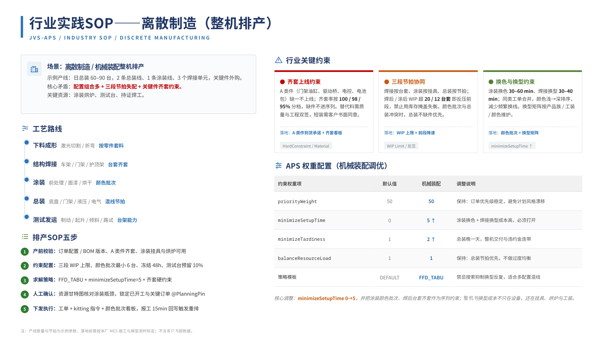
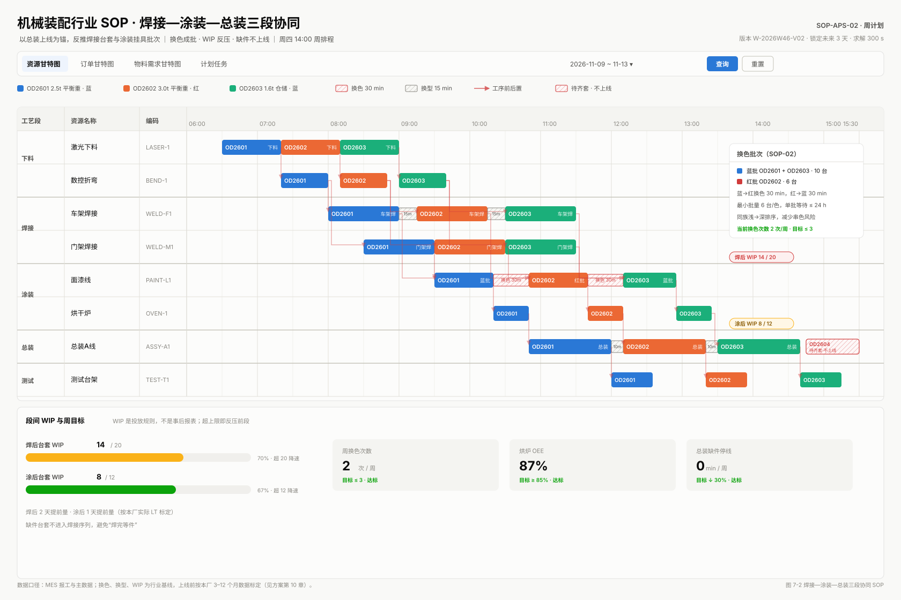
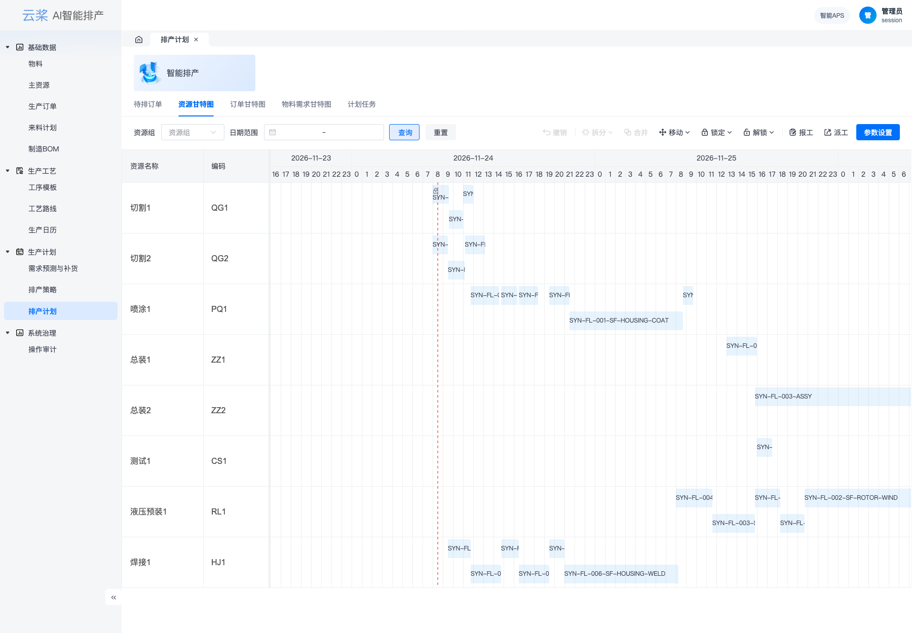
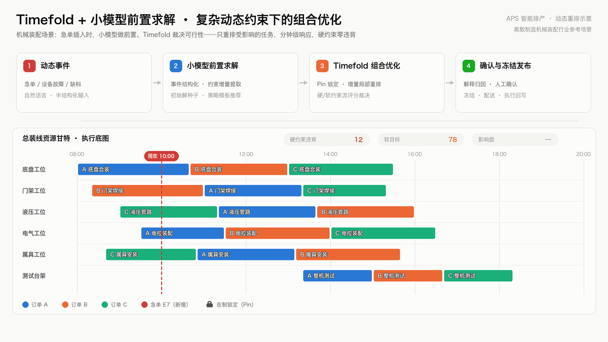
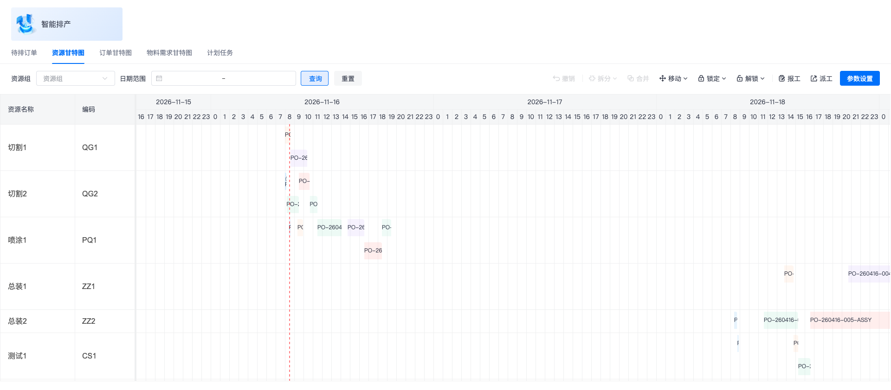
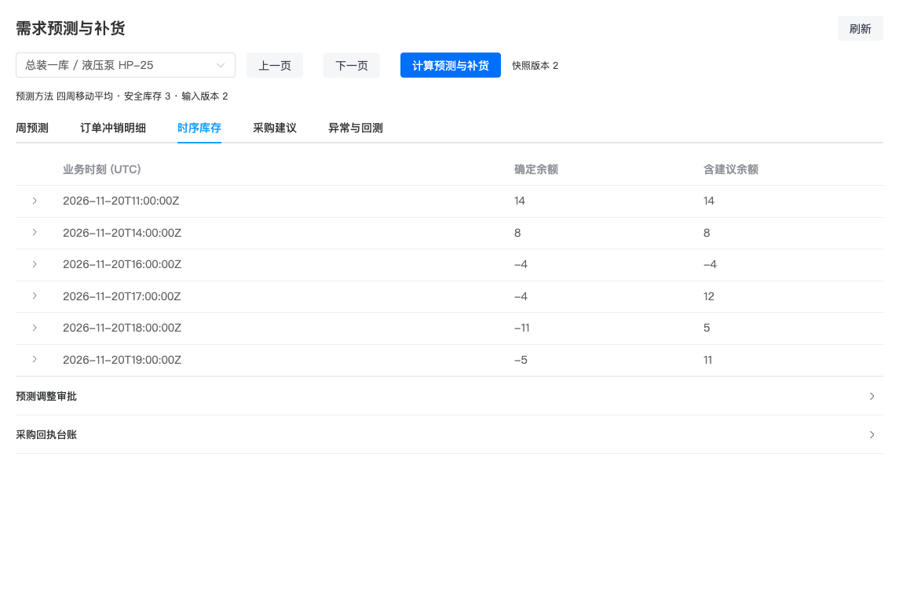
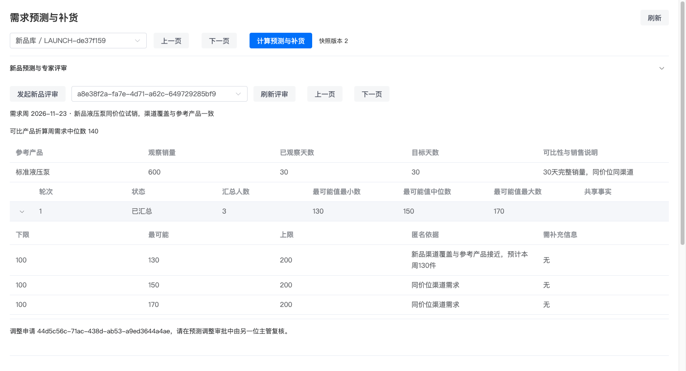

# agentic-aps

#### 智能排产工作流程（全链路动图）


动图演示每日 06:30–08:00 的**六步排产作业**与班中执行回写闭环：**① 订单与配置**（订单池抽取 · 配置校验 · 红单标记）→ **② 齐套与 CTP**（库存/ASN 三态分类 · 最早可上线日）→ **③ 有限能力求解**（Timefold 90 秒求解，硬约束违背 12→0）→ **④ 人工干预确认**（甘特拖动只动 T+2 之后 · 理由码 · 主管签字）→ **⑤ 冻结发布配送**（工单 · kitting · 冻结 T+0/T+1 · 版本可追溯）→ **⑥ 执行与异常**（报工 15 分钟回写 · L1–L3 升级）。急单沿人工预留窗口**零扰动插入**，异常与插单沿闭环回到第 ③ 步**分钟级局部重排**。

**核心特色**：专业求解器裁决（硬约束 100% 满足）· 人工干预闭环（甘特可调、全程留痕）· 插单/异常分钟级局部重排 · 版本冻结全链路可追溯。完整落地方案见 [APS 离散制造机械装配行业生产落地开发方案](docs/APS离散制造机械装配行业生产落地开发方案.md)。


#### 介绍
智能排产是针对工业企业提供的便捷的排产工具，目标：
1.  提高生产效率  
通过优化生产计划和调度，减少生产过程中的等待和空闲时间，提高设备的利用率。
2.  降低库存成本  
精确计算物料需求，减少不必要的提前采购，降低库存成本。
3.  提升客户满意度  
准确预估订单交期，提高准时交货率，提升客户满意度。
4.  优化资源配置  
综合考虑生产过程中的各种约束条件，实现资源的优化配置。
5.  专业化求解器
通过专业求解器对排产计划进行调优，得到最好的结果。





#### 机械装配 SOP 排程示意（资源甘特 × 订单甘特）


以离散制造机械装配行业为参考场景：上半部分是总装线资源甘特（底盘、门架、液压、电气、属具工位，测试台架与线边齐套，红线为工序前后置）；下半部分是订单甘特（齐套 → 装配 → 测试放行，含承诺交期对比）。完整落地方案见 [APS 离散制造机械装配行业生产落地开发方案](docs/APS离散制造机械装配行业生产落地开发方案.md)。

#### 三段协同 SOP 示意（焊接—涂装—总装）



从激光下料、折弯、车架/门架焊接，到面漆、烘干、总装与测试：彩色条按订单区分，斜纹块表示换色/换型，红线为工序前后置；下半部分为段间 WIP 水位与周目标。对应方案中的 SOP-APS-02 与第 7.2 节。

#### 机械装配行业实践 SOP（排产到放行）


左侧六步把排产落到工位：订单与配置 → 齐套与 CTP → 有限能力求解 → 人工干预与主管确认 → 冻结发布与配送 → 执行报工与异常；右侧是资源甘特执行底图、五条运行铁律、L1–L3 升级与验收 KPI。每一步都写明输入、判定、动作与输出，回答“谁来做、几点做、按什么规则做、做不完找谁”。

#### 软件逻辑架构
APS是连接企业资源计划（ERP）系统和制造执行系统（MES）的核心枢纽，为整个生产流程提供了智能化的计划与排程解决方案

整个系统的核心功能：


#### 项目特点：
- 智能优化（求解器）  
先进算法：采用遗传算法、模拟退火算法等先进的优化算法，实现全局最优的生产计划和调度。  
实时响应：能够实时响应市场需求、设备故障、物料短缺等变化，动态调整生产计划和调度。  

- 高度灵活性（策略）  
多品种、小批量生产：支持灵活应对产品种类的变化和订单量的波动。  
插单处理：能够快速响应紧急订单，依照已经制定的排程计划自动调整现有排程，减少对机台产线的影响。  

- 数据驱动 
丰富的数据分析和可视化工具：提供实时的数据分析和可视化工具，帮助企业管理层做出更明智的生产决策。  
系统集成：具有良好的系统集成能力和扩展性，可以与ERP、SCM、MES等其他管理系统无缝集成。  


#### Timefold + 小模型前置求解：复杂动态约束下的组合优化

**自适应排程 V2**：后续候选可复用本次最佳可行方案，通过完整种子校验后直接进入局部搜索，减少重复构造；预算按有效任务规模分档，优先寻找首个可行解，再分配剩余候选预算。新增“复用本次最佳方案”和“组合预算分配”配置，支持固定预算冷启动回退；候选审计记录种子来源、实际预算与各阶段耗时。详见[实现与回退说明](docs/自适应排程热启动与规模预算实现说明.md)及[本轮三模式对照与事务验收](docs/e2e/adaptive-warm/验收结果.md)。

**V1 自适应排程真实 HTTP 验收（2026-11-23，历史基线）**：使用隔离 MySQL/Redis 和合成装配数据，36、72、144 工序均获得零硬约束违例方案；14 项规模与事务场景通过，覆盖缺件、停机、优先插单、交期变更、在制冻结、并发互斥、过期快照确认拦截、取消与失败保护。求解期间 8 会话持续查询约 60 秒，共 4,562 次请求，零错误。360 工序仅验证预算不足时拒绝发布。本批数据未显示组合算法优于普通 Timefold，结果不代替制造企业现场验收。详见[完整验收结果与截图](docs/e2e/adaptive/验收结果.md)、[复现步骤与模型边界](docs/e2e/adaptive/README.md)。



支持在 Timefold 排产策略中启用“自适应组合求解”，面向多层硬约束叠加的装配计划，无 3% 场景比例限制。系统以 jDE 差分进化搜索禁忌/晚期接受模板及搜索参数，逐次独立求解，保留统一业务权重；只有通过完整初始化、硬约束评分与冻结基线复核的结果才进入原有人工确认流程。组合总预算默认180秒，各候选参数、评分、耗时及选中结果写入求解审计。需选择 Timefold 并启用物料约束；关闭组合开关即可使用原算法。具体配置、支持边界与实施修订见[多层硬约束自适应求解](docs/自适应排程热启动与规模预算实现说明.md#实施修订多层硬约束自适应求解)。

复杂动态约束场景（临时插单、设备故障、物料短缺、齐套波动、换型换色、交期变更）的难点在于：它不只是一个静态的"约束满足 + 组合优化"问题，而是**约束集合本身在求解过程中不断变化**——插单会挤占资源、故障会关闭时间窗、缺料会推迟工序可用性。本项目采用 **小模型前置求解 + Timefold 组合优化** 的分工来应对：



上方为离散制造机械装配的场景示意动图：急单 E7 落入（动态事件）→ 小模型生成待审核的结构化事件与初始解种子→ Timefold 锁定在制任务并局部重排→ 人工确认后发布。其中“4 条调整、14 条保留”为示意数据；真实运行截图和验收结果见下文。


| 环节 | 承担者 | 做什么 | 不做什么 |
| --- | --- | --- | --- |
| 动态事件理解 | 小模型（前置求解） | 把插单/故障/缺料等自然语言或半结构化事件，翻译成结构化约束增量：新增任务、锁定区间、资源不可用窗、交期变更 | 不直接修改计划 |
| 初始解构造 | 小模型（前置求解） | 基于历史排产与启发式规则，给出初始解种子、策略模板推荐（FFD+Tabu / FFD+Late Acceptance）、约束权重调整建议 | 不保证硬约束可行 |
| 可行性与目标优化 | Timefold（组合优化） | 构造启发式 + 局部搜索优化软目标，仅接受初始化分数与硬分数均为零的候选，保留问题快照与审计 | 不推断业务意图，不保证全局最优 |
| 结果解释与归因 | 小模型（后置解释） | 解释"为什么这五台排前面"、"如果把这台提前会影响谁"，生成交接班摘要 | 不参与求解、不替代审批 |

**分工铁律**：小模型永远在求解环之外做"前置"与"后置"，Timefold（及兼容的 OptaPlanner 引擎）是唯一的可行性裁决者。小模型的输出只是候选与种子，最终计划必须经求解器评分验证与人工确认后才能冻结发布——把 LLM 放进优化环，等于把交期交给概率。

**组合方式与验证边界**：小模型负责生成待审核建议，Timefold 用列表变量、时间影子变量和约束流执行局部重排，保护冻结任务。本次已验证 MiniCPM5-2B 自然语言事件提取、核对后提交 Timefold、模型后置解释和确认入库的真实闭环。小模型是否提高初始解质量或缩短求解时间，仍须通过同数据集 A/B 测试，当前不宣称组合方案相对单独求解器的加速收益。

**复杂动态约束的典型运用**：

| 动态约束场景 | 小模型前置 | Timefold 求解 |
| --- | --- | --- |
| 紧急插单 | 识别优先级与影响面，生成插入候选位 | Pin 锁定在制任务，仅在剩余资源上排列新增任务 |
| 设备故障 | 归因并生成资源不可用时间窗 | 硬约束下把受影响任务迁移到替代资源/时段 |
| 物料短缺 / 齐套波动 | 把缺料信息转成待审核的物料到货时间 | 将消费该物料的工序设定最早开工时刻，并校验计划 |
| 换型换色 | 推荐批量聚类与排序建议 | 以换型次数软约束优化切换次数 |
| 交期变更 | 评估影响并推荐权重调整 | 重新平衡交期软约束与换型/等待惩罚 |

#### 真实运行效果与端到端验收（2026-11-14）

以下截图来自 **MiniCPM5-2B + Timefold** 组合优化完成并确认入库后的真实浏览器页面。演示工厂包含 **6 个主订单、8 台资源、36 道工序**，覆盖切割、绕线、焊接、喷涂、总装与测试。本轮由 MiniCPM 从自然语言中提取设备停机、来料延期和交期变更，逐项核对事件后原样提交给 Timefold，没有用手写事件替代模型输出。

**资源甘特图**：按设备展示订单工序的分配与起止时间，可核对资源占用和工序衔接。



**工序任务表**：展示组合优化确认后的订单、产品、数量、工序、计划资源与起止时间。


| 实测场景 | 结果 |
| --- | --- |
| MiniCPM5-2B 真实提取 | **8.76 秒**提取 3 项事件，事件类型、目标 ID、时间均与预期一致，提取阶段数据库未改变 |
| MiniCPM + Timefold 真实重排 | 求解阶段 **9.14 秒**，36 道工序，调整 18 道；1 道已报工任务不变，6 道工序遵守来料时间，初始化分数与硬分数均为零 |
| 组合优化闭环 | **6 项**验收通过：提取核对、可行解、动态约束、四组预览、真实模型后置解释、确认入库；新交期已写回订单 |
| 先前结构化输入基线 | Timefold 正排约 **9.69 秒**，结构化动态重排约 **6.65 秒**；与本轮扰动时间不同，不作为 A/B 对比 |
| OptaPlanner 正排 / Timefold 倒排 | 均生成 36 道工序，初始化分数与硬分数均为零 |
| 自动化与业务验收 | 后端 **39 项**测试、前端 **5 项**测试、原有 **15 项**端到端业务验收通过；前端生产构建成功 |
| 历史 0.5B 模型对照 | 未通过事件提取质量门槛，错误候选未提交求解；本轮使用用户配置的 MiniCPM5-2B 完成真实闭环 |

求解阶段耗时包含接口轮询与模型后置解释，仅反映本机及本次演示数据；不代表生产吞吐，也不是组合方案与单引擎的 A/B 性能对比。小模型已通过当前三事件样本，生产启用仍须扩充实际业务样本，并由计划员核对事件类型、目标与时间。

详细证据见 [MiniCPM 组合优化真实记录](docs/e2e/minicpm-report.json)、[端到端验收报告与复现步骤](docs/端到端验收报告.md)、[业务验收记录](docs/e2e/backend-report.json)、[引擎兼容记录](docs/e2e/compatibility-report.json)和[历史 0.5B 模型质量记录](docs/e2e/model-report.json)。

#### 正在支持的能力

围绕上述"小模型前置求解 + Timefold 组合优化"路线，当前正在支持与建设的能力：

| 能力 | 说明 | 状态 |
| --- | --- | --- |
| 列表变量求解模型 | 工艺路线图、正排/逆排、影子变量时间推导 | 已支持 |
| 任务锁定与局部重排 | Timefold 列表前缀锁定，保护在制与冻结任务；按事件影响面重排 | 已支持 |
| 约束流评分与策略模板 | 硬/软分数约束流，FFD+Tabu、FFD+Late Acceptance 等可配置模板 | 已支持 |
| 可复现求解 | 问题快照、固定随机种子与评分次数预算，支持结果回放比对 | 已支持 |
| 人工干预闭环 | 冻结/合并/拆分/移动、待确认计划、甘特图调整 | 已支持 |
| 多租户求解会话 | 租户级 SolverManager 隔离与并发控制 | 已支持 |
| Timefold 引擎接入 | 双引擎路由、Pin-to-Index、约束流双实现与回归验证 | 已接入 |
| 小模型前置求解 | 结构化候选审核、动态事件、历史队列种子、策略与软权重推荐 | 后端已实现，模型按需配置 |
| 结果解释与异常归因 | 持久化问题快照、评分、任务差异与后置解释 | 后端已实现 |
| 影子运行与 A/B 基准对比 | 双引擎/双策略同数据集对比，硬分数为 0 与任务位置等价性校验 | 规划中 |

组合排产的接口、迁移 SQL、模型配置、约束和验证范围见 [Timefold 与小模型生产实现](docs/Timefold小模型生产实现.md)。

#### 需求预测与智能补货的三个现场场景

以下三个场景跟踪总装一库的同一款液压泵 HP-25。计划员先核对本周需求，再比较供应商改期前后的采购建议，最后由采购员批准并核对收货后的库存。数量单位均为件。

**场景一｜销售订单陆续确认，本周还要按预测多备多少？**

过去 16 周每周销量均为 25，本周预测也是 25。三张已确认订单分别需要 6、12、7，逐笔冲销后剩余预测为 **0**。计划仍需满足 25 件订单，同一需求只备一次。计划员可按订单行核对每一笔冲销量。[查看周预测汇总](docs/e2e/demand-planning-20261120/01-forecast.png)


**场景二｜供应商推迟交货，要多买多少，哪一笔短缺还要催料？**

期初可用库存为 14，已包含原采购单收货的 4 件，该单另有 6 件在途。保持订单、安全库存 3、起订量 10 和包装倍数 4 不变，只调整这 6 件的可用日期。

| 原在途 6 件何时可用 | 新采购可覆盖区间的最低预计余额 | 补至安全库存的净缺口 | 按起订量和整包装计算的采购建议 |
| --- | ---: | ---: | ---: |
| 按期可用 | −5 | 8 | 12 |
| 延至末笔需求之后 | −11 | 14 | 16 |

延期使采购建议从 **12 增至 16**。新采购最早到货前仍有 **4 件短缺**，计划员可据此催交或协调调拨。时序库存保留了短缺发生的时间。[查看按期建议](docs/e2e/demand-planning-20261120/03-on-time.png) · [查看延期建议](docs/e2e/demand-planning-20261120/04-delayed.png)



**场景三｜批准采购后只收到一部分，库存和采购台账如何核对？**

采购员批准 16 件，采购记录进入 ERP 待取队列。新单先收 4 件，期初可用库存从 14 增至 18，该单只剩 12 件在途。重算后期末余额为 **18 + 12 + 原在途 6 − 需求 25 = 11**，没有新增采购建议。重复发送同一 ERP 确认后，台账中仍只有一条 16 件的已对账记录，外部行号为 `PO-QA-4316`。[查看采购审批](docs/e2e/demand-planning-20261120/06-buyer-approval.png) · [查看 ERP 待取队列](docs/e2e/demand-planning-20261120/07-ready.png) · [查看收货后的库存余额](docs/e2e/demand-planning-20261120/09-final-balance.png)


2026-11-20 的隔离环境验收使用前端生产构建、Spring Boot 发布包和 MySQL 8.4.13，ERP 回执由测试客户端按接口合同发送。后端 65 项、前端 5 项测试通过。[完整验收记录](docs/e2e/demand-planning-20261120/README.md) · [运行数据与截图校验信息](docs/e2e/demand-planning-20261120/evidence.json) · [开发落地方案与运行手册](docs/需求预测和智能补货开发落地方案.md)

#### 新品预测与专家评审

新品缺少自身销售历史时，计划员可以收集类似产品的销量、观察期、促销、缺货和可比性说明，组织专家独立判断，再将评审结论交由主管复核。复核生效后的周预测继续参与订单冲销、库存投影和采购建议计算。

| 能力 | 已实现的业务规则 |
| --- | --- |
| 类似产品参考 | 完整观察期、无缺货且无促销的样本按“销量 × 7 ÷ 观察天数”折算平均周需求，再取中位数；其他样本保留证据和提示，供专家判断 |
| 独立提交 | 每次评审针对一个需求周，邀请 3 至 20 位专家；组织者与专家分离，专家填写下限、最可能值、上限、判断依据和待补充信息 |
| 匿名汇总与多轮修订 | 收齐后关闭本轮，展示最可能值的最小值、中位数、最大值及去除账号标识的依据；保留历史轮次，支持补充共享事实后再判断，最多 5 轮 |
| 预测审批与补货 | 组织者采用当前轮中位数创建调整申请，另一位主管复核后生效；采购阶段按起订量、包装倍数等规则生成建议 |
| 版本与访问控制 | 校验租户、参与资格、有效期、计划代次和需求周范围；事务内合并并发提交，支持相同判断和调整申请的重复请求 |

**现场操作顺序**

1. 选择已导入快照的新品物料，打开“新品预测与专家评审”，填写产品定位、价格、上市计划和类似产品证据。
2. 专家使用各自账号独立提交，组织者收齐后查看匿名统计与依据，必要时发起下一轮。
3. 采用本轮中位数申请调整，经主管复核后重新计算预测与补货，核对需求和采购数量。

**端到端验收与页面截图（2026-11-21）**

HTTP 多账号验收使用完整参考样本 600 件／30 天，折算周参考为 140 件，同时验证缺货、促销和观察期不足样本的提示。首轮判断为 120、140、300，第二轮为 130、150、170，第二轮中位数为 **150 件**。主管批准后，周预测生效为 **150 件**，起订量为 3000 时采购建议为 **3000 件**。

浏览器另建一笔评审，组织者在页面录入参考产品，专家在页面提交 130 件判断，另两位专家经真实 HTTP 会话提交 150、170 件。组织者关闭本轮并申请调整，独立主管通过 HTTP 复核，最后在浏览器重算并核对结果。以下截图来自这笔浏览器评审。





本轮使用 MySQL 8.4、Spring Boot 发布包与前端生产构建完成验收。后端 **71 项测试通过**，含 6 项新增规则测试，前端 **5 项测试通过**；真实接口验收覆盖多租户与参与资格、当轮意见保密、并发提交、多轮修订、双人复核、重复请求及旧版本失效。原有采购并发审批、ERP 回执和部分收货流程通过回归。部署前须在已有需求计划表上执行本次迁移。[数据库迁移](aps/sql/20261121_launch_review.sql) · [实现、部署与验收说明](docs/新品预测与专家评审实现及验收.md) · [结构化运行证据与截图校验值](docs/e2e/launch-review-20261121/evidence.json)

当前类似产品参考采用平均周需求折算，专家上下限用于复核分歧。新品上市日龄曲线、缺货损失受控校正和阶梯报价总成本优化已接入版本化周计划；输入、计算边界和仍需建设的数据项见[生命周期、缺货校正与商业成本扩展](docs/新品预测与专家评审实现及验收.md#生命周期缺货校正与商业成本扩展)。

**需求与补货信号场景（2026-11-23 真实 HTTP 验收）**

| 场景 | 输入与决策规则 | 计划结果与审计输出 |
| --- | --- | --- |
| 新品上市日龄曲线 | 在快照 `signals.lifecycle` 中维护上市周、锚点周需求及按周龄递增的指数；可选择替代稀疏统计基准或对其缩放。 | 上市前预测为零，上市后按曲线线性插值；结果方法以 `LIFECYCLE_` 标识，`baseline` 保留曲线后的周预测。验收首周为 **100**。 |
| 缺货损失受控校正 | 为关闭历史周输入实际销量、可售比例及可选的同类需求上限。20% 以下只提示人工复核；其余以“销量 ÷ 可售率”估计并按上限封顶。 | 修正后的历史参与模型选择、回测与预测；`lostSales` 逐周返回可售率、损失、修正需求与方法。验收中销量50、可售50%、上限80，得到损失 **30**、修正需求 **80**。 |
| 阶梯报价总成本优化 | 输入 `ALL_UNITS` 或 `INCREMENTAL` 阶梯报价、固定运费、加工费及超额库存持有费；在 MOQ、包装倍数、预算、库容、最大订单约束内比较候选量。 | 选择总成本最低的可行采购量，并在 `proposal.cost` 返回货值、运费、加工、持有成本和命中档位。验收中80件净需求选择 **100** 件报价档，总成本 **820**。 |

三项信号均为可选快照字段；不提供 `signals` 时，既有预测、库存净算与采购建议保持不变。服务端在导入阶段校验周粒度、历史关闭范围、可售比例、曲线锚点和报价阶梯，避免低质量数据静默影响排产。可复现脚本为 [e2e_launch_review.py](aps/scripts/e2e_launch_review.py)，完整输入契约和计算边界见[实现与验收说明](docs/新品预测与专家评审实现及验收.md)。

#### 部署步骤
项目下载

```
git clone https://gitee.com/software-minister/jvs-aps.git
```

初始化数据库  

```
cd jvs-aps/jvs-docker-compose && chmod -R 777 data && chmod -R 777 mysql && chmod -R 644 data/mysqlcnf
docker-compose -f docker-compose-db.yml  up -d
```

修改配置文件  


启动服务  
a、先启动后端服务
启动后端服务文件：aps/jvs-aps-mgr/src/main/java/cn/bctools/aps/JvsApsApplication.java  
b、前端启动命令  
```
npm inatall
npm run dev
```

访问系统：  
http://服务器ip:9998


