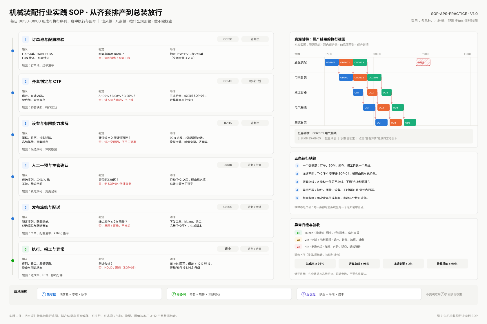
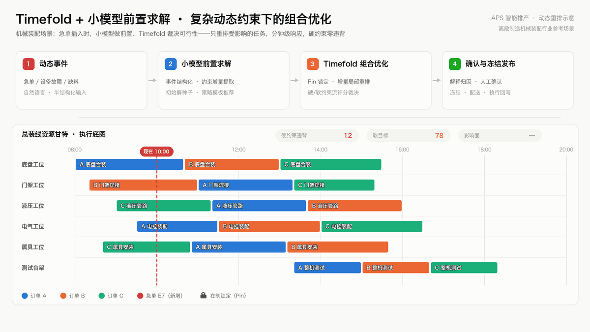

# agentic-aps


#### 介绍
智能排产是针对工业企业提供的便捷的排产工具，目标：
1.  提高生产效率  
通过优化生产计划和调度，减少生产过程中的等待和空闲时间，提高设备的利用率。
2.  降低库存成本  
精确计算物料需求，减少不必要的提前采购，降低库存成本。
3.  提升客户满意度  
准确预估订单交期，提高准时交货率，提升客户满意度。
4.  优化资源配置  
综合考虑生产过程中的各种约束条件，实现资源的优化配置。
5.  专业化求解器
通过专业求解器对排产计划进行调优，得到最好的结果。


#### 机械装配 SOP 排程示意（资源甘特 × 订单甘特）


以林德叉车类整机制造为参考场景：上半部分是总装线资源甘特（底盘、门架、液压、电气、属具工位，测试台架与线边齐套，红线为工序前后置）；下半部分是订单甘特（齐套 → 装配 → 测试放行，含承诺交期对比）。完整落地方案见 [APS 林德叉车生产落地开发方案](docs/APS林德叉车生产落地开发方案.md)。

#### 三段协同 SOP 示意（焊接—涂装—总装）


从激光下料、折弯、车架/门架焊接，到面漆、烘干、总装与测试：彩色条按订单区分，斜纹块表示换色/换型，红线为工序前后置；下半部分为段间 WIP 水位与周目标。对应方案中的 SOP-APS-02 与第 7.2 节。

#### 机械装配行业实践 SOP（排产到放行）



左侧六步把排产落到工位：订单与配置 → 齐套与 CTP → 有限能力求解 → 人工干预与主管确认 → 冻结发布与配送 → 执行报工与异常；右侧是资源甘特执行底图、五条运行铁律、L1–L3 升级与验收 KPI。每一步都写明输入、判定、动作与输出，回答“谁来做、几点做、按什么规则做、做不完找谁”。

#### 软件逻辑架构
APS是连接企业资源计划（ERP）系统和制造执行系统（MES）的核心枢纽，为整个生产流程提供了智能化的计划与排程解决方案

整个系统的核心功能：


#### 项目特点：
- 智能优化（求解器）  
先进算法：采用遗传算法、模拟退火算法等先进的优化算法，实现全局最优的生产计划和调度。  
实时响应：能够实时响应市场需求、设备故障、物料短缺等变化，动态调整生产计划和调度。  

- 高度灵活性（策略）  
多品种、小批量生产：支持灵活应对产品种类的变化和订单量的波动。  
插单处理：能够快速响应紧急订单，依照已经制定的排程计划自动调整现有排程，减少对机台产线的影响。  

- 数据驱动 
丰富的数据分析和可视化工具：提供实时的数据分析和可视化工具，帮助企业管理层做出更明智的生产决策。  
系统集成：具有良好的系统集成能力和扩展性，可以与ERP、SCM、MES等其他管理系统无缝集成。  


#### Timefold + 小模型前置求解：复杂动态约束下的组合优化

复杂动态约束场景（临时插单、设备故障、物料短缺、齐套波动、换型换色、交期变更）的难点在于：它不只是一个静态的"约束满足 + 组合优化"问题，而是**约束集合本身在求解过程中不断变化**——插单会挤占资源、故障会关闭时间窗、缺料会推迟工序可用性。本项目采用 **小模型前置求解 + Timefold 组合优化** 的分工来应对：



上方动图以叉车整机装配为例循环演示全过程：急单 E7 落入（动态事件）→ 小模型把事件翻译成结构化约束增量与初始解种子（前置求解）→ Timefold 锁定在制任务、只挪动受牵连的 4 根条并把硬约束违背收敛到 0（组合优化）→ 输出解释归因并冻结发布。全程只有受影响的任务被重排，其余 14 条纹丝不动。


| 环节 | 承担者 | 做什么 | 不做什么 |
| --- | --- | --- | --- |
| 动态事件理解 | 小模型（前置求解） | 把插单/故障/缺料等自然语言或半结构化事件，翻译成结构化约束增量：新增任务、锁定区间、资源不可用窗、交期变更 | 不直接修改计划 |
| 初始解构造 | 小模型（前置求解） | 基于历史排产与启发式规则，给出初始解种子、策略模板推荐（FFD+Tabu / FFD+Late Acceptance）、约束权重调整建议 | 不保证硬约束可行 |
| 可行性与最优性求解 | Timefold（组合优化） | 构造启发式 + 局部搜索在硬/软约束流下搜索，保证硬约束 100% 满足、结果可复现、可审计 | 不"猜测"业务意图 |
| 结果解释与归因 | 小模型（后置解释） | 解释"为什么这五台排前面"、"如果把这台提前会影响谁"，生成交接班摘要 | 不参与求解、不替代审批 |

**分工铁律**：小模型永远在求解环之外做"前置"与"后置"，Timefold（及兼容的 OptaPlanner 引擎）是唯一的可行性裁决者。小模型的输出只是候选与种子，最终计划必须经求解器评分验证与人工确认后才能冻结发布——把 LLM 放进优化环，等于把交期交给概率。

**为什么这样组合有效**：小模型把非结构化的动态扰动快速收敛为结构化约束增量与优质初始解，压缩构造启发式的冷启动时间；Timefold 用列表变量 + 影子变量 + 约束流在**增量问题**上做局部重排（Pin 锁定在制与临近开工任务），避免全盘推翻重排。两者组合后，插单场景的响应从"小时级全盘重排"变为"分钟级局部重排"。

**复杂动态约束的典型运用**：

| 动态约束场景 | 小模型前置 | Timefold 求解 |
| --- | --- | --- |
| 紧急插单 | 识别优先级与影响面，生成插入候选位 | Pin 锁定在制任务，仅在剩余资源上排列新增任务 |
| 设备故障 | 归因并生成资源不可用时间窗 | 硬约束下把受影响任务迁移到替代资源/时段 |
| 物料短缺 / 齐套波动 | 把缺料信息转成工序可用性约束 | 逆排重算齐套时点，联动 CTP 交期答复 |
| 换型换色 | 推荐批量聚类与排序建议 | 以换型惩罚软约束收敛切换次数 |
| 交期变更 | 评估影响并推荐权重调整 | 重新平衡交期软约束与换型/等待惩罚 |


#### 正在支持的能力

围绕上述"小模型前置求解 + Timefold 组合优化"路线，当前正在支持与建设的能力：

| 能力 | 说明 | 状态 |
| --- | --- | --- |
| 列表变量求解模型 | 工艺路线图、正排/逆排、影子变量时间推导 | 已支持 |
| 任务锁定与局部重排 | `@PlanningPin` 锁定在制/临近开工任务，插单只排列增量 | 已支持 |
| 约束流评分与策略模板 | 硬/软分数约束流，FFD+Tabu、FFD+Late Acceptance 等可配置模板 | 已支持 |
| 可复现求解 | 固定随机种子、算法 Profile 记录，支持结果回放比对 | 已支持 |
| 人工干预闭环 | 冻结/合并/拆分/移动、待确认计划、甘特图调整 | 已支持 |
| 多租户求解会话 | 租户级 SolverManager 隔离与并发控制 | 已支持 |
| Timefold 引擎接入 | 双引擎（OptaPlanner + Timefold）路由、Pin-to-Index、约束流双实现 | 接入中 |
| 小模型前置求解 | 动态事件结构化、约束增量提取、初始解种子与策略模板推荐 | 建设中 |
| 结果解释与异常归因 | 冲突/差异 JSON 转人可读解释，输出标注"解释性建议"，可核对原始数据 | 建设中 |
| 影子运行与 A/B 基准对比 | 双引擎/双策略同数据集对比，硬分数为 0 与任务位置等价性校验 | 规划中 |


#### 部署步骤
项目下载

```
git clone https://gitee.com/software-minister/jvs-aps.git
```

初始化数据库  

```
cd jvs-aps/jvs-docker-compose && chmod -R 777 data && chmod -R 777 mysql && chmod -R 644 data/mysqlcnf
docker-compose -f docker-compose-db.yml  up -d
```

修改配置文件  


启动服务  
a、先启动后端服务
启动后端服务文件：aps/jvs-aps-mgr/src/main/java/cn/bctools/aps/JvsApsApplication.java  
b、前端启动命令  
```
npm inatall
npm run dev
```

访问系统：  
http://服务器ip:9998


