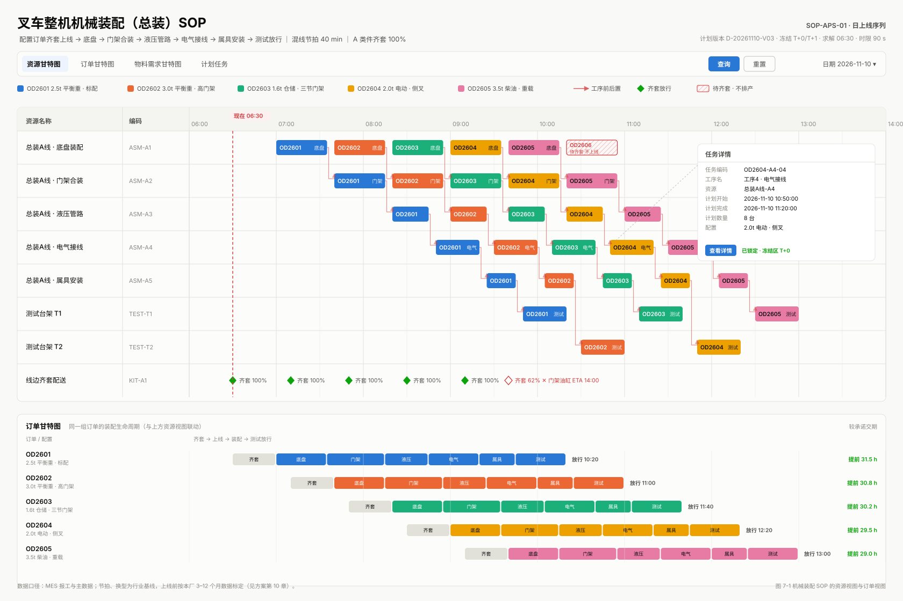
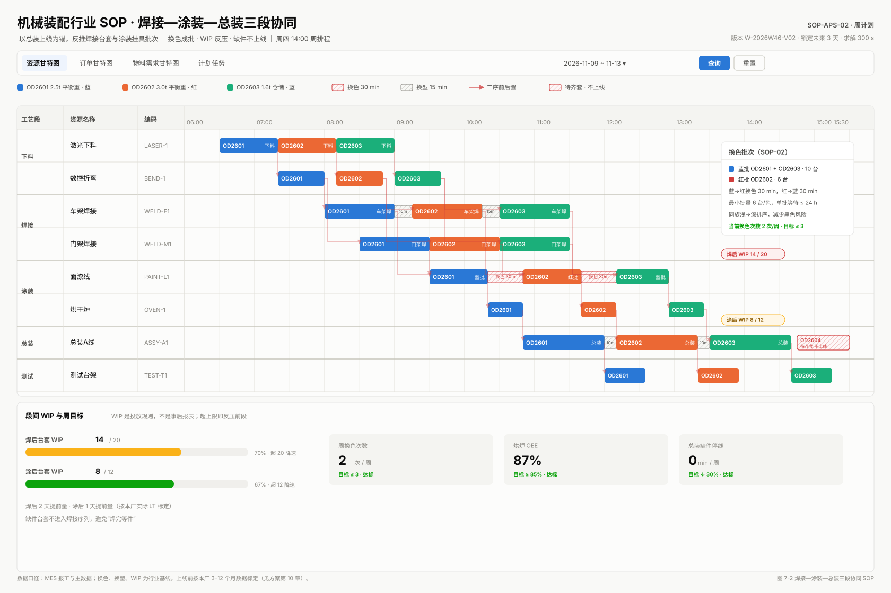

# 林德叉车类整机制造 APS 生产落地开发方案

> 基于《APS 离散制造 SOP 手册 V1.0》（2026-11）与本仓库 `agentic-aps` 实际代码
> 版本：V1.0　｜　日期：2026-11-09　｜　适用范围：平衡重式 / 仓储叉车整机制造，年产 2,000–8,000 台，多配置混线
> 读者：制造总监、计划经理、IT/数字化负责人、后端/前端/算法工程师、IE 与质量工程师

---

## 0. 一页结论

**结论一：手册是对的，但真正的落地对象不是“六个 SOP”，而是四道硬约束、一个冻结机制和一个版本底座。**

手册第 5 页自己写下了判断：“APS 的价值不在算得快，而在约束对不对。” 这句话应该直接翻译成开发优先级：前置工序、换型、冻结窗口、测试台能力没有进模型，六个 SOP 就只是六张流程图。反过来，只要这四件事进了模型，SOP 才有系统可以依托。

**结论二：本仓库已经具备约 70% 的骨架，缺的是“最后一公里”的硬约束与治理。**

已有：列表变量求解模型、工艺路线图、资源日历、正排/逆排、双引擎（OptaPlanner + Timefold）、任务锁定、甘特图、拆分/合并/移动、待确认计划、多租户字段。
缺口集中在五处：**前置工序目前只是软约束**、**换型只有常数惩罚没有时长**、**齐套只在求解前扣库存**、**冻结只有手工 pin 没有窗口策略**、**计划没有版本表**。这五处不补，系统能“排出来”，但车间不敢“照着做”。

**结论三：不要一次上六段工艺。用 16–18 周，先让总装线“可信”，再让三段“协同”。**

建议节奏：前 6 周补硬约束与版本底座，做单线双轨；第 7–10 周上齐套门禁、换型矩阵、缺件重排；第 11–14 周才做焊接—涂装—总装协同与 WIP 控制；ECN、烘炉批次、多工厂放到第二阶段。**先可信，再最优**，这与手册第 05 章的判断一致。

**结论四：收益来自“采纳率”和“冻结纪律”，不是求解分数。**

求解器把延误从 37 台降到 31 台，如果计划员第二天仍然用 Excel 改回原样，收益是 0。因此本方案把“排程采纳率 ≥ 85%”“冻结区变更率 ≤ 3%”“缺件停线分钟 −30%”作为一级验收指标，把 soft score 只作为过程指标。

**结论五：三件事不要做。**

1. 不要在第一期把下料、焊接、涂装、总装、测试、发运全部建模——复杂度会翻三倍，而 80% 的停线发生在总装与关键件。
2. 不要让大模型进入优化环——LLM 适合解释“为什么这五台排前面”，不适合保证交期与可行性。
3. 不要自研 ERP/MES/WMS——APS 只做“有限能力决策”，主数据与执行反馈必须来自既有的企业系统。

**投入与回报（框架性估算，需按本厂数据复核）**

| 项目 | 估算 |
|---|---|
| 周期 | 16–18 周上线单线，6 个月覆盖三段 |
| 人力 | 后端 2、前端 1、算法/IE 1、QA 0.5、项目经理 0.5，合计约 90–110 人周 |
| 直接收益 | 计划达成率 +5pt、缺件停线 −30%、换型/换色 −15%、在制 −20%（手册 5.2 的目标口径） |
| 间接收益 | 交期承诺可解释、插单有代价单、ECN 有 cut-in、审计可追溯 |
| 回本条件 | 年产 ≥ 2,000 台且配置 ≥ 100 种；低于此规模，先做流程与冻结纪律，暂缓上求解器 |

---

## 1. 文档定位与方法

### 1.1 这份方案回答什么

手册回答的是“谁来做、几点做、按什么规则做、做不完找谁”。本方案回答另外四个工程问题：

1. **手册里的规则，哪些必须进求解器，哪些应该在求解器外面做？**
2. **本仓库现有代码离“生产可用”还差什么，按什么顺序补？**
3. **每一处改动落在哪张表、哪个类、哪个接口、哪个页面？**
4. **怎么验收，怎么止损，什么时候应该承认“这个厂不适合 APS”？**

### 1.2 分析方法

```text
业务场景（叉车整机）
   ↓ 分解
六个 SOP → 触发条件 / 输入 / 判定 / 动作 / 升级 / KPI
   ↓ 提炼
九类系统能力 → 数据 / 约束 / 流程 / 交互 / 治理
   ↓ 对照
本仓库代码现状（实体、约束、接口、页面）
   ↓ 取舍
P0 / P1 / P2，以及明确不做的清单
   ↓ 交付
DDL、约束公式、API、UI、路线图、验收、风险
```

### 1.3 边界与免责

- **不引用林德公司内部数据。** 手册封面与附录已经声明：所有节拍、批量、换型、权重、阈值均为行业初始基线，不代表任何企业的真实产线。本方案沿用这一边界。
- **“林德叉车”在本方案中是“林德叉车类整机制造”的代称**：平衡重式与仓储叉车、按配置接单、结构件自制、关键件外购、混线总装、以周为交期单位。公开层面的企业特征（多工厂、多品牌、全球供应链、租赁与售后业务）只用于提示扩展性，不作为参数依据。
- 安全、法规、认证、客户合同的判定，以企业现行标准为准；本方案不替代 EHS、法务与质量体系。

---

## 2. 案例解构：一台叉车为什么难排

### 2.1 案例画像（公开信息层面的合理抽象）

叉车整机是典型的**配置型离散制造**：看起来是标准产品，实际每一台都可能是不同的吨位、门架、起升高度、电池、属具、驾驶室与认证组合。它的计划难点不在工序数量，而在三件事同时发生：

1. **前段是“零件流”，中段是“台套流”，后段是“整机节拍流”。** 三种计划对象混在一个工单体系里，必然有一段失真。
2. **关键件是外购的，供应波动是常态。** 门架总成、驱动桥、电控、液压阀块、电池包，任何一项晚到，整机就不能上线。
3. **换型与换色是有成本的。** 涂装换色 30–60 分钟、焊接工装 30–40 分钟、总装吨位切换 15–30 分钟；顺序错了，产量再高也亏。

这三件事决定了：**通用 APS 的“资源不重叠 + 交期优先”不够用。** 它会把一台缺门架油缸的车排上线，也会为了赶交期把涂装线拆成七种颜色。

### 2.2 六个让通用 APS 失效的约束（手册提炼）

| # | 约束 | 业务表现 | 对系统的要求 |
|---|---|---|---|
| 1 | 配置爆炸 | 吨位 × 门架 × 起升 × 电池 × 属具 × 驾驶室，上千种组合 | 150% 配置 BOM + 配置规则 + 按订单裁剪 |
| 2 | 三段节拍失配 | 焊接按台套、涂装按挂具、总装按节拍 | 分段计划对象 + 段间 WIP 上限 + 拉动提前期 |
| 3 | 齐套是硬约束 | 缺一根门架油缸，整机不能上线 | A 类件 100% 齐套才能进入可排池 |
| 4 | 换型与换色 | 换色 30–60 min、工装 30–40 min、吨位 15–30 min | 序列相关准备时间矩阵，不是常数惩罚 |
| 5 | 关键资源稀缺 | 测试台、烘炉、大型焊机、持证焊工 | 独立资源建模 + 能力预留 + 日历 |
| 6 | 扰动高频 | 供应商延迟、质量封锁、插单、ECN 每周发生 | 可重排、可解释、可追溯、可回滚 |

### 2.3 三段工艺与计划对象

| 工艺段 | 典型工序 | 计划对象 | 节拍/批量特征 | 主要约束 |
|---|---|---|---|---|
| 下料成形 | 激光切割、等离子切割、折弯、冲压、套料 | 零件工单 | 大批量、按板材套料 | 板材利用率、模具与程序、余料 |
| 结构焊接 | 车架、门架、配重焊接、焊缝探伤 | 台套工单 | 工位/机器人单元，换型分钟级 | 工装夹具、持证焊工、机器人程序、探伤返修 |
| 涂装 | 前处理、电泳/底漆、面漆、烘干、强冷 | 挂具批次 | 批次流，按颜色与涂料族成批 | 挂具数量、烘炉容量、换色清洗、膜厚 |
| 总装 | 底盘、门架合装、液压管路、电气接线、属具 | 整机工单 | 节拍流，多配置混线 | 齐套、工位能力、配置差异、线边空间 |
| 测试 | 制动、起升、倾斜、绝缘、噪声、路试 | 整机 + 台架 | 台架单台计时 | 台架数量、返修复测、一次合格率 |
| 发运 | 包装、入库、装车、单证 | 日批量 | 库位、运输计划、随机文件与认证 |

**关键判断：不要用一个“工单”粒度排到底。** 下料按零件、焊接按台套、涂装按挂具、总装按整机、测试按台架。计划对象不同，任务生成、齐套判定、WIP 统计、KPI 归因都必须分口径。这是本方案与“通用 APS 演示”的第一条分界线。

### 2.4 从六个 SOP 到九类系统能力

| SOP | 触发 | 核心决策 | 需要的系统能力 | 本方案优先级 |
|---|---|---|---|---|
| SOP-01 配置订单齐套与总装上线排序 | 每日 06:30 | 今天哪些车上线、按什么顺序 | 齐套门禁、CTP、序列求解、冻结、kitting 指令 | **P0** |
| SOP-02 焊接—涂装—总装协同与换色批排 | 每周四 14:00 | 三段如何对齐、颜色如何成批 | 多段前置、换型矩阵、批次、WIP 上限 | **P1**（先硬前置，后批次） |
| SOP-03 关键件供应波动与缺件重排 | 事件 | 缺件影响谁、选哪个方案 | 影响面反查、方案比选、非冻结区重排 | **P0** |
| SOP-04 紧急插单与冻结窗口例外 | 事件 | 插不插、插哪里、挤掉谁 | 代价单、额度、审批、pin/半冻结 | **P1** |
| SOP-05 质量封锁、返修与测试台架重排 | 事件 | 隔离范围、返修路线、台架排序 | HOLD 状态、返修工单、台架能力预留 | **P1** |
| SOP-06 ECN 工程变更与版本切换 | 事件 | cut-in 时点、旧料处置、同台禁混装 | BOM 版本、生效方式、版本隔离约束 | **P2** |

**提炼出的九类能力：**

1. 配置与 BOM 裁剪（150% BOM → 订单 BOM）
2. 齐套与物料承诺（A/B/C 分类、替代、短装）
3. 多段工序网络与硬前置（台套、挂具、整机、台架）
4. 序列相关换型（吨位、门架、颜色、工装、程序）
5. 有限能力与关键资源（班次、日历、OEE、台架、烘炉）
6. 冻结窗口与人工干预（pin、半冻结、理由码、撤销）
7. 异常响应与重排（缺件、插单、质量、ECN）
8. 计划版本与可追溯（版本、参数、分数、差异、回滚）
9. 数据治理与参数标定（主数据门禁、季度回测、参数委员会）

### 2.5 对手册的评估：三个洞见、五个可商榷、六个空白

这一节不是挑刺，而是把手册当作“需求文档”来审。需求文档的质量，决定后面返工的量。

#### 2.5.1 三个真正的洞见

1. **“齐套率是硬约束而不是事后检查。”** 这句话值一个项目。多数 APS 失败在“排完再补一张缺件表”，而正确的顺序是“缺件的不进入排序”。
2. **“冻结不是僵化，而是让车间敢按计划备料、排班。”** 这把“计划权威”从管理口号变成了系统机制：48 小时硬冻结 + 例外审批 + 理由码 + 代价单。
3. **“如果一个排程方案无法解释为什么这五台排在前面，车间就不会执行。”** 可解释性不是锦上添花，是采纳率的前提。

#### 2.5.2 五个可商榷的数字与规则

| 规则 | 表面问题 | 深入分析 | 建议 |
|---|---|---|---|
| 冻结区变更率 ≤ 3%，同时 P0 插单 2 单/周/线 | 两个指标可能互相打架 | 若 2 单 P0 + 1 单冻结区变更 = 3 台/周；要满足 3%，冻结区周计划需 ≥ 100 台，即年产约 5,000 台以上。年产 3,000 台时，同样额度会做出 5% 的变更率 | 把 KPI 改成“额度内变更率”和“超额度变更数”两个指标；额度按周产量比例设定，而不是固定 2 单 |
| T+0/T+1 硬冻结，但 16:00 又做 T+1 最终确认 | 既然冻结，为何还能改 | 如果“确认”只确认人员、工装、配送，不改序列，逻辑成立；但手册没有区分“序列冻结”和“执行资源确认” | 明确两级冻结：序列冻结（不可动）与执行确认（可补人、补具、补配送） |
| 半冻结 72h 仅允许“同配置替换” | 同配置替换看似无害 | 同配置换的是序列号与齐套批次，仍会影响关键件分配、追溯与客户指定 | 半冻结允许“同配置、同颜色、同客户优先级”三者同时满足的替换，并记录理由码 |
| 测试台预留 10% 返修能力 | 预留是静态比例 | 若一次合格率 98%，10% 预留可能长期闲置；若批量返工，10% 又不够 | 按近 8 周 FPY 与返修队列动态计算，下限 5%、上限 20%，每周复核 |
| “返修优先于普通订单，但不得挤占已承诺订单” | 两句话优先级冲突 | 返修件已经产生沉没成本，已承诺订单有违约风险，二者需要显式代价比较 | 用“延误罚分 × 客户系数 vs 返修滞留成本”做同尺度比较，而不是口号式优先 |

#### 2.5.3 手册没写的六件事

1. **人**：持证焊工、测试员、多能工的技能矩阵与班次可用性，只在约束里被提到，没有被建模。
2. **工装**：挂具、夹具、机器人程序的寿命与可用数量，被当作“能力”而不是“资源”。
3. **成本**：加班费率、加急运费、外协价、违约金，只在方案比选里出现，没有进入统一成本模型。
4. **多工厂**：集团层面的产能分配、跨厂转移、统一物料池，没有涉及。
5. **售后与租赁**：整机序列号、配置履历、召回评估，只在 ECN 里一笔带过。
6. **变更管理**：谁培训计划员、谁说服销售、谁承担冻结带来的延期，属于组织问题，手册给了 RACI，但没有给“抵抗时怎么办”。

这六件事不影响第一期上线，但决定了第二期能不能规模化。

---

## 3. 代码现状评估（基于本仓库）

> 本节所有结论来自对 `aps/` 与 `aps-ui/` 的代码扫描，路径与类名为实际存在。扫描时间：2026-11-09。

### 3.1 系统架构现状

```text
aps-ui (Vue 3 + Vite + @visactor/vtable-gantt)
   │  axios /mgr/jvs-aps
   ▼
jvs-aps-mgr (Spring Boot 2.7 / Java 17 / Undertow)
   ├─ controller：排产、结果、调整、报工、派工、主数据
   ├─ config/security/auth：多租户上下文 + 静态用户
   └─ 异步求解（@Async + Redis 进度）
   ▼
jvs-aps-common
   ├─ solve/model：SchedulingSolution / ProductionTask / MainProductionResource
   ├─ solve/score：9 条约束（OptaPlanner + Timefold 双实现）
   ├─ solve/config：SolveManageConfigurator / ManagedSolverSession
   ├─ solve/impl：SolveServiceImpl / 正排 / 逆排 / 任务生成
   ├─ service/facade：待确认计划、确认、调整、报表
   └─ database / redis / 多租户拦截器
   ▼
MySQL 8 + Redis 6
```

**双引擎现状**：同一套业务实体同时打 OptaPlanner 9.44 与 Timefold 1.16 注解；`SolveManageConfigurator` 按策略模板路由到 `OptaPlannerEngine` 或 `TimefoldV1Engine`；同一租户只允许一个活动会话，不同租户可并发。这个设计在开源 APS 里是罕见的，应该保留，不要为了“统一”而砍掉其中一个。

### 3.2 已经具备的十二项能力

| # | 能力 | 代码证据 | 生产可用度 |
|---|---|---|---|
| 1 | 列表变量资源排程 | `MainProductionResource.taskList` + `ProductionTask.resource` 反向影子变量 | 高 |
| 2 | 正排 / 逆排 | `TaskTimeForwardServiceImpl` / `TaskTimeBackwardServiceImpl` | 高 |
| 3 | 工艺路线图与任务生成 | `jvs_process_route.route_design` JSON，`ProductionTaskUtils.createTaskFromProcessRoute` | 中高 |
| 4 | 资源日历与班次 | `jvs_work_calendar` / `jvs_work_mode` / `jvs_resource_calendar`，`TaskCalendarUtils` | 高 |
| 5 | 任务锁定 | `ProductionTask.pinned`（`@PlanningPin`），Timefold `@PlanningPinToIndex` | 高 |
| 6 | 待确认计划 | `jvs_plan_task_pending` + `PlanSolutionFacadeServiceImpl` | 高 |
| 7 | 甘特图三类视图 | `resourceGantt` / `orderGantt` / `materialGantt`，VTableGantt | 高 |
| 8 | 拆分 / 合并 / 移动 / 冻结 / 撤销 | `TaskAdjustController` + `jvs_plan_task_adjust` | 中高 |
| 9 | 双引擎与策略模板 | 7 个模板，参数 JSON 无损回显 | 高 |
| 10 | 异步求解与进度 | Redis job id + `SolveProgressService` | 高 |
| 11 | 多租户字段与拦截 | `tenant_id` 全表 + `TenantContextHolder` | 中（认证仍为静态用户） |
| 12 | 审计日志 | `jvs_operation_audit_log` | 中 |

### 3.3 关键差距矩阵：手册要求 vs 代码现实

| 手册要求 | 代码现实 | 证据 | 影响 | 方案 | 优先级 |
|---|---|---|---|---|---|
| 前置工序必须先后执行 | **前置只是软约束**；求解后由 `TaskValidatorUtils.validateTaskTimeConflicts` 事后校验，冲突则抛错 | 两个 ConstraintProvider 均无硬前置；`minimizeGapBetweenDependentTasks` 是软约束 | 可能排出“后工序早于前工序”的解；靠抛错兜底，用户体验差 | 新增硬前置约束 + 时间下界双保险 | **P0** |
| 齐套是硬约束 | 只在求解前做 MRP 扣减；缺料通过 `materialDelayMap` 延迟开工；求解器不知道“齐套” | `MrpUtils.calculateMaterialAvailability` | 缺 A 类件的车仍可能被排上线；缺件表是事后报表 | 齐套快照 + 门禁 + `materialReadyAt` 时间下界 | **P0** |
| 48h 冻结、72h 半冻结 | 只有手工 pin；没有按日期自动冻结，没有半冻结 | `ProductionTask.pinned`；`jvs_plan_task_adjust` | 每天重排会洗掉计划员刚调好的序列 | 冻结策略表 + 自动 pin + 半冻结扰动罚分 | **P0** |
| 换型时间 30/20/15/25 分钟 | 只有“相邻任务物料不同”的常数软惩罚，权重默认 0；没有换型时长 | `minimizeSetupTime` 约束；`ProcessRouteNodePropertiesDTO` 无 setup 字段 | 序列优化无法真正减少换型损失；甘特图看不到换型块 | 换型矩阵 + 时间推导加 setup + 甘特显示 | **P0** |
| 测试台能力与返修预留 | 资源是独立行，可建 T1/T2；但没有预留、没有 blocked interval | `MainProductionResource`；`resource_status=MAINTENANCE` 只整资源剔除 | 批量返修会堵死台架 | 资源占用块表 + 动态预留 | **P1** |
| 插单要出代价单 | 无 | — | 销售打电话、计划员硬塞 | What-if 双解 + 差异 + 审批 | **P1** |
| 缺件要出三个方案 | 无影响面反查与方案比选 | — | 缺件后靠人拍脑袋 | 事件 + BOM 反查 + 三方案 | **P1** |
| 质量 HOLD 阻断下游 | 无 HOLD 实体；任务状态只有通用状态 | `jvs_plan_task.task_status` | 不良品可能继续流转 | HOLD 表 + 状态机 + 约束/门禁 | **P1** |
| ECN 版本切换、同台禁混装 | BOM 无版本与有效期；无 ECN 实体 | `jvs_manufacture_bom` 仅 `material_id + child_materials` | 新旧料混装、追溯困难 | BOM 版本表 + ECN + 版本隔离约束 | **P2** |
| 烘炉批量、挂具批次 | `batchStrategy` 字段存在但求解器从未读取 | `ProcessBatchStrategyDTO.batchThreshold` | 涂装无法按炉次/挂具成批 | 预分批 + 批次任务 | **P2** |
| 计划可追溯、可回滚 | 无版本表；confirm 即覆盖 | `PlanSolutionFacadeServiceImpl.saveSolution` | 无法回答“昨天为什么这么排” | `jvs_plan_version` + 快照 + 回滚 | **P0** |
| 多租户 RBAC | 静态用户来自 `application.yml`，无角色表 | `aps.auth.users` / `ApsAuthProperties` | 无法上线到真实组织 | RBAC 表 + 菜单权限 | **P1** |

### 3.4 差距分级与“伪需求”清单

**P0（不做就不能上线）**

1. 硬前置约束（跨资源）。
2. 齐套门禁与 `materialReadyAt` 时间下界。
3. 冻结策略（自动 pin + 半冻结罚分 + 理由码）。
4. 换型矩阵与序列相关 setup 时长。
5. 计划版本、参数版本、分数与 KPI 快照。
6. 求解失败/超时的降级：返回上一次已发布计划，不返回空。

**P1（上线后 3 个月内）**

7. 插单代价单与审批流。
8. 缺件影响面与三方案比选。
9. 质量 HOLD 与测试台预留。
10. 资源占用块（维护、升温、返修预留）。
11. RBAC 与租户管理。
12. 三段协同的 WIP 上限与拉动。

**P2（第二阶段）**

13. ECN 与 BOM 版本。
14. 烘炉/挂具批次建模。
15. 多工厂产能分配。
16. 成本模型与自动方案推荐。

**明确判为“伪需求”的四件事（第一期不做）**

| 伪需求 | 为什么现在不做 |
|---|---|
| “AI 全自动排产，计划员不需要干预” | 现场信息永远不全；没有人工干预的 APS 会被车间弃用。人机协同是能力，不是过渡方案。 |
| “秒级实时重排” | 叉车总装的扰动以小时计，90 秒求解 + 2 小时决策已经足够；秒级重排会把冻结纪律打穿。 |
| “全工序、全工厂、全链路一次建模” | 数据成熟度不够，复杂度会吞噬收益。先做总装 + 关键件，三段协同放第二期。 |
| “用大模型直接生成排程” | LLM 不能保证硬约束与可复现；它适合解释、问答、异常归因，不适合做优化器。 |

### 3.5 双引擎的落地建议

- **保留双引擎，但生产只选一个默认引擎。** 建议新模板统一走 Timefold（社区版足够，列表变量与 pin-to-index 更成熟），OptaPlanner 保留给历史策略与回滚。
- **约束实现必须成对维护。** 目前 `ApsHardSoftScoreConstraintProvider` 与 `TimefoldConstraintProvider` 是两份代码，新增硬前置、换型、版本隔离时，**必须同一 PR 改两份**，并用同一组测试数据跑两个引擎，比较硬分数是否为 0、任务位置是否等价。
- **不要用原始分数给两个引擎排名。** 两个引擎的重叠惩罚计算精度不同（项目 `DUAL_ENGINE.md` 已说明），应比较业务 KPI（延误台数、换型次数、WIP），而不是 hard/soft 原始值。
- **模板与参数分离。** `solverProfile` 决定算法，`constraintWeightConfig` 决定目标；同一模板可以有多套权重（保交期/保换型/保平准）。参数版本必须随计划版本一起存档。

---

## 4. 目标蓝图

### 4.1 业务蓝图：一个计划中枢，六个闭环

```text
                    ┌──────────────────────────────────────────┐
                    │        计划中枢（Control Tower）          │
                    │  需求计划 · 生产计划 · 物料计划 同屏协同   │
                    └───────────────┬──────────────────────────┘
                                    │
   订单/预测 ──► 齐套与能力（CTP） ──► 有限能力排程 ──► 车间执行 ──► 反馈与重排
        ▲              ▲                    ▲               ▲            │
        │              │                    │               │            │
      ERP/CRM        WMS/SRM              APS 求解        MES/报工   异常/质量/ECN
        │              │                    │               │            │
        └──────────────┴────────────────────┴───────────────┴────────────┘
                                    事件与快照
```

六个闭环对应六个 SOP，但系统上只有三类入口：**定时（日/周）**、**事件（缺件/插单/质量/ECN）**、**人工（甘特调整）**。所有入口最终都落到同一条链路：`快照 → 校验 → 求解/重排 → 预览 → 确认 → 发布 → 回写`。

### 4.2 应用架构

| 层 | 组件 | 职责 | 本期动作 |
|---|---|---|---|
| 接入层 | `jvs-aps-mgr` controller | REST、鉴权、租户、审计 | 补 RBAC、补新接口 |
| 计划服务 | `service/facade` | 齐套、冻结、版本、代价单、方案比选 | 新增 6 个 facade |
| 求解服务 | `solve/*` | 建模、约束、时间推导、双引擎 | 补硬约束、setup、版本隔离 |
| 求解 Worker | 新增独立进程 | 重求解与批量 what-if，避免拖垮 Web | 第二期拆分 |
| 数据层 | MySQL + Redis | 主数据、事务、快照、进度 | 新增 8 张表 |
| 集成层 | Outbox + 定时拉取 | ERP/MES/WMS/PLM 同步 | 第一期先做幂等接口 |
| 分析层 | 计划版本 + KPI 快照 | 采纳率、冻结率、换型、WIP | 新增报表 |

**为什么求解 Worker 要独立（第二期）**：当前求解与 Web 在同一 JVM，`@Async` 只是线程池隔离，GC 与 CPU 仍会互相影响。单线试运行够用；三段协同 + 多租户并发后，必须把求解拆成独立进程/容器，用队列接单、回传结果，Web 层只管理状态。

### 4.3 数据架构：四类数据，四种新鲜度

| 数据类 | 例子 | 新鲜度要求 | 来源 | 失败策略 |
|---|---|---|---|---|
| 主数据 | 物料、BOM、工艺路线、资源、日历 | 变更时同步，T+1 校验 | ERP/PLM/MES | 校验失败阻断发布 |
| 事务数据 | 订单、工单、报工、库存、ASN | 订单实时；库存 15 min；在途 4 h | ERP/WMS/SRM | 超时降级为上次快照并告警 |
| 快照数据 | 齐套快照、计划版本、参数版本 | 每次求解一份，不可变 | APS 自己 | 保留 ≥ 24 个月 |
| 事件数据 | 缺件、HOLD、ECN、插单 | 分钟级 | MES/WMS/PLM/销售 | Outbox 重试 + 死信 |

### 4.4 部署架构

```text
[浏览器] ──HTTPS──► [Nginx] ──► [aps-ui 静态资源]
                        └────► [jvs-aps-mgr ×2] ──► [MySQL 主从]
                                                   └─► [Redis 哨兵]
[求解 Worker ×N] ◄── Redis 队列 ──► [jvs-aps-mgr]
       └── 读取只读副本 + 对象存储（大快照）
```

- 第一期：单机 Docker Compose（现有 `jvs-docker-compose`）即可，但 MySQL 必须开 binlog，Redis 必须持久化。
- 第二期：Web 双实例、求解 Worker 独立伸缩、MySQL 主从、对象存储存版本快照。
- 不要在第一期上 K8s：团队还没形成发布纪律时，K8s 只会增加故障面。

### 4.5 与 ERP/MES/WMS/PLM 的边界

| 系统 | 拥有什么 | APS 只读/只写什么 | 禁止 |
|---|---|---|---|
| ERP | 订单、BOM 主数据、采购、财务 | 读订单/BOM/库存；写回承诺交期与排产状态 | 不在 APS 维护第二套 BOM；不在 APS 改采购价 |
| MES | 报工、质量、设备状态、序列号 | 读报工/质量/状态；写工单与序列 | 不用口头反馈替代系统记录 |
| WMS | 库位、可用量、冻结量、配送 | 读可用量与齐套；写 kitting 与配送指令 | 不把“在检量”算作可用 |
| PLM | 图纸、ECN、工艺版本 | 读 ECN 与版本；写 cut-in 计划 | 不在 APS 判断互换性 |
| SRM | ASN、供应商承诺、PCN | 读 ETA；写加急与分流指令 | 不把“待确认 ETA”当承诺 |

**一条铁律（手册 0.3）：一个数据源。** APS 不维护第二套 BOM，也不允许 Excel 私改交期。系统上要能证明这一点：所有交期变更必须留下 `reason_code + operator + timestamp`，否则计划版本对不上账。

---

## 5. 领域模型与数据设计

### 5.1 复用与扩展的边界

**原则：不在 APS 复制主数据，只增加“决策所需的派生字段”和“不可变快照”。**

| 类别 | 处理方式 | 对象 |
|---|---|---|
| 直接复用 | 不改结构 | 订单、任务、资源、日历、工艺路线、BOM、策略、调整记录、待确认计划 |
| 扩展字段 | `ALTER TABLE` 增加决策字段 | 任务（setup、materialReadyAt、frozenLevel、baseline）、订单（config、customerLevel）、物料（ABC、替代组） |
| 新增表 | 快照、策略、版本、事件 | 计划策略、换型矩阵、齐套快照、计划版本、版本任务、资源占用块、插单申请、质量 HOLD、求解作业、BOM 版本、ECN |

**为什么必须新增“计划版本”而不是复用 `jvs_plan_info`**：当前 `confirm` 是覆盖式发布（`saveSolution` 把 pending 拷到正式表并清空调账），无法回答三个生产问题——“上周三为什么把这台排前面”“参数改了什么”“能否回滚”。没有版本表，KPI 无法归因，参数委员会也无法做季度回测。

### 5.2 新增与变更 DDL（MySQL 8）

> 以下 DDL 按本仓库现有命名习惯（`jvs_` 前缀、`tenant_id`、审计字段）编写，可直接作为第一期迁移脚本的基础。上线前需由 DBA 按分库分表与字符集规范复核。

```sql
-- 1) 计划策略：按厂/线/工艺段版本化，冻结、齐套、WIP、测试预留都在这里
CREATE TABLE jvs_plan_policy (
  id BIGINT NOT NULL AUTO_INCREMENT,
  tenant_id VARCHAR(32) NOT NULL,
  scope_type VARCHAR(16) NOT NULL COMMENT 'PLANT/LINE/STAGE',
  scope_code VARCHAR(64) NOT NULL,
  version INT NOT NULL DEFAULT 1,
  freeze_hard_hours INT NOT NULL DEFAULT 48,
  freeze_semi_hours INT NOT NULL DEFAULT 72,
  kitting_a DECIMAL(5,2) NOT NULL DEFAULT 100.00,
  kitting_b DECIMAL(5,2) NOT NULL DEFAULT 98.00,
  kitting_c DECIMAL(5,2) NOT NULL DEFAULT 95.00,
  p0_quota_week INT NOT NULL DEFAULT 2,
  freeze_change_quota_week INT NOT NULL DEFAULT 1,
  test_reserve_pct DECIMAL(5,2) NOT NULL DEFAULT 10.00,
  wip_limits_json JSON NULL COMMENT '{"WELD":20,"PAINT":12,"LINE_SIDE_HOURS":2}',
  setup_default_min INT NOT NULL DEFAULT 15,
  effective_from DATETIME NOT NULL,
  effective_to DATETIME NULL,
  create_by VARCHAR(64) DEFAULT NULL,
  create_time DATETIME DEFAULT NULL,
  update_by VARCHAR(64) DEFAULT NULL,
  update_time DATETIME DEFAULT NULL,
  PRIMARY KEY (id),
  UNIQUE KEY uk_policy (tenant_id, scope_type, scope_code, version),
  KEY idx_policy_effective (tenant_id, effective_from, effective_to)
) ENGINE=InnoDB DEFAULT CHARSET=utf8mb4 COMMENT='计划策略基线（版本化）';

-- 2) 换型矩阵：序列相关准备时间，替代“物料不同就罚常数”
CREATE TABLE jvs_setup_matrix (
  id BIGINT NOT NULL AUTO_INCREMENT,
  tenant_id VARCHAR(32) NOT NULL,
  resource_group VARCHAR(64) NOT NULL,
  attribute_code VARCHAR(32) NOT NULL COMMENT 'TONNAGE/MAST/BATTERY/ATTACHMENT/COLOR/PROGRAM',
  from_value VARCHAR(64) NOT NULL,
  to_value VARCHAR(64) NOT NULL,
  setup_minutes INT NOT NULL,
  min_batch INT NULL COMMENT '最小批量，未达标时由软约束惩罚',
  overlap_factor DECIMAL(4,2) NOT NULL DEFAULT 1.00 COMMENT '多属性换型叠加系数',
  effective_from DATETIME NOT NULL,
  effective_to DATETIME NULL,
  PRIMARY KEY (id),
  UNIQUE KEY uk_setup (tenant_id, resource_group, attribute_code, from_value, to_value, effective_from)
) ENGINE=InnoDB DEFAULT CHARSET=utf8mb4 COMMENT='换型时间矩阵';

-- 3) 齐套快照：每次求解一份，不可变，用于追溯“当时为什么判齐套”
CREATE TABLE jvs_kitting_snapshot (
  id BIGINT NOT NULL AUTO_INCREMENT,
  tenant_id VARCHAR(32) NOT NULL,
  snapshot_no VARCHAR(40) NOT NULL,
  order_code VARCHAR(64) NOT NULL,
  task_code VARCHAR(64) DEFAULT NULL,
  material_code VARCHAR(64) NOT NULL,
  required_qty DECIMAL(18,4) NOT NULL,
  available_qty DECIMAL(18,4) NOT NULL,
  shortage_qty DECIMAL(18,4) NOT NULL,
  abc_class CHAR(1) DEFAULT NULL,
  eta DATETIME DEFAULT NULL,
  status VARCHAR(16) NOT NULL COMMENT 'READY/PARTIAL/BLOCKED/SUBSTITUTE',
  substitute_code VARCHAR(64) DEFAULT NULL,
  snapshot_time DATETIME NOT NULL,
  source VARCHAR(16) NOT NULL COMMENT 'ERP/WMS/MANUAL',
  PRIMARY KEY (id),
  KEY idx_kitting (tenant_id, snapshot_no, order_code),
  KEY idx_kitting_material (tenant_id, material_code, snapshot_time)
) ENGINE=InnoDB DEFAULT CHARSET=utf8mb4 COMMENT='齐套判定快照';

-- 4) 计划版本：每次发布不可变，支持对比与回滚
CREATE TABLE jvs_plan_version (
  id BIGINT NOT NULL AUTO_INCREMENT,
  tenant_id VARCHAR(32) NOT NULL,
  plan_id BIGINT NOT NULL,
  version_no INT NOT NULL,
  version_label VARCHAR(64) NOT NULL COMMENT '如 D-20261110-V03',
  status VARCHAR(16) NOT NULL COMMENT 'DRAFT/PUBLISHED/SUPERSEDED/ROLLED_BACK',
  strategy_json JSON NOT NULL,
  policy_version INT NOT NULL,
  solver_profile VARCHAR(32) NOT NULL,
  hard_score BIGINT DEFAULT NULL,
  soft_score BIGINT DEFAULT NULL,
  kpi_json JSON DEFAULT NULL COMMENT '延误台数/换型次数/齐套率/峰值负荷/采纳率基数',
  solve_job_id VARCHAR(40) DEFAULT NULL,
  published_by VARCHAR(64) DEFAULT NULL,
  published_time DATETIME DEFAULT NULL,
  create_time DATETIME NOT NULL,
  PRIMARY KEY (id),
  UNIQUE KEY uk_version (tenant_id, plan_id, version_no),
  KEY idx_version_status (tenant_id, status, published_time)
) ENGINE=InnoDB DEFAULT CHARSET=utf8mb4 COMMENT='计划版本头';

-- 5) 版本任务快照：半冻结扰动罚分与回滚的基线
CREATE TABLE jvs_plan_version_task (
  id BIGINT NOT NULL AUTO_INCREMENT,
  tenant_id VARCHAR(32) NOT NULL,
  version_id BIGINT NOT NULL,
  task_code VARCHAR(64) NOT NULL,
  order_code VARCHAR(64) DEFAULT NULL,
  process_code VARCHAR(64) DEFAULT NULL,
  resource_id BIGINT DEFAULT NULL,
  start_time DATETIME(3) DEFAULT NULL,
  end_time DATETIME(3) DEFAULT NULL,
  setup_minutes INT DEFAULT 0,
  sequence INT DEFAULT NULL,
  pinned TINYINT DEFAULT 0,
  frozen_level VARCHAR(8) DEFAULT NULL COMMENT 'F1/F2/F3',
  material_version VARCHAR(32) DEFAULT NULL,
  PRIMARY KEY (id),
  KEY idx_version_task (tenant_id, version_id, task_code),
  KEY idx_version_order (tenant_id, version_id, order_code)
) ENGINE=InnoDB DEFAULT CHARSET=utf8mb4 COMMENT='计划版本任务快照';

-- 6) 资源占用块：检修、烘炉升温、换槽、测试返修预留
CREATE TABLE jvs_resource_block (
  id BIGINT NOT NULL AUTO_INCREMENT,
  tenant_id VARCHAR(32) NOT NULL,
  resource_id BIGINT NOT NULL,
  start_time DATETIME(3) NOT NULL,
  end_time DATETIME(3) NOT NULL,
  reason VARCHAR(32) NOT NULL COMMENT 'MAINTENANCE/HEAT_UP/TEST_RESERVE/CLEANING/OTHER',
  source VARCHAR(32) NOT NULL COMMENT 'MES/APS/MANUAL',
  remark VARCHAR(255) DEFAULT NULL,
  enabled TINYINT NOT NULL DEFAULT 1,
  PRIMARY KEY (id),
  KEY idx_block (tenant_id, resource_id, start_time, end_time)
) ENGINE=InnoDB DEFAULT CHARSET=utf8mb4 COMMENT='资源不可用区间';

-- 7) 插单申请与代价单
CREATE TABLE jvs_insert_order_request (
  id BIGINT NOT NULL AUTO_INCREMENT,
  tenant_id VARCHAR(32) NOT NULL,
  request_no VARCHAR(40) NOT NULL,
  customer VARCHAR(128) DEFAULT NULL,
  config_json JSON NOT NULL,
  quantity INT NOT NULL,
  required_delivery DATETIME NOT NULL,
  priority_level CHAR(2) NOT NULL COMMENT 'P0/P1/P2',
  reason VARCHAR(255) NOT NULL,
  penalty_amount DECIMAL(18,2) DEFAULT NULL,
  alternative_json JSON DEFAULT NULL COMMENT '客户可接受的延期/降配/分批',
  status VARCHAR(16) NOT NULL COMMENT 'SUBMITTED/VALIDATING/COSTING/APPROVING/APPROVED/REJECTED/SCHEDULED',
  cost_json JSON DEFAULT NULL COMMENT '被挤订单、延误台数、换型增量、加班与运费',
  affected_json JSON DEFAULT NULL,
  approver VARCHAR(64) DEFAULT NULL,
  approve_time DATETIME DEFAULT NULL,
  create_by VARCHAR(64) DEFAULT NULL,
  create_time DATETIME NOT NULL,
  PRIMARY KEY (id),
  UNIQUE KEY uk_request (tenant_id, request_no),
  KEY idx_request_status (tenant_id, status, create_time)
) ENGINE=InnoDB DEFAULT CHARSET=utf8mb4 COMMENT='插单申请与代价单';

-- 8) 质量 HOLD
CREATE TABLE jvs_quality_hold (
  id BIGINT NOT NULL AUTO_INCREMENT,
  tenant_id VARCHAR(32) NOT NULL,
  hold_no VARCHAR(40) NOT NULL,
  serial_no VARCHAR(64) DEFAULT NULL,
  order_code VARCHAR(64) DEFAULT NULL,
  task_code VARCHAR(64) DEFAULT NULL,
  defect_code VARCHAR(32) NOT NULL,
  scope VARCHAR(16) NOT NULL COMMENT 'UNIT/BATCH/SUPPLIER',
  related_material_code VARCHAR(64) DEFAULT NULL,
  related_batch_no VARCHAR(64) DEFAULT NULL,
  hold_time DATETIME NOT NULL,
  release_time DATETIME DEFAULT NULL,
  status VARCHAR(16) NOT NULL COMMENT 'OPEN/REPAIRING/RELEASED/SCRAPPED',
  disposition VARCHAR(16) DEFAULT NULL COMMENT 'REPAIR/CONCESSION/SCRAP/RETURN',
  repair_task_code VARCHAR(64) DEFAULT NULL,
  remark VARCHAR(255) DEFAULT NULL,
  PRIMARY KEY (id),
  UNIQUE KEY uk_hold (tenant_id, hold_no),
  KEY idx_hold_serial (tenant_id, serial_no, status)
) ENGINE=InnoDB DEFAULT CHARSET=utf8mb4 COMMENT='质量封锁单';

-- 9) 求解作业：参数、耗时、分数、失败原因
CREATE TABLE jvs_solve_job (
  id BIGINT NOT NULL AUTO_INCREMENT,
  tenant_id VARCHAR(32) NOT NULL,
  job_id VARCHAR(40) NOT NULL,
  plan_id BIGINT DEFAULT NULL,
  scenario VARCHAR(32) NOT NULL COMMENT 'DAILY/WEEKLY/SHORTAGE/INSERT/WHAT_IF',
  status VARCHAR(16) NOT NULL COMMENT 'QUEUED/RUNNING/SUCCEEDED/FAILED/CANCELLED/TIMEOUT',
  solver_profile VARCHAR(32) NOT NULL,
  strategy_json JSON NOT NULL,
  policy_version INT DEFAULT NULL,
  task_count INT DEFAULT NULL,
  resource_count INT DEFAULT NULL,
  started_at DATETIME DEFAULT NULL,
  finished_at DATETIME DEFAULT NULL,
  duration_ms BIGINT DEFAULT NULL,
  hard_score BIGINT DEFAULT NULL,
  soft_score BIGINT DEFAULT NULL,
  error_code VARCHAR(32) DEFAULT NULL,
  error_msg VARCHAR(512) DEFAULT NULL,
  PRIMARY KEY (id),
  UNIQUE KEY uk_job (tenant_id, job_id),
  KEY idx_job_time (tenant_id, started_at)
) ENGINE=InnoDB DEFAULT CHARSET=utf8mb4 COMMENT='求解作业审计';

-- 10) BOM 版本（P2）：与现有 jvs_manufacture_bom 并存，按生效期裁剪
CREATE TABLE jvs_bom_version (
  id BIGINT NOT NULL AUTO_INCREMENT,
  tenant_id VARCHAR(32) NOT NULL,
  material_id BIGINT NOT NULL,
  version VARCHAR(32) NOT NULL,
  child_materials JSON NOT NULL,
  effective_from DATETIME NOT NULL,
  effective_to DATETIME DEFAULT NULL,
  ecn_code VARCHAR(40) DEFAULT NULL,
  status VARCHAR(16) NOT NULL COMMENT 'DRAFT/ACTIVE/FROZEN/RETIRED',
  PRIMARY KEY (id),
  UNIQUE KEY uk_bom_version (tenant_id, material_id, version)
) ENGINE=InnoDB DEFAULT CHARSET=utf8mb4 COMMENT='BOM 版本';

-- 11) ECN 主单（P2）
CREATE TABLE jvs_ecn (
  id BIGINT NOT NULL AUTO_INCREMENT,
  tenant_id VARCHAR(32) NOT NULL,
  ecn_code VARCHAR(40) NOT NULL,
  change_type VARCHAR(24) NOT NULL COMMENT 'DESIGN/MATERIAL/SUPPLIER/REGULATION/CONFIG',
  affected_materials JSON NOT NULL,
  old_version VARCHAR(32) DEFAULT NULL,
  new_version VARCHAR(32) DEFAULT NULL,
  effective_mode VARCHAR(16) NOT NULL COMMENT 'DATE/QTY/SERIAL',
  effective_value VARCHAR(64) NOT NULL,
  cut_in_date DATETIME DEFAULT NULL,
  first_serial_no VARCHAR(64) DEFAULT NULL,
  interchangeability VARCHAR(16) NOT NULL COMMENT 'FULL/NONE/CONDITIONAL',
  old_material_disposition VARCHAR(24) DEFAULT NULL COMMENT 'CONSUME/SCRAP/REWORK/RETURN',
  status VARCHAR(16) NOT NULL COMMENT 'DRAFT/ANALYZING/APPROVED/CUT_IN/CLOSED',
  owner VARCHAR(64) DEFAULT NULL,
  create_time DATETIME NOT NULL,
  PRIMARY KEY (id),
  UNIQUE KEY uk_ecn (tenant_id, ecn_code)
) ENGINE=InnoDB DEFAULT CHARSET=utf8mb4 COMMENT='工程变更单';
```

**对现有表的扩展：**

```sql
ALTER TABLE jvs_plan_task
  ADD COLUMN setup_minutes INT NOT NULL DEFAULT 0 COMMENT '本任务前的换型分钟',
  ADD COLUMN material_ready_at DATETIME NULL COMMENT '关键件齐套可用时点',
  ADD COLUMN frozen_level VARCHAR(8) NULL COMMENT 'F1硬冻结/F2半冻结/F3自由',
  ADD COLUMN baseline_resource_id BIGINT NULL COMMENT '上一发布版本资源',
  ADD COLUMN baseline_start_time DATETIME NULL COMMENT '上一发布版本开始时间',
  ADD COLUMN bom_version VARCHAR(32) NULL COMMENT '任务使用的 BOM 版本';

ALTER TABLE jvs_production_order
  ADD COLUMN config_json JSON NULL COMMENT '配置特征值（吨位/门架/电池/属具/驾驶室）',
  ADD COLUMN customer_level VARCHAR(8) NULL COMMENT 'S/A/B',
  ADD COLUMN kitting_status VARCHAR(16) NULL COMMENT 'READY/PARTIAL/BLOCKED',
  ADD COLUMN order_bom_version VARCHAR(32) NULL;

ALTER TABLE jvs_material
  ADD COLUMN abc_class CHAR(1) NULL,
  ADD COLUMN substitute_group VARCHAR(64) NULL,
  ADD COLUMN substitute_priority INT NULL,
  ADD COLUMN min_pack DECIMAL(18,4) NULL;

ALTER TABLE jvs_manufacture_bom
  ADD COLUMN version VARCHAR(32) NULL,
  ADD COLUMN effective_from DATETIME NULL,
  ADD COLUMN effective_to DATETIME NULL;

ALTER TABLE jvs_plan_info
  ADD COLUMN current_version_id BIGINT NULL,
  ADD COLUMN published_by VARCHAR(64) NULL;
```

> **迁移注意**：`jvs_plan_task` 是热表，新增列必须允许 NULL 或有默认值，先在从库验证再主库执行；`ALTER` 期间用 `pt-online-schema-change` 或 `gh-ost`，不要直接锁表。

### 5.3 实体关系

```text
jvs_production_order 1 ─── n jvs_plan_task
        │                        │  n ─── 1 jvs_production_resource
        │                        │  n ─── n jvs_plan_task（front_task_codes）
        │                        └────── n jvs_quality_hold
        │
        ├── 1 ─── n jvs_kitting_snapshot
        └── 1 ─── 1 jvs_order_bom_version（由 jvs_bom_version 裁剪）

jvs_plan_info 1 ─── n jvs_plan_version 1 ─── n jvs_plan_version_task
jvs_production_resource 1 ─── n jvs_resource_block
jvs_material 1 ─── n jvs_bom_version 1 ─── n jvs_ecn（按 ecn_code 关联）
jvs_solve_job 1 ─── 1 jvs_plan_version（按 solve_job_id）
```

### 5.4 时间模型：把“顺序”翻译成“时刻”

现有系统中，`startTime` 是影子变量，`endTime` 由 `TaskCalendarUtils` 根据资源日历推导。新增能力后，最早开始时间应改为四者取最大：

```text
earliestStart(task) = max(
    resourceAvailableAt(task.position),          // 同资源前一个任务结束 + 换型
    max(predecessor.endTime + transfer(task)),   // 跨资源前置（硬约束保证）
    task.materialReadyAt,                        // 齐套可用时点
    shiftStart(task.startTime)                   // 班次日历
)

runDuration(task)  = quantity / throughput × 工时换算
setupDuration(task)= setupMatrix(previousTask, task) ?? policy.setupDefaultMin
endTime(task)      = calendar.addWorkingMinutes(startTime, setupDuration + runDuration)
```

四个关键约定：

1. **换型时间属于“后一个任务”**，在甘特图上显示为任务条前面的斜纹块，不计入工时考核，但计入资源占用。
2. **转运/冷却/缓冲**由工艺路线的 `preIntervalDuration`、`postIntervalDuration`、`bufferTime` 表达；跨段转运另加 `transferMinutes`，默认 5 分钟。
3. **逆排**必须做对称处理：从交期倒推时，先减 `setupDuration` 再减 `runDuration`，并保留同样的日历跳过规则。当前逆排忽略 `materialDelayMap`，这是已知缺口，P1 必须补。
4. **所有时间以工厂时区存储**，`DATETIME(3)` 毫秒精度；跨时区工厂在展示层转换，不在数据库混存。

**冻结级别定义：**

| 级别 | 时间范围 | 允许动作 | 系统实现 |
|---|---|---|---|
| F1 硬冻结 | 已开工 ~ T+48h | 只能走 SOP-04 例外，且占用额度 | 任务 `pinned=true`，列表前缀锁定 |
| F2 半冻结 | T+48h ~ T+72h | 同配置、同颜色、同客户优先级可替换 | 扰动罚分 + 版本基线比对 |
| F3 自由 | T+72h 之后 | 可自由重排 | 正常求解 |

### 5.5 数据质量门禁

**没有门禁的 APS，会把数据错误放大成停线。** 上线前必须把下列检查做成“求解前置校验”，而不是事后报表。

| # | 检查 | 规则 | 阈值 | 动作 | 责任人 |
|---|---|---|---|---|---|
| 1 | BOM 完整率 | 可排订单的 BOM 子项齐全、用量 > 0 | ≥ 98% | 低于阻断发布 | 工艺/IT |
| 2 | 路线闭环 | 每个可排物料有路线，节点无环，首尾完整 | 100% | 阻断 | 工艺 |
| 3 | 资源能力 | 每个工序至少绑定一个可用主资源，`throughput > 0` | 100% | 阻断 | IE |
| 4 | 日历覆盖 | 未来 14 天资源日历无空洞 | 100% | 阻断 | 计划 |
| 5 | 报工完整率 | 上一班报工完整 | ≥ 98% | 低于告警，可带理由放行 | 车间 |
| 6 | 库存准确率 | 循环盘点差异 | ≥ 97% | 低于告警 | 仓储 |
| 7 | 齐套快照新鲜度 | 快照时间距求解开始 | ≤ 4 h | 超时强制刷新 | 物料计划 |
| 8 | BOM 版本一致 | APS / MES / ERP 三系统版本比对 | 100% | 不一致阻断 | IT/工艺 |
| 9 | 在途 ETA 新鲜度 | ASN 最后更新时间 | ≤ 4 h | 超时标注“待确认” | 采购 |
| 10 | 任务时长异常 | 标准工时偏差 | > 10% | 标记，提交 IE 复核 | IE |

三条可直接落地的检查 SQL：

```sql
-- 路线闭环：找出没有主资源的工序节点
SELECT r.material_id, n->>'$.data.code' AS process_code
FROM jvs_process_route r,
     JSON_TABLE(r.route_design, '$.nodes[*]' COLUMNS (
       node JSON PATH '$'
     )) AS n
WHERE r.enabled = 1
  AND JSON_LENGTH(n.node->'$.data.useMainResources') = 0;

-- 任务时长异常：按工序比较实际与标准
SELECT process_code,
       AVG(TIMESTAMPDIFF(MINUTE, start_time, end_time)) AS actual_avg,
       AVG(scheduled_quantity) AS qty_avg
FROM jvs_work_report
WHERE create_time >= DATE_SUB(NOW(), INTERVAL 90 DAY)
GROUP BY process_code
HAVING actual_avg > 0;

-- 齐套口径：可用量 = 现有量 - 冻结 - 已分配
SELECT material_code,
       SUM(quantity) - SUM(frozen_qty) - SUM(allocated_qty) AS available
FROM jvs_inventory
GROUP BY material_code;
```

> 注：`jvs_inventory` 为示意表名；若本仓库以 `jvs_material.quantity` + `jvs_incoming_material_order` 计算可用量，则以实际表为准。门禁逻辑应封装在 `DataQualityGateService`，不要散落在 SQL 里。

---

## 6. 求解器设计（核心）

### 6.1 决策变量与求解世界

保持现有列表变量模型，不改成链式模型：

```text
PlanningSolution: SchedulingSolution
  problem facts : planTime, strategy, productionOrders, policy, setupMatrix,
                  kittingSnapshot, resourceBlocks, baselineVersion
  entities      : MainProductionResource（taskList 列表变量）
                  ProductionTask（resource 反向影子变量、startTime 影子变量）
  score         : HardSoftLongScore
```

**新增三个事实对象（Problem Facts）：**

| 事实 | 作用 |
|---|---|
| `PlanPolicyFact` | 冻结小时、齐套阈值、WIP 上限、测试预留、默认换型 |
| `SetupMatrixFact` | 资源组 × 属性 × from→to 的换型分钟 |
| `BaselineVersionFact` | 上一发布版本的任务位置，用于半冻结扰动罚分与版本对比 |

**新增两个影子变量（Shadow Variables）：**

| 影子 | 来源 | 用途 |
|---|---|---|
| `previousTask` | 列表变量的前一个元素（`@PreviousElementShadowVariable`，若引擎版本不支持则在监听器中按索引取） | 计算换型时间、同配置连续台数 |
| `materialReadyAt` | 齐套快照聚合 | 作为开始时间下界与硬约束 |

### 6.2 硬约束（必须为 0 才能发布）

| # | 约束 | 公式 | 实现要点 | 状态 |
|---|---|---|---|---|
| H1 | 前置工序先后 | `penalty = max(0, pred.end + transfer − task.start)`，按分钟罚 | 跨资源；前置列表来自 `frontTasks`；与逆排对称 | **新增** |
| H2 | 资源能力匹配 | 任务的 `process.useMainResources` 必须包含所分配资源 | 现有 `matchingResource` | 保留 |
| H3 | 同资源不重叠 | 重叠毫秒数 | 现有 `noResourceTimeOverlapping` | 保留 |
| H4 | 每个任务必须分配 | 未分配任务计 1 次硬违规 | 现有 | 保留 |
| H5 | 齐套时间下界 | `start >= materialReadyAt` | 对 B/C 类部分齐套与替代料生效 | **新增** |
| H6 | 冻结任务不可动 | `pinned` 任务保持资源与前缀位置 | `@PlanningPin` / `@PlanningPinToIndex` | 已有，补策略 |
| H7 | 同台禁混装 | 同一订单/序列号的任务，`material_version` 必须一致 | 按订单分组，统计 distinct 版本 > 1 | **P2** |
| H8 | 测试台预留 | 预留时段不得被普通订单占用 | 用 `jvs_resource_block` 扣减日历，不做评分 | **P1** |

**H1 的伪代码（两个 ConstraintProvider 各实现一份）：**

```java
Constraint hardPrecedence(ConstraintFactory factory) {
    return factory.forEach(ProductionTask.class)
        .filter(t -> t.getStartTime() != null && t.getFrontTasks() != null)
        .flattenLast(ProductionTask::getFrontTasks)
        .filter((task, pred) -> pred.getEndTime() != null
                && task.getStartTime().isBefore(
                       pred.getEndTime().plusMinutes(transferMinutes(task))))
        .penalizeLong(HardSoftLongScore.ONE_HARD,
                (task, pred) -> Duration.between(
                        pred.getEndTime(), task.getStartTime()).toMinutes()
                        + transferMinutes(task))
        .asConstraint("硬前置：后工序不得早于前工序");
}
```

**关键取舍：为什么前置必须是硬约束，而不是靠“时间监听器自动取 max”？**

- 若在监听器中把 `start = max(resourceAvailable, predecessorEnd)`，当列表位置把后工序排在前面时，开始时间会被推后，但**同一资源上它后面的任务不会自动顺延**，影子变量不会级联重排，结果仍是错的。
- 硬约束让求解器主动避开违规位置，代价是每次移动多一次 join 评估。以 5,000 任务、平均 1.4 个前置计算，增量评分（Bavet）可以承受。
- 仍保留 `TaskValidatorUtils` 的事后校验，作为“最后一道闸门”：硬分数为 0 但校验失败，说明建模有漏，必须阻断发布并告警，而不是静默保存。

### 6.3 软约束（决定“排得好不好”）

| # | 约束 | 公式 | 默认权重 | 说明 |
|---|---|---|---|---|
| S1 | 最小化逾期 | `delayMinutes × weight × customerCoeff` | 1000/台/天 | 客户系数 S 1.5、A 1.2、B 1.0 |
| S2 | 按优先级安排 | 高优先级任务越早越好 | 50 | 现有 |
| S3 | 尽早完成 | 所有任务 makespan 惩罚 | 1 | 现有 |
| S4 | 依赖间空档 | 前置结束到后置开始的等待分钟 | 1 | 现有，权重可调 |
| S5 | 资源负载均衡 | 资源负载平方 | 10 | 现有 |
| S6 | 最小化换型 | **实际 setup 分钟 × 权重** | 50 | 替换现有常数惩罚 |
| S7 | 半冻结扰动 | 偏离基线的任务数 × 500 | 300–500 | **新增** |
| S8 | WIP 峰值 | 段内在制超过上限的台套分钟 | 20 | **新增（软）** |
| S9 | 同配置连续上限 | 连续同配置 > 8 台的超出数 × 10 | 10 | **新增** |
| S10 | 替代料成本 | 替代料差价 × 用量 | 按财务 | **P1** |
| S11 | 加班成本 | 超出班次分钟 × 加班费率 | 按财务 | **P1** |
| S12 | 颜色批次 | 换色分钟已含在 S6；额外惩罚批次 < 最小批量 | 20 | **P2** |

**S6 的实现要点：**

1. 换型时间不是“物料不同就罚固定值”，而是查 `jvs_setup_matrix`：先按资源组，再按属性（吨位、门架、电池、属具、颜色、程序）逐项查表。
2. 多属性同时变化时，默认**求和 × overlap_factor**（默认 1.0）。如果本厂实测发现换型动作可并行（例如换吨位时同时换门架），把 `overlap_factor` 调到 0.7–0.9，用实测数据标定，不要拍脑袋。
3. 查不到矩阵时用 `policy.setup_default_min`，并记录一条数据缺口告警；**不允许静默按 0 处理**。
4. `setup_minutes` 回写到任务，甘特图显示斜纹块，报工时区分“换型”与“加工”，否则换型改善无法归因。

### 6.4 齐套：为什么用“门禁 + 时间下界”，而不是一条硬约束

手册说“齐套是硬约束”，这句话在业务上是对的，在求解建模上要拆成两层：

- **A 类件缺一件，整机不能上线**：这不是求解器能“优化”的问题，物料不会因为算法而出现。正确做法是在任务生成前把订单放入“待齐套池”，**不进入本次排序**。这比在求解器里加一条永远无法满足的硬约束更干净。
- **B/C 类部分齐套、替代料、分批到货**：这些是“何时可以开工”的时间事实，用 `materialReadyAt` 作为开始时间下界（H5）即可，求解器仍然可以在可用时点之后排序。

**为什么不在求解器里做物料约束：**

1. 物料可用量是快照事实，求解过程中不会变化；让求解器反复评估是浪费。
2. 一条“缺件即硬违规”的约束会让整个解不可行，而业务需要的是“把缺件的车拿出去，剩下的照排”。
3. 替代料涉及质量与工程双签，属于流程判断，不适合交给评分函数。

**但门禁不能只看总数。** 必须按“订单 × 关键件 × 需求日”展开，且区分现有量、在检量、冻结量、已分配量。手册的“可用量 = 现有量 − 冻结 − 已分配”应作为唯一口径；在检量不计入可用，这一点要在 `KittingService` 里写死并测试。

**齐套快照的不可变性**：一次求解只认一份 `snapshot_no`。求解中途物料到货，不改变本次结果；下一次求解重新生成快照。否则同一版本的计划无法复现。

### 6.5 冻结：pin 是机制，策略才是管理

现有 `@PlanningPin` 已经能锁任务，但生产上还需要三件事：

1. **自动冻结**：发布时按 `start_time < now + freeze_hard_hours` 自动置 `pinned=true`，并写入 `frozen_level=F1`。不要依赖计划员手工点“锁定”。
2. **半冻结罚分**：T+48h ~ T+72h 的任务允许动，但偏离上一版本要付代价。实现方式是把 `jvs_plan_version_task` 作为基线事实，比较 `resource_id` 与 `start_time` 的偏移：

```text
perturbationPenalty(task) =
    (resourceChanged ? 1 : 0) × 500
  + min(60, |startOffsetMinutes| / 30) × 50
```

3. **额度与理由码**：P0 插单每周每线 2 单、冻结区变更每周 1 单，额度用尽后只能走高层特批。额度检查放在 API 层（`FreezeQuotaService`），不要放进求解器——求解器不该知道“本周还剩几个额度”。

**一个反直觉的结论：冻结越严格，求解器越有价值。** 因为可动范围小了，人工试错成本变高，算法在有限空间里找更优解的能力才显现。反过来，如果每天全量重排，计划员用 Excel 也能做，系统就退化成报表。

### 6.6 多段协同与 WIP：约束、投放控制，还是两者都要

手册要求“焊后 20 台套、涂后 12 台、线边 2 小时”的硬上限。直接把它写成求解器约束有三个问题：

1. WIP 是**时间区间内的数量**，不是单点属性；在列表变量模型里表达为“任意时刻某段在制数 ≤ N”，需要滑动窗口，评分代价高。
2. 硬上限可能让问题不可行（例如前段已经堆了 25 台套），求解器只能返回硬违规，无法给出可执行方案。
3. 现场真正可操作的手段是**投放控制**：前段不多投、后段按节拍拉。约束只能“罚”，不能“阻止投料”。

**推荐组合：**

| 手段 | 层级 | 实现 |
|---|---|---|
| CONWIP 投放令牌 | 流程 | 每段设定在制上限，达到上限不再释放新任务；`WipReleaseService` |
| WIP 峰值软惩罚 | 求解 | 段内重叠台套数超过上限的部分按台套分钟罚 |
| 可视化红线 | 交互 | 甘特图与看板显示 WIP 水位，超限变红并阻断“发布” |
| 烘炉/挂具物理容量 | 资源 | 预分批，一个炉次/挂具批次生成一个批次任务（P2） |

**结论：WIP 上限首先是投放规则，其次才是评分项。** 把这句话写进 SOP-02 的作业指导书，比在求解器里加一条昂贵约束更有用。

### 6.7 目标函数与场景权重

现有 9 条约束 + 新增 3 条，统一到 `constraintWeightConfig`。建议四套场景模板：

| 权重项 | 保交期 | 保换型 | 保平准 | 插单/缺件 |
|---|---|---|---|---|
| `minimizeTardinessWeight` | 2000 | 1000 | 1000 | 2000 |
| `priorityWeight` | 50 | 50 | 30 | 80 |
| `minimizeSetupTimeWeight` | 20 | 200 | 50 | 50 |
| `balanceResourceLoadWeight` | 1 | 1 | 50 | 1 |
| `finishEarlyWeight` | 1 | 1 | 5 | 1 |
| `minimizeGapBetweenDependentTasksWeight` | 1 | 1 | 10 | 1 |
| `perturbationWeight` | 200 | 300 | 200 | 500 |
| `wipPeakWeight` | 20 | 20 | 20 | 20 |
| 适用场景 | 旺季/红单多 | 换色/换型密集 | 淡季/稳班组 | 插单与缺件 |

**单位问题必须先解决。** 现有约束用“分钟 × 权重”，而延误用“天 × 1000”。如果直接混用，1 天延误 = 1440 分钟 × 1000，会压过一切。建议统一为**分钟**：

```text
tardinessPenalty = max(0, finish − due) in minutes × tardinessWeight × customerCoeff
```

保交期模板的 2000 表示“延误 1 分钟罚 2000”，相当于 1 天 288 万分，仍然远高于换型的 50/分钟。若按天罚，则权重应为 1000/1440 ≈ 0.7/分钟。**上线前用历史订单回放确认量级，不要让权重靠猜。**

### 6.8 性能设计与规模估算

| 指标 | 目标 | 说明 |
|---|---|---|
| 任务规模 | 5,000–10,000 | 单厂 14 天窗口，含下料/焊接/涂装/总装/测试 |
| 资源规模 | 150–300 | 含工位、机器人单元、台架、烘炉 |
| 求解时限 | 90 s（日）/ 300 s（周） | 超时返回当前最优可行解 |
| 硬分数 | 必须 0 | 否则不发布 |
| 前端首屏 | < 3 s | 单线 1,000 任务以内；超出分页/分段时间窗 |

**四条性能手段（按性价比排序）：**

1. **增量重排**：只把非冻结任务作为可移动集合，冻结任务作为固定前缀。缺件重排通常只动 5%–15% 的任务，这是最大的加速。
2. **按段/线分区**：焊接、涂装、总装分别求解，用“段间需求时点”做边界；每区 1,000–2,000 任务，90 秒足够。
3. **构造启发式**：沿用 FFD 思路，但按“交期 + 齐套 + 换型”综合难度降序插入，先得到可行解，再局部搜索。
4. **并行**：不同租户/不同场景可并行；同一租户同一时刻只允许一个活动求解会话（现有设计），不要为了吞吐打破它。

**不要做的事：**

- 不要用 `moveThreadCount=AUTO` 在 4 核容器里开 8 线程，上下文切换会拖慢小规模问题。
- 不要为了“最快”把 `acceptedCountLimit` 调到 10000；禁忌搜索在列表变量上每步代价高，1000 已经偏大。
- 不要在求解线程里查数据库；所有事实必须在 `SchedulingSolution` 装配阶段一次性加载。

### 6.9 可解释性：让车间相信这份计划

三类解释，缺一不可：

| 解释 | 回答的问题 | 实现 |
|---|---|---|
| 冲突解释 | 为什么排不进去 | 提取硬违规：哪条约束、哪些任务、哪个资源、哪个时间窗；映射为“A3 线 11 月 11 日 09:00–11:00 超载 2 台” |
| 差异解释 | 为什么这版和上版不同 | 版本对比：新增/删除/移动的任务、原因码、影响的订单与交期 |
| 决策解释 | 为什么这五台排前面 | 关键因素排序：齐套时间、交期余量、换型节省、客户等级；用自然语言模板生成 |

**LLM 的正确位置**：把结构化的冲突/差异 JSON 交给 LLM，生成一段人能读懂的解释，或回答“如果把这台提前，会影响谁”。LLM **不参与**求解、不修改计划、不替代审批。所有 LLM 输出标注“解释性建议”，并保留原始结构化数据可核对。

### 6.10 双引擎落地策略

| 事项 | 决策 |
|---|---|
| 默认引擎 | 新模板统一 Timefold；历史 `FFD_*` 保留 OptaPlanner |
| 约束一致性 | 每个新约束两份实现 + 一套共享测试数据；CI 中两引擎都跑 |
| 结果比较 | 比较业务 KPI（延误台数、换型分钟、WIP、硬违规数），不比原始分数 |
| 回退 | 求解失败不自动切换引擎；保留上一发布版本，人工决定是否换模板重跑 |
| 版本锁定 | `pom.xml` 锁定 OptaPlanner 9.44.0.Final 与 Timefold 1.16.0；升级需跑全量场景回放 |
| 并行 | 不同租户可并行；同租户串行；求解 Worker 独立后按 CPU 配额限流 |

---

## 7. 六个 SOP 的系统落地方案

> 每个 SOP 都按“触发 → 输入 → 判定 → 动作 → 升级 → 验收”展开，并映射到具体接口与页面。接口路径沿用现有 `/mgr/jvs-aps` 前缀。

### 7.1 SOP-APS-01：配置订单齐套与总装上线排序（P0）

**目标**：每天 06:30–08:00，形成一条“可上线、可齐套、换型可控”的总装序列，并下发 kitting 指令与配置清单。

| 手册步骤 | 系统动作 | 接口 / 类 | 数据 | 输出 |
|---|---|---|---|---|
| 06:30 抽取订单池 | 拉取 T+0~T+7 已配置冻结订单 | `GET /planning-production-order/page/pending/orders` | 订单、配置特征 | 订单池 |
| 06:30 CTP | 按 BOM 展开关键件，算最早上线日 | `POST /kitting/evaluate`（新增） | BOM、库存、ASN | 齐套率、缺口清单 |
| 06:45 红色订单 | 交期余量 < 2 天标红 | 前端规则 + `customer_level` | 订单 | 红单列表 |
| 07:00 物料站会 | 确认 A 类件到货承诺，三态分类 | 齐套看板（新增） | 齐套快照 | 可上线/待齐套/不可上线 |
| 07:15 设参 | 选场景、冻结、权重、同配置上限 | `POST /smart-scheduling/generate` | 策略 JSON | 求解作业 |
| 07:20 求解 | 90 秒求解，校验四指标 | `GET /smart-scheduling/plan/progress` | 求解结果 | 候选序列 |
| 07:30 人工干预 | 只动 T+2 以后，实时校验，理由码 | `POST /task-adjust/move/position` | 调整记录 | 变更记录 |
| 07:45 主管确认 | 工位、人员、工装、线边空间确认 | 前端电子签字 | 确认记录 | 锁定序列 |
| 08:00 发布 | 冻结 T+0/T+1，生成版本与 kitting | `POST /plan/pending/confirm` + `POST /plan/version/{id}/publish` | 计划版本 | 工单、配置清单 |
| 班中 回写 | 缺件、HOLD、工时偏差 15 分钟内回写 | `POST /task-report/update/progress` | 报工 | 异常单 |
| 16:00 终确认 | 次日首班物料、人员、工装 | 前端 | 版本 | T+1 终版 |

**关键判定规则的代码落点：**

| 规则 | 落点 |
|---|---|
| 齐套门槛 A/B/C = 100/98/95% | `KittingService.evaluate`，按订单 × 物料展开，A 类缺一即 `BLOCKED` |
| 冻结区例外必须走 SOP-04 | `FreezeQuotaService` 校验时间窗与额度；甘特图禁止拖动 F1 |
| 不可行时先调班/加班，再外协，最后延交 | `ConstraintConflictResolver` 输出按代价排序的建议动作 |
| 同配置连续 ≤ 8 台 | S9 软约束 + 甘特图提示；不作为硬约束（否则会与交期冲突） |

**失败模式与对策：**

- **求解超时**：返回当前最优可行解，标注“未最优”；硬分数 > 0 则拒绝发布，展示冲突面板。
- **齐套快照过期**：阻断发布，强制刷新；不允许“先排了再说”。
- **主管不确认**：08:00 未确认则沿用上一版并升级 L2，不允许“默认通过”。

**验收**：A 类齐套上线率 100%；硬前置违规 0；冻结区变更率 ≤ 3%；排程采纳率 ≥ 90%（试运行期 ≥ 70%）。

### 7.2 SOP-APS-02：焊接—涂装—总装协同与换色批排（P1）

**目标**：以总装锁定序列为锚，反推焊接台套与涂装挂具批次，在交期、换色、WIP 之间取平衡。

| 手册步骤 | 系统动作 | 接口 / 类 | 说明 |
|---|---|---|---|
| 周四 12:00 锁定总装锚点 | 读取未来两周上线序列 | `GET /schedule-result/report/plan/order/gantt` | 锚点不可被下游反向修改 |
| 14:00 反推焊涂需求 | 按台套提前期倒推 | `TaskTimeBackwardServiceImpl` + 新增 `PullInService` | 焊接提前 2 天、涂装提前 1 天（可标定） |
| 14:10 计算三段产能 | 日历 × OEE × 技能可用率 | `CapacityService` + `jvs_resource_block` | 识别瓶颈段 |
| 14:20 涂装颜色批排 | 颜色族聚类、浅→深、最小批量 | `ColorBatchService`（新增） | 未达标合并，等待 ≤ 24h |
| 14:40 焊接台套批排 | 按台套齐套、工装、程序分组 | 求解器 + setup 矩阵 | 缺件台套不进序列 |
| 15:00 设 WIP 上限 | 焊后 20 / 涂后 12 / 线边 2h | `WipReleaseService` + S8 | 超限反压前段 |
| 15:20 求解校验 | 换色次数、烘炉 OEE、WIP、缺件风险 | `POST /smart-scheduling/generate` | 四指标看板 |
| 16:00 三方评审发布 | 焊/涂/装主管共同确认 | 前端评审页 + 版本发布 | 锁定 3 天 |

**系统落地要点：**

1. **硬前置是前提**：没有 H1，反推出来的焊涂计划无法保证“焊完才能涂、涂完才能装”。这是 P0 必须先做的原因。
2. **颜色批次先做“软聚类”**：P1 用 S6 换型权重 + S12 最小批量罚分，让求解器自然成批；P2 再做“一个挂具批次 = 一个批次任务”的显式建模。不要一上来就做批次实体，否则任务粒度会炸。
3. **烘炉容量先做资源块**：把烘炉的升温、换槽、清洗作为 `jvs_resource_block` 扣减，容量 12 台/炉的物理约束在 P2 用批次任务表达。
4. **WIP 反压先做投放**：`WipReleaseService` 在生成任务时按段限额释放，不要把在制数量塞进求解器。

**验收**：周换色次数 ≤ 目标；烘炉 OEE ≥ 85%；段间 WIP ≤ 上限；总装缺件停线分钟同比下降 30%。

### 7.3 SOP-APS-03：关键件供应波动与缺件重排（P0）

**目标**：30 分钟量化影响，2 小时完成决策，4 小时完成重排与通知。

| 手册步骤 | 系统动作 | 接口 | 说明 |
|---|---|---|---|
| T+0 登记事件 | 物料、供应商、原/新 ETA、原因码 | `POST /shortage/event` | 未确认 ETA 标“待确认” |
| T+15min 影响面 | BOM 反查工单、订单、客户、交期 | `GET /shortage/{id}/impact` | 按上线日做热力图 |
| T+30min 分类处置 | A 类无替代 / B 类替代 / C 类短装 | `POST /shortage/{id}/classify` | 规则引擎 |
| T+45min 三方案 | 保交期 / 保成本 / 保稳定 | `POST /shortage/{id}/options` | 三次 what-if 求解 |
| T+60min 评审签字 | 计划/采购/销售/质量 | 审批流 | 超权限升级 |
| T+2h 重排 | 仅动非冻结区，锁定首批 | `POST /smart-scheduling/generate`（scenario=SHORTAGE） | 增量重排 |
| T+4h 通知 | kitting、配送、客户 | `POST /shortage/{id}/notify` | 24h 内客户告知 |
| 每 2h 跟踪 | 刷新 ETA，到货加急检验 | 定时任务 | 不合格回到方案评估 |
| T+3d 复盘 | OTD、停线分钟、替代率 | 报表 | 修订安全库存 |

**影响面反查的核心 SQL 思路：**

```sql
-- 从物料反查到整机订单（沿 BOM 向上）
WITH RECURSIVE parent AS (
  SELECT m.id AS material_id, m.code, NULL AS parent_id
  FROM jvs_material m WHERE m.code = #{materialCode}
  UNION ALL
  SELECT b.material_id, m2.code, p.material_id
  FROM jvs_manufacture_bom b
  JOIN parent p ON JSON_CONTAINS(b.child_materials, JSON_OBJECT('materialId', p.material_id))
  JOIN jvs_material m2 ON m2.id = b.material_id
)
SELECT o.code, o.delivery_time, o.customer_level
FROM jvs_production_order o
JOIN parent p ON p.material_id = o.material_id
WHERE o.scheduling_status IN ('PENDING','SCHEDULED');
```

> 实际 BOM 是 `child_materials` JSON 数组，反查需要先建“父子关系展开视图”或物化表，避免每次递归解析 JSON。建议新增 `jvs_bom_edge(parent_material_id, child_material_id, qty, version)` 作为查询加速表，由 BOM 变更事件维护。

**三方案生成**：同一个求解快照跑三次，只改权重（保交期/保成本/保稳定），每次 30–60 秒；输出延误台数、加班与运费、换型增量、违约风险。方案必须带订单号与新交期，不接受“尽量协调”。

### 7.4 SOP-APS-04：紧急插单与冻结窗口例外（P1）

**目标**：给插单一个入口、一张代价单、一条审批链、一份可追溯记录。

| 手册步骤 | 系统动作 | 接口 | 说明 |
|---|---|---|---|
| T+0 受理 | 客户、配置、数量、交期、理由、损失 | `POST /insert-order/request` | 缺一项不予受理 |
| T+30min 资格校验 | 配置可制造性、BOM/ECN、ATP、认证 | `POST /insert-order/{id}/validate` | 输出可接/不可接/需改配 |
| T+45min 代价单 | 被挤订单、延误台数、换型、加班、运费 | `POST /insert-order/{id}/cost` | what-if 双解 |
| T+60min 审批 | P0 30min / P1 2h / P2 4h | `POST /insert-order/{id}/approve` | 额度检查 |
| T+90min 选插入点 | 同配置、同颜色、同吨位相邻优先 | 求解器 S7 + 手工微调 | 禁止插在换色批次中间 |
| T+2h 锁定重排 | 锁定关键工序，仅动非冻结区 | `POST /smart-scheduling/generate`（scenario=INSERT） | 被挤订单新交期写回 |
| T+24h 通知 | 销售/客户/物料/仓储 | `POST /insert-order/{id}/notify` | 不得当天通知延期 |
| 每周复盘 | 数量、来源、级别、代价、履约率 | 报表 | 额度校准 |

**代价单的算法：**

```text
cost = Δ延误台数 × 客户系数 × 单位延误成本
     + Δ换型分钟 × 换型费率
     + Δ加班分钟 × 加班费率
     + Δ运费（加急/空运）
     + ΔWIP 占用 × 资金成本
     − 插单带来的收入贡献
```

**注意**：代价单不是财务核算，是**决策比较**。所有参数应有默认值并可配置，不要等财务给出一套完美成本模型才上线。

### 7.5 SOP-APS-05：质量封锁、返修与测试台架重排（P1）

**目标**：30 分钟内隔离，2 小时内定性，返修与台架能力一起重排。

| 手册步骤 | 系统动作 | 接口 | 说明 |
|---|---|---|---|
| T+0 创建 HOLD | 扫序列号，冻结后续工序与发运 | `POST /quality/hold` | MES 同步；实物红牌 |
| T+30min 疑似范围 | 同批次、同工位、前后 2h | `GET /quality/hold/{id}/scope` | 先宽后窄 |
| T+1h 定性 | 个别/批次/系统性 | `PUT /quality/hold/{id}/classify` | 批次问题扩 HOLD |
| T+2h 处置 | 返修/让步/报废/退供 | `PUT /quality/hold/{id}/disposition` | 安全件不得让步 |
| T+2h 返修工单 | 拆解、更换、复焊、重涂、复测 | `POST /quality/hold/{id}/repair-task` | 工时、技能、物料 |
| T+3h 台架重排 | 安全件优先、返修优先、同机型连续 | `POST /smart-scheduling/generate`（scenario=HOLD） | 预留 10% 复测 |
| T+4h 重排上线/发运 | 按最早放行时间 | 同上 | 未放行不占发运库位 |
| 放行 | 复测合格解 HOLD，回写状态 | `POST /quality/hold/{id}/release` | 不合格二次返修 |
| T+7d 闭环 | QRQC/8D，更新 FMEA 与控制计划 | 质量系统 | 供应商问题转 SOP-03 |

**系统要点：**

- HOLD 必须是**硬状态**：未解除的任务不能被排入下游，也不能占用发运计划。实现上用状态过滤（不进入任务生成）比用约束更可靠。
- 返修预留用 `jvs_resource_block` 在台架日历上扣 10%，按近 8 周 FPY 动态调整（5%–20%）。
- 返修工单是独立任务类型，优先级权重 800（手册建议），高于普通订单、低于 P0 插单。
- 同一台连续两次返修必须升级评审，系统用 `repair_count` 触发。

### 7.6 SOP-APS-06：ECN 工程变更与版本切换（P2）

**目标**：用“自然断点 + 版本隔离”把变更切成可控台阶。

| 手册步骤 | 系统动作 | 接口 | 说明 |
|---|---|---|---|
| T+0 登记 ECN | 变更号、物料、版本、生效方式 | `POST /ecn` | 生效方式不清退回 |
| T+2h 影响分析 | 在制、已排未开工、在途、已发运 | `GET /ecn/{id}/impact` | BOM 反查 |
| T+4h 互换性 | 可互换/不可互换，安全件硬切换 | `PUT /ecn/{id}/interchangeability` | 工程+质量确认 |
| T+1d 自然断点 | 批次结束、颜色批次结束、班次结束 | `POST /ecn/{id}/cut-in` | 确定首台序列号 |
| T+1d 旧料处置 | 用完/报废/返工/退供 | `PUT /ecn/{id}/old-material` | 14 天上限 |
| T+2d 版本有效期 | 日期/台数/序列号区间 | `POST /ecn/{id}/activate` | 写 BOM 版本 |
| 首台前 首件确认 | 干涉、扭矩、间隙、功能、认证 | 质量系统 | 未确认不批量切换 |
| 切换日 发布 | 新版本工单、配置清单、按版本拣配 | `POST /plan/version/{id}/publish` | 旧料隔离 |
| T+48h 跟踪 | 首台装配、测试、质量问题 | 报表 | 异常回 ECN/SOP-05 |

**版本隔离的硬约束（H7）**：同一订单/序列号的任务，`bom_version` 必须一致；不同版本的关键件不得混装。实现上可在任务生成时按订单锁定版本，再用约束兜底。安全件、认证件一律硬切换，不设混用窗口。

---

## 8. 接口设计

### 8.1 现有接口（复用，不改语义）

| 方法 | 路径 | 用途 |
|---|---|---|
| POST | `/smart-scheduling/generate` | 发起求解（异步） |
| GET | `/smart-scheduling/plan/progress` | 查询进度 |
| POST | `/smart-scheduling/plan/pending/cancel` | 放弃待确认计划 |
| POST | `/smart-scheduling/plan/pending/confirm` | 确认计划 |
| POST | `/smart-scheduling/preview/plan/{tasks,resource/gantt,order/gantt,material/gantt}` | 预览 |
| POST | `/schedule-result/report/plan/{tasks,resource/gantt,order/gantt,material/gantt}` | 正式结果 |
| POST | `/schedule-result/plan/task/detail/{code}` | 任务详情 |
| POST | `/task-adjust/split/quantity|split/evenly-task-number|split/completion` | 拆分 |
| POST | `/task-adjust/merge/selected-tasks` | 合并 |
| POST | `/task-adjust/move/position` | 移动 |
| POST | `/task-adjust/freeze/selected-tasks|freeze/started-tasks` | 冻结 |
| POST | `/task-adjust/cancel|adjusted` | 撤销 / 查询 |
| POST | `/task-report/import|update/progress|update/batch/progress` | 报工 |
| POST | `/task-assignment/export` | 派工导出 |
| GET/POST | `/plan-report-field-setting/*` | 甘特字段配置 |
| GET | `/health`、`/tenant/current`、`/runtime/menu` | 运维与租户 |

### 8.2 新增接口（按优先级）

| # | 方法 | 路径 | 优先级 | 用途 |
|---|---|---|---|---|
| 1 | POST | `/kitting/evaluate` | P0 | 生成齐套快照并返回三态 |
| 2 | GET | `/kitting/snapshot/{no}` | P0 | 查询某次齐套明细 |
| 3 | POST | `/plan/version/{id}/publish` | P0 | 发布版本并自动冻结 |
| 4 | GET | `/plan/version/list` | P0 | 版本列表 |
| 5 | GET | `/plan/version/{id}/diff/{otherId}` | P0 | 版本差异 |
| 6 | POST | `/plan/version/{id}/rollback` | P0 | 回滚（仅未开工任务） |
| 7 | POST | `/shortage/event` | P0 | 登记缺件事件 |
| 8 | GET | `/shortage/{id}/impact` | P0 | 影响面 |
| 9 | POST | `/shortage/{id}/options` | P0 | 三方案 |
| 10 | POST | `/shortage/{id}/decide` | P0 | 选定方案 |
| 11 | POST | `/insert-order/request` | P1 | 插单申请 |
| 12 | POST | `/insert-order/{id}/validate` | P1 | 资格校验 |
| 13 | POST | `/insert-order/{id}/cost` | P1 | 代价单 |
| 14 | POST | `/insert-order/{id}/approve` | P1 | 审批 |
| 15 | POST | `/quality/hold` | P1 | 创建 HOLD |
| 16 | POST | `/quality/hold/{id}/release` | P1 | 放行 |
| 17 | POST/GET | `/resource-block` | P1 | 资源占用块 |
| 18 | POST | `/ecn` | P2 | 登记 ECN |
| 19 | POST | `/ecn/{id}/cut-in` | P2 | cut-in 计划 |
| 20 | GET | `/plan/kpi/{versionId}` | P1 | KPI 快照 |
| 21 | GET | `/solve/job/{jobId}` | P0 | 求解作业审计 |

### 8.3 三个关键接口的契约

**（1）齐套评估**

```http
POST /mgr/jvs-aps/kitting/evaluate
Content-Type: application/json

{
  "asOf": "2026-11-10T06:30:00+08:00",
  "lineCode": "ASM-A",
  "orderCodes": ["OD2601", "OD2602", "OD2603"],
  "includeSubstitutes": true
}
```

```json
{
  "snapshotNo": "KIT-20261110-0630-01",
  "orders": [
    {
      "orderCode": "OD2601",
      "status": "READY",
      "rate": 1.00,
      "earliestStart": "2026-11-10T07:00:00+08:00",
      "shortages": []
    },
    {
      "orderCode": "OD2602",
      "status": "BLOCKED",
      "rate": 0.62,
      "earliestStart": null,
      "shortages": [
        {
          "materialCode": "M-MAST-CYL-01",
          "required": 1,
          "available": 0,
          "abc": "A",
          "eta": "2026-11-10T14:00:00+08:00",
          "reason": "SUPPLIER_DELAY"
        }
      ]
    }
  ],
  "policyVersion": 3
}
```

**（2）发布与冻结**

```http
POST /mgr/jvs-aps/plan/version/{versionId}/publish
{
  "approver": "zhang.plan",
  "note": "T+0/T+1 冻结，T+2 半冻结",
  "freezePolicyVersion": 3
}
```

```json
{
  "versionId": 1024,
  "versionLabel": "D-20261110-V03",
  "status": "PUBLISHED",
  "pinnedTasks": 96,
  "semiFrozenTasks": 42,
  "effectiveFrom": "2026-11-10T08:00:00+08:00"
}
```

**（3）插单代价单**

```http
POST /mgr/jvs-aps/insert-order/{requestNo}/cost
{
  "scenario": ["DELIVERY", "COST", "STABILITY"],
  "timeLimitSeconds": 60
}
```

```json
{
  "requestNo": "INS-20261110-001",
  "options": [
    {
      "code": "DELIVERY",
      "label": "保交期",
      "lateOrders": 2,
      "lateUnits": 5,
      "extraSetupMinutes": 90,
      "overtimeMinutes": 120,
      "extraFreight": 18000,
      "affected": [
        {"orderCode": "OD2599", "oldDue": "2026-11-11", "newDue": "2026-11-12"}
      ]
    }
  ],
  "recommended": "STABILITY",
  "reason": "STABILITY 方案只挤 1 台、无加班，代价最低"
}
```

### 8.4 事件与集成

| 事件 | 来源 | 消费者 | 幂等键 | 时效 |
|---|---|---|---|---|
| `erp.order.changed` | ERP | APS 订单池 | `orderCode + version` | 实时 |
| `erp.bom.released` | ERP/PLM | APS BOM 版本 | `materialCode + version` | 变更时 |
| `wms.inventory.updated` | WMS | 齐套服务 | `warehouse + material + snapshotTime` | 15 min |
| `srm.asn.updated` | SRM | 齐套/缺件 | `asnNo + version` | 4 h |
| `mes.task.reported` | MES | 报工/进度 | `taskCode + reportSeq` | 15 min |
| `mes.quality.hold` | MES/QMS | HOLD | `serialNo + defectCode + holdTime` | 实时 |
| `plm.ecn.released` | PLM | ECN | `ecnCode` | 实时 |
| `aps.plan.published` | APS | MES/WMS/销售 | `versionId` | 实时 |

**集成原则：**

1. **幂等**：每个事件带 `eventId`，消费端去重表保留 30 天。
2. **顺序**：用版本号或时间戳做乐观校验，旧事件不得覆盖新状态。
3. **补偿**：Outbox 表 + 定时重试；失败进入死信并告警，不阻塞主流程。
4. **降级**：ERP/MES 不可用时，APS 用上次快照继续排产，但发布时标注“数据截止时间”，并由计划经理确认。

### 8.5 与 MES 的报工闭环

- 报工必须到**工序级**：任务号、开始、结束、合格/不合格、停线原因、实际工时。
- 实际工时偏差 > 10% 自动提交 IE 复核；连续两周偏差 > 15% 的工序，强制重标定。
- 报工延迟 > 15 分钟的异常，在甘特图上标黄；延迟 > 2 小时标红，并阻断下一次发布（可带理由放行）。

### 8.6 与 ERP 的 CTP 闭环

- ERP 下单时调用 APS `CTP` 接口，返回“最早可承诺日 + 置信度”，而不是一个确定日期。
- 置信度由齐套率、能力负荷、历史 OTD 计算；低于 80% 时提示销售“建议分批或改配”。
- APS 不直接改 ERP 承诺交期；写回“建议交期 + 版本号”，由 ERP 走审批。

### 8.7 与 WMS 的齐套闭环

- 齐套判定只认 WMS 的“可用量”，不认 ERP 的账面库存。
- kitting 指令按上线序列生成，线边库存上限 2 小时；超限时 WMS 拒收，APS 反压。
- 配送异常 15 分钟内反馈，未反馈视为未发生（手册 0.3 第 4 条）。

---

## 9. 前端与交互

### 9.1 甘特图工作台

现有 `resourceGantt/index.vue` 已具备工具栏（拆分/合并/移动/锁定/报工/派工）与 VTableGantt 渲染，但**任务条 `resizable=false`、`moveable=false`**，所有调整走弹窗。第一期保留这一交互（安全、可校验），第二期再加拖拽。

| 能力 | 现状 | 第一期 | 第二期 |
|---|---|---|---|
| 资源甘特 | 有 | 增加冻结区底色、锁图标、换型斜纹块 | 拖拽 + 实时校验 |
| 订单甘特 | 有 | 增加齐套徽标、承诺交期线 | 订单链路追踪 |
| 物料甘特 | 有 | 增加缺件红点、ETA 悬停 | 替代料联动 |
| 任务详情 | 有 | 增加 setup、齐套、版本、理由码 | 决策解释 |
| 调整 | 弹窗 | 增加“冻结区禁止”提示与理由码必填 | 拖拽 + 冲突预览 |
| 版本对比 | 无 | 新增 | 差异高亮 + 回滚 |

**冻结区的视觉规则（必须统一）：**

- F1 硬冻结：任务条加锁图标 + 浅灰底 + 禁止拖动；点击弹出“走 SOP-04 例外”。
- F2 半冻结：任务条加虚线边框 + 提示“仅同配置可替换”。
- F3 自由：正常显示。
- 颜色不能是唯一信号：锁图标、边框、文字标签至少两种编码并存，满足色觉障碍与打印场景。

### 9.2 新增页面

| 页面 | 核心内容 | 使用者 |
|---|---|---|
| 齐套看板 | 订单三态、缺口清单、ETA、影响台数、一键转 SOP-03 | 物料计划、计划员 |
| 异常中心 | 缺件/插单/HOLD/ECN 四类事件，按影响排序 | 计划经理 |
| 代价单抽屉 | 三方案对比、被挤订单、审批链 | 计划经理、销售 |
| 版本对比 | 两版差异、移动原因、KPI 变化 | 计划经理、IT |
| 参数委员会 | 参数版本、影响评估、回测结果 | 计划/IE/质量/IT |
| 求解监控 | 作业队列、耗时、硬分数、失败原因 | IT/APS 管理员 |

### 9.3 交互细节

1. **发布前阻断清单**：硬分数 > 0、齐套快照过期、BOM 版本不一致、未确认主管——任一未过，发布按钮置灰并给出原因。
2. **调整必须选理由码**：客户/物料/质量/设备/管理要求；理由码进入版本快照，供周复盘。
3. **冲突提示要具体**：不要只说“资源冲突”，要说“A3 线 11-11 09:00–11:00 超载 2 台，最早可插 11:30”。
4. **撤销的边界**：撤销移动/拆分/合并，不撤销锁定与解锁（现有设计正确，保留）。
5. **性能**：单线 1,000 任务以内直接渲染；超过则按班次分段加载，避免一次拉 14 天全量。

### 9.4 权限与多租户

- 现状：`application.yml` 静态用户 + `tenant_id` 字段 + `TenantContextHolder`。适合试点，不适合生产组织。
- P1 增加：`jvs_user`、`jvs_role`、`jvs_permission`、`jvs_user_role`、`jvs_role_permission`，菜单与按钮级权限。
- 角色建议：计划员（改 T+2 以后）、计划经理（发布/例外审批）、物料计划（齐套/缺件）、车间主管（确认/报工）、质量（HOLD）、IT（参数/监控）、管理层（只读）。
- 租户隔离在 MyBatis 拦截器统一注入 `tenant_id`，禁止在 SQL 里手写；跨租户查询必须走显式管理接口并审计。

---

## 10. 参数标定与数据治理

### 10.1 初始参数基线（第一周就能跑，但必须标定）

下表把手册第 04 章的基线，与本方案新增的参数合并。**所有数字都是行业初始值，不是本厂事实。**

| 类别 | 参数 | 建议初值 | 作用 | 标定频率 |
|---|---|---|---|---|
| 冻结 | 硬冻结 / 半冻结 | 48 h / 72 h | 保护备料、排班、配送 | 每半年 |
| 冻结 | P0 额度 / 冻结区变更额度 | 2 单/周/线；1 单/周/线 | 防止例外常态化 | 每季度 |
| 齐套 | A/B/C 门槛 | 100 / 98 / 95% | 决定能否上线 | 每季度 |
| 齐套 | 安全库存 A/B/C | 3 / 2 / 1 天 | 缓冲供应波动 | 每季度 |
| 齐套 | 快照新鲜度 | ≤ 4 h | 防止用过期库存排产 | 每次求解 |
| 库存 | 线边上限 | 2 h 用量 | 防止线边堆积 | 每月 |
| 换型 | 总装吨位/门架/电池/属具 | 30 / 20 / 15 / 25 min | 序列成本 | 每季度 |
| 换型 | 焊接车架/门架/程序 | 40 / 30 / 15 min | 序列成本 | 每季度 |
| 换型 | 涂装同色系/浅→深/深→浅 | 30 / 45 / 60 min | 换色成本 | 每季度 |
| 换型 | 默认换型（缺矩阵时） | 15 min | 防止静默按 0 | 每月 |
| 批量 | 颜色最小批量 / 最大等待 | 6 台 / 24 h | 成批与交期的平衡 | 每季度 |
| 批量 | 同配置最大连续 | 8 台 | 防扎堆 | 每季度 |
| WIP | 焊后 / 涂后上限 | 20 / 12 台套 | 反压前段 | 每月 |
| WIP | 日颜色种类上限 | 3 种 | 平准化 | 每月 |
| 测试 | 台架节拍 / 换型 | 25 / 10 min | 台架能力 | 每季度 |
| 测试 | 返修预留 / 计划缓冲 | 10% / 5%（动态 5–20%） | 防返修堵台 | 每两周 |
| 权重 | 延误罚分 | 1000/台/天（或 ≈0.7/分钟） | 交期 | 每半年 |
| 权重 | 换型 / 平准 / 扰动 | 50 / 10 / 200–500 | 目标平衡 | 每半年 |
| 权重 | WIP 峰值 / 同配置超限 | 20 / 10 | 新增目标 | 每半年 |
| 求解 | 日/周时限 | 90 s / 300 s | 业务时效 | 每季度 |
| 时间 | 跨段转运 | 5 min | 前后置间隔 | 每季度 |

### 10.2 四项标定方法（可直接执行）

**（1）标准工时与节拍**

- 计划值取 **P50**，能力上限取 **P90**；剔除异常停机、返工、试制。
- 数据来源：`jvs_work_report` 的工序级开始/结束、数量；设备节拍另取 MES 采集。
- MySQL 8 没有 `PERCENTILE_CONT`，用窗口函数取分位：

```sql
WITH base AS (
  SELECT process_code,
         resource_id,
         TIMESTAMPDIFF(SECOND, start_time, end_time) / 60.0 AS minutes,
         ROW_NUMBER() OVER (PARTITION BY process_code, resource_id
                            ORDER BY TIMESTAMPDIFF(SECOND, start_time, end_time)) AS rn,
         COUNT(*) OVER (PARTITION BY process_code, resource_id) AS cnt
  FROM jvs_work_report
  WHERE del_flag = 0
    AND start_time >= DATE_SUB(NOW(), INTERVAL 180 DAY)
    AND quantity_completed > 0
    AND stop_reason IS NULL
)
SELECT process_code, resource_id,
       MAX(CASE WHEN rn = FLOOR(cnt * 0.5) THEN minutes END) AS p50,
       MAX(CASE WHEN rn = FLOOR(cnt * 0.9) THEN minutes END) AS p90,
       MAX(cnt) AS samples
FROM base
GROUP BY process_code, resource_id
HAVING samples >= 30;
```

> 样本少于 30 的工序不做自动标定，保留人工写实；否则 P90 会被单次异常带偏。

**（2）换型时间**

- 口径必须统一：**上次合格品下线 → 下次合格品下线**，中间包含清线、换工装、换程序、首件确认。
- 按“资源组 × 属性 × from→to”分组，每组至少 5 次样本，取 P50；不足则用工程测时。
- 视频测时作为补充，但必须由 IE 签字，不能由计划员估算。

**（3）权重**

- 先用手册基线跑两周，记录计划员实际选择；再用成对比较（AHP）校准 3–5 个关键权重。
- 不要用“历史排程结果”直接回归——历史结果可能本身就是错的；用“计划员在冲突场景下的选择”更可靠。
- 每次调整权重必须做一次历史回放，比较延误、换型、WIP 三项，确认改进不是偶然。

**（4）安全库存与批量**

- 安全库存 = 服务水平系数 × 需求标准差 × √(提前期)；再按最小包装与运输周期向上取整。
- 批量不是算出来的，是挂具/烘炉/工装的物理约束；先由 IE 给硬约束，再用换型成本微调。

### 10.3 参数治理

| 机制 | 做法 |
|---|---|
| 一个委员会 | 计划、制造、IE、质量、IT 各一名，每月一次，只审参数，不处理具体订单 |
| 变更必带影响评估 | 影响的订单数、换型次数、预计达成率变化；没有评估不表决 |
| 版本化 | 每次调整生成新 `jvs_plan_policy.version` 与生效日；计划版本引用策略版本 |
| 季度回测 | 用历史订单回放，比较新旧参数的延误、换型、WIP；回测不通过则回滚 |
| 权限 | 只有委员会召集人可以发布参数版本；IT 只能执行，不能改值 |

### 10.4 数据质量 KPI 与责任人

| 指标 | 目标 | 责任人 | 低于目标时的动作 |
|---|---|---|---|
| BOM 准确率 | ≥ 98% | 工艺/IT | 停止新订单排产，先修 BOM |
| 工序级报工完整率 | ≥ 98% | 车间主任 | 当日补录；连续 3 天不达标升级 |
| 库存准确率 | ≥ 97% | 仓储经理 | 循环盘点；差异 > 2% 冻结相关物料 |
| 工艺路线完整率 | 100% | 工艺经理 | 阻断不可排物料 |
| 日历完整率 | 100% | 计划经理 | 补齐未来 14 天 |
| 在途 ETA 新鲜度 | ≤ 4 h | 采购 | 超时标注“待确认”，不计入齐套 |
| 计划版本可追溯率 | 100% | IT | 每次发布必须有版本与参数快照 |

---

## 11. 交付路线图

### 11.1 阶段与退出条件

| 阶段 | 周期 | 关键动作 | 交付物 | 退出条件 |
|---|---|---|---|---|
| **0 数据体检** | 2 周 | 盘点 BOM、路线、库存、报工、换型矩阵；找 Top 20 数据问题 | 数据体检报告、问题清单、责任人 | BOM ≥ 98%、报工 ≥ 95%、库存 ≥ 97% 或已有明确修复计划 |
| **1 约束底座** | 4 周 | H1 硬前置、齐套门禁、冻结策略、换型矩阵、计划版本、部署流水线 | 可发布的单线日排程 | 硬违规 0；冻结任务 10 次重排不动；版本可回滚 |
| **2 齐套与异常** | 4 周 | 齐套看板、缺件三方案、插单代价单、HOLD、资源块 | SOP-01/03/04/05 闭环 | 缺件决策 ≤ 2 h；插单代价单 ≤ 60 s；HOLD 阻断下游 |
| **3 三段协同** | 4 周 | 反推焊涂、WIP 投放、颜色软聚类、测试预留、RBAC | SOP-02 闭环 | WIP ≤ 上限；换色次数达标；三段硬前置 0 违规 |
| **4 规模化** | 4 周 | ECN 版本、烘炉批次、求解 Worker 独立、多工厂 | 第二阶段能力 | 切换准时率 ≥ 98%；10k 任务 300 s 内 |
| **5 持续运营** | 长期 | 月度参数委员会、季度回测、KPI 复盘 | 运营报告 | 采纳率 ≥ 85% 连续 3 个月 |

### 11.2 团队与分工

| 角色 | 人数 | 职责 |
|---|---|---|
| 业务负责人（计划经理） | 1 | 需求优先级、SOP 落地、冻结纪律、验收签字 |
| 后端工程师 | 2 | 领域模型、约束、接口、集成 |
| 前端工程师 | 1 | 甘特、看板、代价单、版本对比 |
| 求解/IE 工程师 | 1 | 约束调优、参数标定、性能基准 |
| QA | 0.5 | 场景回放、UAT、回归 |
| 项目经理 | 0.5 | 计划、风险、跨部门协调 |
| DBA/运维 | 0.2 | 迁移、监控、容灾 |
| 实施/培训 | 0.5 | 角色培训、作业指导书、上线支持 |

### 11.3 工作量估算

| 工作包 | 人周 |
|---|---|
| 数据体检与治理 | 10 |
| 硬前置 + 换型 + 齐套 | 20 |
| 冻结 + 版本 + 发布流程 | 12 |
| 六个 SOP 的接口与页面 | 24 |
| 前端甘特与看板 | 16 |
| 集成（ERP/MES/WMS/PLM） | 12 |
| 测试与 UAT | 10 |
| 培训与上线支持 | 6 |
| **合计** | **约 110 人周** |

> 这是“有现成主数据、有 IT 配合”的估算。若 BOM/路线需要从头建，数据治理工作量可能翻倍；此时应先做 4–8 周的数据专项，不要边建数据边上线。

### 11.4 里程碑与门禁

| 里程碑 | 时间 | 门禁 |
|---|---|---|
| M0 数据就绪 | 第 2 周末 | BOM/路线/日历/报工达标；Top 20 问题有责任人 |
| M1 约束可信 | 第 6 周末 | 双引擎硬违规 0；冻结与版本可用；单线双轨开始 |
| M2 单线试运行 | 第 10 周末 | 连续 2 周建议采纳率 ≥ 70%；无排程导致停线 |
| M3 冻结区运行 | 第 14 周末 | 冻结区变更率 ≤ 5%；计划达成率 +3pt |
| M4 三段协同 | 第 18 周末 | WIP/换色/缺件三项达标；采纳率 ≥ 85% |
| M5 规模化 | 第 22 周末 | 10k 任务性能达标；ECN 切换准时率 ≥ 98% |

---

## 12. 测试与验收

### 12.1 测试金字塔

| 层级 | 内容 | 工具/方式 | 通过标准 |
|---|---|---|---|
| 单元 | 每条约束的边界：前置、齐套、换型、冻结、版本隔离 | JUnit + 求解器小数据集 | 两个引擎结果一致；硬违规可复现 |
| 组件 | 时间推导、日历跳过、逆排、setup 叠加 | 固定数据集断言 | 开始/结束时间逐分钟一致 |
| 集成 | API 幂等、事件顺序、版本发布/回滚 | Testcontainers + MySQL/Redis | 重复调用不产生副作用 |
| 场景 | 3 个月历史订单回放 | 离线批量 | 硬违规 0；KPI 不低于人工基线 |
| 性能 | 5k/10k 任务、90/300 s | JMH + 压测脚本 | P95 达标；内存 < 4 GB |
| UAT | 六角色按 SOP 走查 | 真实用户 | 每角色 1 份签字脚本 |

### 12.2 必测场景（可直接作为验收用例）

| # | 场景 | 输入 | 期望 |
|---|---|---|---|
| 1 | 跨资源硬前置 | 50 订单、随机路线、3 段 | 两个引擎硬违规均为 0；无后工序早于前工序 |
| 2 | 冻结不动 | 发布后连续 10 次重排 | F1 任务的资源、开始时间完全不变 |
| 3 | 半冻结罚分 | 手动移动 F2 任务 | 产生扰动罚分；版本差异可追溯 |
| 4 | 齐套门禁 | A 类件缺 1 | 订单进入待齐套池，不参与排序 |
| 5 | 部分齐套 | B 类缺 2%，ETA 14:00 | 任务不早于 14:00 开工，硬分数 0 |
| 6 | 换型时长 | 颜色深→浅 | 甘特图出现 60 min 斜纹块；结束时间相应顺延 |
| 7 | 换型缺矩阵 | 新属性组合 | 使用默认 15 min，并产生数据缺口告警 |
| 8 | 求解超时 | 10k 任务、30 s 时限 | 返回可行解；硬违规 0 才允许发布 |
| 9 | 版本回滚 | 发布 V3 后回滚 V2 | 未开工任务恢复到 V2；已开工任务不动 |
| 10 | 插单代价 | P1 插单 | 60 s 内出 3 方案；被挤订单号与新交期准确 |
| 11 | 质量 HOLD | 单台缺陷 | 后续工序与发运被阻断；解除后恢复 |
| 12 | ECN 混装 | 同订单新旧版本 | 触发硬违规；不允许发布 |
| 13 | 多租户 | 两租户并发求解 | 数据不串；会话互不阻塞 |
| 14 | 集成降级 | ERP 超时 | 用上次快照排产；发布标注数据截止时间 |

### 12.3 UAT 角色脚本

| 角色 | 脚本 | 通过标准 |
|---|---|---|
| 计划员 | 06:30 生成 → 07:30 调整 → 08:00 发布 | 90 分钟内完成；每一步有系统记录 |
| 计划经理 | 插单审批 → 代价单 → 发布 | 30 分钟内完成 P0；额度自动校验 |
| 物料计划 | 缺件登记 → 三方案 → 通知 | 2 小时内完成决策 |
| 车间主管 | 确认序列 → 报工 → 异常回写 | 15 分钟内回写；无口头替代 |
| 质量工程师 | HOLD → 返修 → 复测 → 放行 | 30 分钟隔离；下游阻断可见 |
| IT/APS 管理员 | 参数版本 → 求解监控 → 失败排查 | 10 分钟内定位失败原因 |

### 12.4 性能与容量验收

| 指标 | 目标 | 测量方法 |
|---|---|---|
| 日排程 P95 | ≤ 90 s（5k 任务） | 连续 20 次求解 |
| 周排程 P95 | ≤ 300 s（10k 任务） | 连续 10 次求解 |
| 增量重排 P95 | ≤ 30 s（变动 ≤ 15%） | 缺件/插单场景 |
| 甘特首屏 | ≤ 3 s（1k 任务/线） | 浏览器 Performance |
| 发布事务 | ≤ 2 s | API 压测 |
| 并发租户 | 4 租户同时求解不互相阻塞 | 压测 |

### 12.5 上线验收清单（Go / No-Go）

- [ ] 硬违规 0，连续 5 个工作日。
- [ ] 冻结区变更率 ≤ 3%，或超额度变更有审批记录。
- [ ] 排程采纳率 ≥ 85%（试运行期 ≥ 70%）。
- [ ] 缺件停线分钟同比下降 ≥ 30%，或达到基线目标。
- [ ] 换型/换色次数下降 ≥ 15%。
- [ ] BOM/路线/日历/报工四项数据门禁全部通过。
- [ ] 版本可回滚，回滚演练成功。
- [ ] 双引擎回归通过，默认引擎明确。
- [ ] 监控、告警、值班表就绪。
- [ ] 六角色 UAT 签字完成。

---

## 13. 风险与自我辩证

> 这一章不是“风险列表”，而是对方案本身的反对意见。一个只有正面论证的落地计划，通常在第一季度就会失败。

### 13.1 反方一：APS 是伪需求，Excel + 冻结纪律就够了

**反方论证**：叉车厂每天几十台、工序固定、计划员经验丰富；把规则写进 Excel，加上 48 小时冻结，能拿到 60% 的收益，成本只有 APS 的十分之一。

**回应**：这个判断在“单线、少配置、供应稳定”的场景下成立。但叉车整机的三个事实让它不成立：配置上千种、关键件供应波动、三段节拍失配。Excel 能表达顺序，不能表达“缺件时哪 5 台可以换、换了之后换型增加多少、哪张订单会延”。**APS 的价值不是算得快，而是把权衡变成可计算、可比较、可追溯的。** 如果本厂连冻结纪律都执行不了，那确实不该上 APS——先做流程。

**前提条件**：计划员愿意用、销售接受冻结、老板支持额度管理。三者缺一，先做组织，不要做系统。

### 13.2 反方二：约束越硬，越容易排不出可行解

**反方论证**：硬前置 + 硬齐套 + 硬冻结 + 硬台架，四条一起上，系统会经常返回“无可行解”，最后还是人工排。

**回应**：这是把“业务不可行”和“模型不可行”混为一谈。正确的做法是**松弛阶梯**：

1. 业务上真的不能违反的（前置、资源不重叠、能力匹配）→ 硬约束。
2. 业务上可以谈的（齐套、冻结、台架预留）→ 门禁 + 软约束 + 人工审批，不把整个问题变不可行。
3. 业务上是偏好（同配置连续、平准、负载均衡）→ 软约束。

如果硬约束组合仍然不可行，说明**产能真的不够**，系统应该输出“最早可承诺日 + 缺口”，而不是伪造一个可行解。这恰恰是 APS 应该做的事。

### 13.3 反方三：冻结窗口一定会被销售击穿

**反方论证**：在中国制造业，销售永远有“这单必须插”的理由；冻结 48 小时只是写在纸上的。

**回应**：冻结不是靠系统禁止，而是靠**代价可见 + 额度有限 + 高层签字**。系统能做的是三件事：把插单代价算清楚、把额度用尽的事实摆出来、把每一次例外留下记录。如果 P0 额度连续 4 周用尽，说明这不是“例外”，而是产能或库存策略有问题，应该回到 S&OP，而不是继续特批。**系统的价值是让组织面对事实，而不是替组织做政治决定。**

### 13.4 反方四：数据永远达不到 98%，项目会死在数据上

**反方论证**：BOM 准确率 98%、库存 97%、报工 98%，多数工厂做不到；等数据做好，项目已经黄了。

**回应**：不要等全厂数据完美，**先圈一个可排产的最小闭环**：

- 只排总装线 + 20 个关键件，BOM 只要求这 20 个件准确；
- 报工只要求总装 5 个工位；
- 库存只认线边仓 + 关键件仓；
- 其余数据用“默认值 + 人工确认”过渡。

这叫“最小可排产数据集”（手册附录 A 的思路）。如果连这个闭环都做不到，说明问题不在 APS，而在基础管理；此时应停止项目，先做数据治理。**止损比坚持更专业。**

### 13.5 反方五：自研不如买商业 APS

**反方论证**：SAP、Siemens、Asprova、AIMMS 都有成熟 APS，自研风险高、周期长。

**回应**：分场景。

| 场景 | 建议 |
|---|---|
| 多工厂、多国家、复杂供应链、预算充足 | 买商业 APS，把本系统作为线边补充 |
| 单厂、多配置、混线、需要深度贴合 SOP | 本仓库二次开发，成本更低、可控性更高 |
| 需要行业模板与顾问团队 | 买 + 实施，不要自研 |
| 需要与现有 MES/ERP 深度集成、快速迭代 | 自研/开源二次开发更有优势 |

**本方案的选择**：不重建 ERP/MES，只在“有限能力排程 + 齐套 + 冻结 + 版本”这一层做深。商业 APS 的强项是集成与行业模板，本仓库的强项是可控与贴合；把两者对立起来是伪命题。

### 13.6 反方六：大模型可以替代排产算法

**反方论证**：LLM 能理解自然语言、能推理、能生成计划，为什么还要 OptaPlanner？

**回应**：排产是**约束满足 + 组合优化**问题，要求硬约束 100% 满足、结果可复现、可解释、可审计。LLM 目前不能保证这四点。正确分工是：

- 求解器：决定“排什么、什么时候、在哪台资源”。
- LLM：解释“为什么”、回答“如果……会怎样”、把异常翻译成人话、生成交接班摘要。
- 人：做价值判断与例外审批。

把 LLM 放进优化环，等于把交期交给概率。

### 13.7 Kill Criteria：什么时候应该停

| 时点 | 停止条件 | 处理 |
|---|---|---|
| 第 2 周末 | BOM < 90%，且无修复计划 | 暂停开发，转数据专项 |
| 第 6 周末 | 双引擎硬违规无法收敛，或性能 < 目标 50% | 回到建模评审，不上线 |
| 第 10 周末 | 连续 2 周采纳率 < 50% | 停止功能开发，做流程与培训 |
| 第 14 周末 | 冻结区变更率 > 10% 连续 4 周 | 组织问题，升级到制造总监 |
| 第 18 周末 | 缺件停线分钟无改善，或 WIP 无下降 | 重新评估收益，缩小范围 |
| 任何时候 | 发生因排程导致的安全/认证/客户停线 | 立即回滚到人工计划 |

### 13.8 风险登记册

| # | 风险 | 概率 | 影响 | 触发信号 | 对策 | 责任人 |
|---|---|---|---|---|---|---|
| R1 | BOM/路线数据不达标 | 高 | 高 | 门禁连续失败 | 最小闭环 + 数据专项 | 工艺/IT |
| R2 | 计划员抵触 | 高 | 高 | 采纳率 < 50% | 双轨、培训、让计划员参与设参 | 计划经理 |
| R3 | 销售击穿冻结 | 高 | 中 | 额度周周用尽 | 代价单 + 高层签字 + 月度复盘 | 制造总监 |
| R4 | 求解性能不达标 | 中 | 高 | P95 > 2× 目标 | 分区、增量、Worker 独立 | 算法 |
| R5 | 换型数据不准 | 高 | 中 | 实际与标准偏差 > 30% | IE 实测 + 季度复核 | IE |
| R6 | 齐套口径争议 | 中 | 高 | 计划与物料对不上账 | 统一可用量口径 + 快照 | 物料计划 |
| R7 | 供应商 ETA 不可信 | 高 | 高 | OTD < 90% | 安全库存 + 第二供应源 | 采购 |
| R8 | 双引擎行为不一致 | 中 | 中 | 同数据结果差异大 | 约束成对实现 + 回归 | 后端 |
| R9 | 版本/回滚缺陷 | 低 | 高 | 回滚后任务错位 | 回滚演练 + 只回滚未开工 | 后端 |
| R10 | 集成延迟/丢事件 | 中 | 高 | 报工/库存滞后 | Outbox + 对账 + 告警 | IT |
| R11 | 多租户数据泄露 | 低 | 极高 | 越权访问 | 拦截器 + 渗透测试 | 安全 |
| R12 | 关键人依赖 | 高 | 中 | 只有一人懂约束 | 文档 + 结对 + 交接 | PM |

---

## 14. 结论

1. **手册给的是“作业标准”，不是“系统设计”。** 本方案的价值在于把六个 SOP 翻译成可执行的模型、约束、接口与页面，并且明确哪些规则不该进求解器。
2. **现有代码是可用的骨架，不是可交付的产品。** 列表变量、双引擎、甘特、pin、待确认计划都是资产；硬前置、齐套门禁、换型时长、冻结策略、版本底座是必须补的债。
3. **第一期的成功标准不是“排得最优”，而是“车间敢照着做”。** 硬违规 0、冻结不动、版本可追溯，比 soft score 提升 10% 重要得多。
4. **第二期的成功标准是“三段协同不靠人吼”。** 焊涂装按总装锚点反推、WIP 有红线、换色有成批、缺件有方案。
5. **任何时候都要保留人工与回滚。** APS 是决策支持系统，不是自动驾驶；计划员的判断、主管的确认、高层的例外审批，都是系统的一部分。

**如果只做三件事，做这三件：**

1. 把前置工序做成硬约束，并让双引擎回归通过。
2. 把齐套做成门禁，让缺 A 类件的车根本不进入排序。
3. 把每次发布做成不可变版本，让“为什么这么排”永远答得出来。

---

## 附录 A：术语

| 术语 | 说明 |
|---|---|
| CTP | Capable to Promise，按有限能力计算的可承诺交期，区别于只看库存的 ATP |
| 150% BOM | 覆盖全部可选配置的超级 BOM，通过配置规则裁剪成具体机型 BOM |
| 台套 | 车架、门架、配重等可独立焊接、涂装的结构件组合，是焊涂段的计划单位 |
| 挂具批次 | 涂装线上一次装挂的同颜色、同工艺要求的结构件集合 |
| cut-in | 新旧版本切换的生效点，可按日期、台数或序列号定义 |
| HOLD | 质量封锁状态，未解除前不得进入下一工序或发运 |
| 冻结窗口 | 计划发布后不允许随意变更的时间段，用于保护备料与排班 |
| CONWIP | 恒定在制投放控制，达到上限不再释放新任务 |
| FPY | First Pass Yield，一次合格率 |
| OTD | On-Time Delivery，按期交付率 |
| WIP | Work In Process，在制品 |
| 扰动罚分 | 重排时对偏离上一版本的任务施加的软惩罚，用于保持计划稳定 |

## 附录 B：策略配置 JSON（可直接作为初始模板）

```json
{
  "direction": "FORWARD",
  "materialConstrained": true,
  "solverProfile": "TF_TABU",
  "maxSolveTimeSeconds": 90,
  "maxNoImprovementTime": 20,
  "acceptedCountLimit": 1000,
  "entityTabuSize": 7,
  "randomSeed": 20261110,
  "scenario": "DELIVERY",
  "constraintWeightConfig": {
    "priorityWeight": 50,
    "finishEarlyWeight": 1,
    "minimizeTardinessWeight": 1000,
    "balanceResourceLoadWeight": 10,
    "minimizeGapBetweenDependentTasksWeight": 1,
    "minimizeSetupTimeWeight": 50,
    "perturbationWeight": 300,
    "wipPeakWeight": 20,
    "sameConfigStreakWeight": 10,
    "substituteCostWeight": 1,
    "overtimeWeight": 1
  },
  "policy": {
    "freezeHardHours": 48,
    "freezeSemiHours": 72,
    "kittingA": 100,
    "kittingB": 98,
    "kittingC": 95,
    "p0QuotaPerWeek": 2,
    "freezeChangeQuotaPerWeek": 1,
    "testReservePct": 10,
    "setupDefaultMin": 15,
    "transferMinutes": 5,
    "wipLimits": {"WELD": 20, "PAINT": 12, "LINE_SIDE_HOURS": 2}
  }
}
```

> `constraintWeightConfig` 中后五项是本方案新增字段；现有 `ConstraintWeightConfigDTO` 需要同步扩展，并在两个 ConstraintProvider 中注册属性名，否则策略编辑器会静默丢弃。

## 附录 C：代码落点清单

| 能力 | 主要文件 | 改动 |
|---|---|---|
| 硬前置 | `solve/score/ApsHardSoftScoreConstraintProvider.java`、`TimefoldConstraintProvider.java` | 新增约束；两份实现 |
| 换型时长 | `solve/util/TaskDurationUtils.java`、`TaskCalendarUtils.java`、`solve/model/ProductionTask.java` | 增加 `previousTask` 影子、setup 计算、回写字段 |
| 齐套门禁 | 新增 `service/impl/KittingServiceImpl.java`、`solve/impl/SolveServiceImpl.java` | 求解前过滤待齐套订单；`materialReadyAt` 进入解 |
| 冻结策略 | 新增 `service/impl/FreezePolicyServiceImpl.java`、`PlanSolutionFacadeServiceImpl.java` | 发布时自动 pin；半冻结基线 |
| 计划版本 | 新增 `entity/po/PlanVersionPO.java`、`PlanVersionServiceImpl.java` | 发布/对比/回滚 |
| 缺件重排 | 新增 `controller/ShortageController.java`、`ShortageServiceImpl.java` | 事件、影响面、三方案 |
| 插单代价 | 新增 `controller/InsertOrderController.java`、`WhatIfService.java` | 双解、差异、审批 |
| 质量 HOLD | 新增 `controller/QualityHoldController.java`、`QualityHoldServiceImpl.java` | HOLD 状态机、返修任务 |
| ECN | 新增 `controller/EcnController.java`、`BomVersionServiceImpl.java` | 版本、cut-in、同台禁混装 |
| 双引擎一致性 | `solve/config/SolveManageConfigurator.java`、测试目录 | 共享场景测试 |

**双引擎实现检查表：**

- [ ] 新约束在两个 Provider 中同名、同公式、同单位。
- [ ] `SolverSettings.weightProperties()` 映射新权重字段。
- [ ] `ConstraintWeightConfigDTO` 前后端字段同步，策略编辑器无损回显。
- [ ] 同一数据集两个引擎硬分数均为 0。
- [ ] 同一数据集业务 KPI 差异 < 10%，否则记录原因。

## 附录 D：机械装配 SOP 图（资源甘特 × 订单甘特）



> 图为 SVG 矢量文件，可直接在浏览器打开；需要位图时，用浏览器打印或设计工具导出 PNG 即可。

**图 7-1 说明**

- 上半部分是**资源甘特图**：左侧为总装线工位（底盘、门架、液压、电气、属具）、测试台架 T1/T2、线边齐套；右侧为时间轴。每一根彩色条是一台整机的一道工序，颜色对应订单；红色折线是工序前后置关系。
- 下半部分是**订单甘特图**：每一行是一张订单，从“齐套”开始，依次经过底盘、门架、液压、电气、属具、测试，右端标注计划放行时间与较承诺交期的提前量。
- 绿色菱形表示齐套放行；红色虚线圈表示齐套未达标（62%），该订单不进入序列；A1 行 10:20 的虚线框是“待齐套、不上线”的占位，体现 SOP-01 的硬门禁。
- 任务详情卡显示工艺、资源、计划开始/完成、数量与冻结状态，对应资源甘特图的悬浮详情。
- 图中的节拍（40 min）、换型、齐套提前量均为示意值，用于说明 SOP 的运行方式；生产使用前必须按本厂 3–12 个月数据标定。

**与 README 两张图的关系**：README 的两张截图分别展示“资源泳道 + 工序依赖箭头”和“资源甘特 + 任务详情悬浮卡”；本图把这两种视图合并为一幅联动图，并补上订单维度，便于在同一张图上解释“资源是否排满”和“订单能否交付”。

### 图 7-2 焊接—涂装—总装三段协同 SOP



**读图要点**

- 资源链路覆盖激光下料、折弯、车架/门架焊接、面漆、烘干、总装与测试，对应手册 SOP-02 的三段协同。
- 彩色条按订单区分；斜纹块表示换色（30 min）与换型（15/10 min）；红色折线是工序前后置。
- 总装行末端的虚线框是“OD2604 待齐套、不上线”的占位，体现齐套门禁。
- 下半部分是段间 WIP 水位（焊后 14/20、涂后 8/12）与周目标（换色次数、烘炉 OEE、缺件停线）。
- 与图 7-1 的关系：图 7-1 聚焦总装线与订单生命周期；图 7-2 把上游焊接、涂装批次与总装锚点放在同一条时间轴上。

## 附录 E：参考

1. 《APS 离散制造 SOP 手册 V1.0》，2026-11，本仓库根目录 `APS离散制造SOP手册.pdf`。
2. 本仓库 `README.md`、`aps/DUAL_ENGINE.md`、`book/01–16` 系列文档。
3. 本仓库代码：`aps/jvs-aps-common/src/main/java/cn/windwheel/aps/solve`、`aps/jvs-aps-mgr/src/main/java/cn/windwheel/aps/controller`、`aps-ui/src/views/aps`。
4. OptaPlanner 9.44 / Timefold 1.16 官方文档（列表变量、影子变量、约束流）。
5. 手册附录 A（最小数据集）、附录 B（表单清单）、附录 C（术语）。

---

> **最后一句**：这份方案不是“把手册抄进系统”，而是把手册里的判断变成可执行的工程约束。真正的验收不在机房，而在每天早上 08:00 的总装线——计划员敢发布、主管敢签字、车间敢照着做，系统才算上线。
