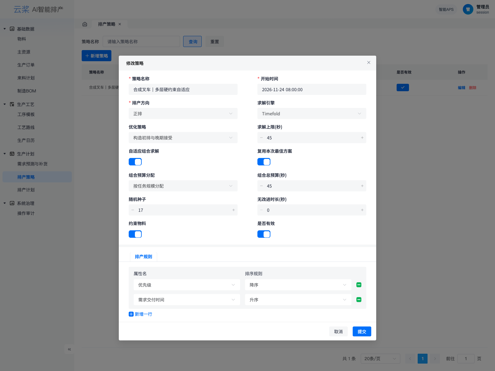

# 自适应排程 V2 验收结果

本轮使用本地隔离 MySQL/Redis、真实 HTTP、实际 Timefold 求解器及合成装配数据。

## 三种模式对照

| 工序 | 种子 | 模式 | 冷 / 热时间额度（秒） | HTTP 耗时（秒） | 构造 / 热启动次数 | 最终得分 | 逾期主订单数 / 总逾期分钟 |
|---:|---:|---|---:|---:|---:|---|---:|
| 36 | 17 | 固定预算冷启动 | 5 / 5 | 22.228 | 8 / 0 | 0hard/-1798331268soft | 0 / 0 |
| 36 | 17 | 固定预算热启动 | 5 / 5 | 26.288 | 1 / 7 | 0hard/-1798326149soft | 0 / 0 |
| 36 | 17 | 规模预算热启动 | 11.25 / 5 | 27.422 | 1 / 7 | 0hard/-1798326784soft | 0 / 0 |
| 72 | 17 | 固定预算冷启动 | 20 / 20 | 160.626 | 8 / 0 | 0hard/-1806357070soft | 1 / 1074.0 |
| 72 | 17 | 固定预算热启动 | 20 / 20 | 160.664 | 1 / 7 | 0hard/-1806346756soft | 1 / 1074.0 |
| 72 | 17 | 规模预算热启动 | 66 / 20 | 165.293 | 1 / 7 | 0hard/-1806346945soft | 1 / 1074.0 |
| 144 | 17 | 固定预算冷启动 | 120 / 120 | 500.130（服务端审计） | 5 / 0 | 预算内未找到可行解 | — |
| 144 | 17 | 固定预算热启动 | 120 / 120 | 500.392 | 5 / 0 | 预算内未找到可行解 | — |
| 144 | 17 | 规模预算热启动 | 300 / 120 | 500.489 | 1 / 7 | 0hard/-1838532907soft | 12 / 51774.0 |

可行方案均通过独立硬约束与日历工时校验；预算不足案例明确标注，不计为正向求解通过。同规模、同种子三组输入已剔除数据库生成标识并核对业务输入指纹一致。标注“服务端审计”的耗时来自持久化开始／结束时间，原因是客户端在保存终态原文后中断；其余为 HTTP 整体耗时。

FIXED 两组具有相同的总时间、单候选时间和评分次数上限，但实际评分／耗时可能因阶段成本或提前终止而不同。SCALE_AWARE 会增加冷启动额度，不能将其与 FIXED 的差异解释为同评分预算下的收益。soft 越大越好；其绝对值包含完成日期等项，不使用 soft 的百分比变化宣传业务收益。

本轮 144 工序 FIXED 使用 120 秒单候选上限，历史 V1 验收曾使用 240 秒；两轮预算不同，不能据此判断版本性能退化。本轮固定预算下未初始化完成的结果用于暴露首个可行解的预算门槛。表中热启动时间额度为基准上限，SCALE_AWARE 实际还受剩余时间均分限制，见逐候选 execution。

热启动减少重复构造，让后续预算用于局部搜索；这不保证总耗时下降，也不保证所有实例评分严格改善。原始任务结果可用于复核主订单逾期指标，指标另存 business-metrics.json。

## 事务和异常保护

- **PASS**：authentication and scheduling authorization。
- **PASS**：360-task undersized budget safely rejected。
- **PASS**：concurrent submission admits exactly one solve。
- **PASS**：stale snapshot confirmation rejected。
- **PASS**：dynamic outage, material delay, priority insertion, frozen WIP and four previews。
- **PASS**：atomic confirmation persists 36 tasks and terminal audit。
- **PASS**：cancellation releases lock and never republishes pending tasks。
- **PASS**：infeasible frozen outage rejected without replacing confirmed plan。

取消测试在本次求解已完成至少一次热启动候选、审计仍为 RUNNING 时发起；确认锁释放、没有待发布任务且已确认任务的设备和时间不变。360 工序仅验证预算不足时拒绝发布，不表示此规模正向求解通过。

## 复现和证据

- [实现、预算规则与回退说明](../../自适应排程热启动与规模预算实现说明.md)
- [对照原始汇总](comparison/comparison.json)
- [事务验收汇总](acceptance/report.json)
- [构建与测试信息](build-evidence.json)
- [Timefold 阶段日志摘录](solver-phases.log)
- [证据校验清单](sha256.json)

## 页面验证

已通过真实页面分别保存关闭热启动／固定预算、开启热启动／规模预算，刷新重开后检查回显，并只读核对测试数据库中持久化的配置。[配置读回证据](ui-persistence.json)。

当前结果只说明所列合成样本的行为；上线仍需目标硬件、客户真实约束和多次历史回放。原 V1 证据保留在 ../adaptive，本轮不会覆盖历史验收。
