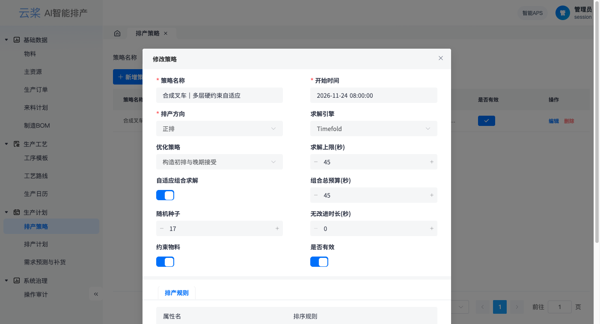
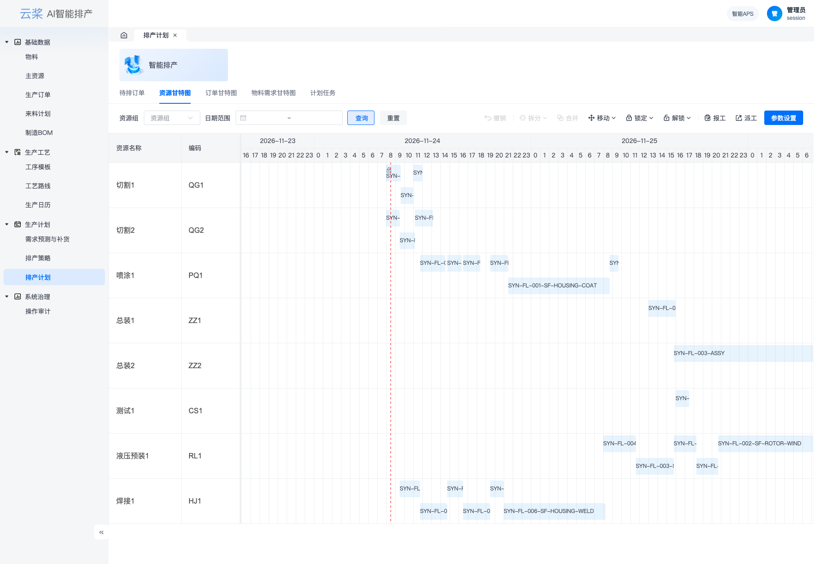
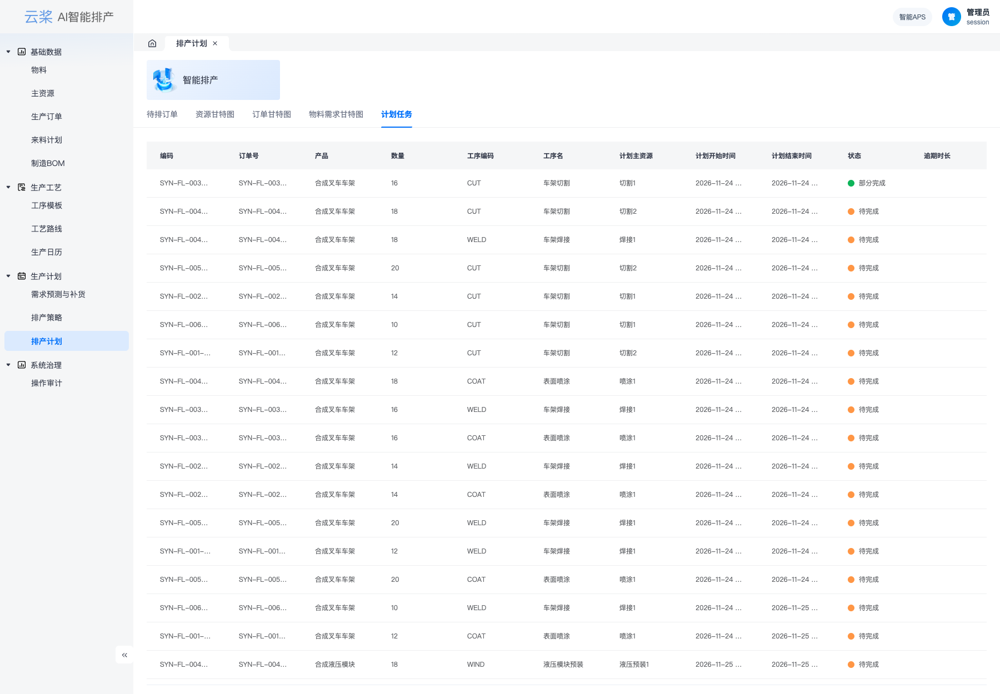
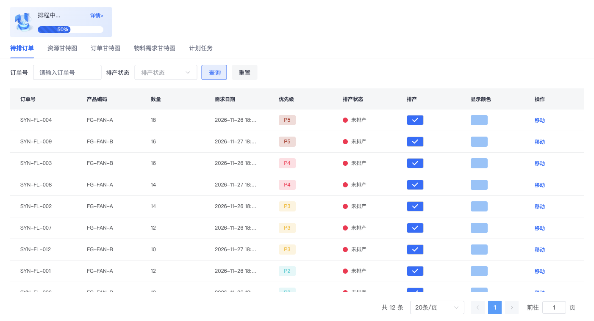

# 合成叉车多层硬约束排程验收结果

计划起点：2026-11-24T08:00:00。数据：合成；服务：真实 HTTP / MySQL / Redis / Timefold。

## 规模结果

| 订单 / 工序 | 模式 | HTTP 完成耗时（秒） | 最终得分 | 候选次数 / 终止原因 |
|---|---|---:|---|---|
| 6 / 36 | Timefold | 25.56 | `0hard/-1798330917soft` | 1 / 评分次数预算 |
| 6 / 36 | jDE + Timefold | 19.948 | `0hard/-1798332521soft` | 8 / COMPLETED |
| 12 / 72 | Timefold | 81.927 | `0hard/-1806349617soft` | 1 / 评分次数预算 |
| 12 / 72 | jDE + Timefold | 160.791 | `0hard/-1806355474soft` | 8 / COMPLETED |
| 24 / 144 | Timefold | 292.315 | `0hard/-1838532441soft` | 1 / 评分次数预算 |
| 24 / 144 | jDE + Timefold | 500.466 | `0hard/-1838533607soft` | 3 / TIME_BUDGET |

36 工序采用普通 Timefold 16,000 次评分预算，对比 8 个候选各 2,000 次评分上限；候选重复构造初解也消耗预算。较大规模为探测可行性使用更长单候选预算，不是等预算性能竞赛。soft 得分越高越好；本批三个规模的组合算法 soft 得分均略低于普通 Timefold，未显示收益。144 工序仅完成 3 次候选尝试（含未完成候选），未完成一代差分进化；不根据单次结果推断固定提效比例。

## 事务与约束验收

- **PASS**：360-task undersized budget safely rejected。 审计 `4dda3718-45e1-4f17-9de6-b9f54726e85a`。
- **PASS**：authentication and scheduling authorization。
- **PASS**：concurrent submission admits exactly one solve。
- **PASS**：stale snapshot confirmation rejected。
- **PASS**：dynamic outage, material delay, priority insertion, frozen WIP and four previews。 审计 `77ed88d8-a55d-4160-895f-5e1a1f40575c`。
- **PASS**：atomic confirmation persists 36 tasks and terminal audit。
- **PASS**：cancellation releases lock and never republishes pending tasks。 审计 `11943e5a-17bc-42cb-82c4-c72ee6ab562f`。
- **PASS**：infeasible frozen outage rejected without replacing confirmed plan。 审计 `e2c73489-b5a1-4ab2-ab89-56d307789e71`。

## 求解期间 HTTP 查询负载

8 并发、200 次已认证进度请求，错误 0；平均 2.32 ms，样本 P95 3.69 ms，最大 5.76 ms。这是单次本机短脉冲测量，排除登录耗时。

另进行约 60.1 秒、8 会话的限速持续查询：4562 次请求，错误 0，样本 P95 1.26 ms。两组测量均发生在实际求解期间，均不能替代目标硬件、真实数据和多租户生产 SLA 验收。

所有正向方案均检查任务总量与编码集合、零硬约束违例、工序先后、候选设备资格、设备不重叠、工作班次边界；动态方案额外检查缺件释放时间、在制冻结与停机避让。审计中的选中候选必须是已完成可行候选的最高分。

360 工序项目验证的是预算不足时拒绝发布的保护；不代表该规模已成功求出生产计划。

## 实际应用截图

### 启用 Timefold、自适应组合与物料约束

### 已确认计划：资源甘特图

### 已确认计划：任务明细

### 72 工序规模：合成订单在真实服务中求解

## 上线判断

这些结果证明本次合成样本上的求解、门禁、审计与确认链路能够运行。仍需现场数据回放、目标硬件多轮持续负载测试和生产 SLA 验收。短脉冲 P95 不能代表生产 P95；也没有证明算法普遍优于普通 Timefold。

运行方法、缺陷修复与模型边界见 [验收说明](README.md)。原始结果见 [report.json](report.json)。
