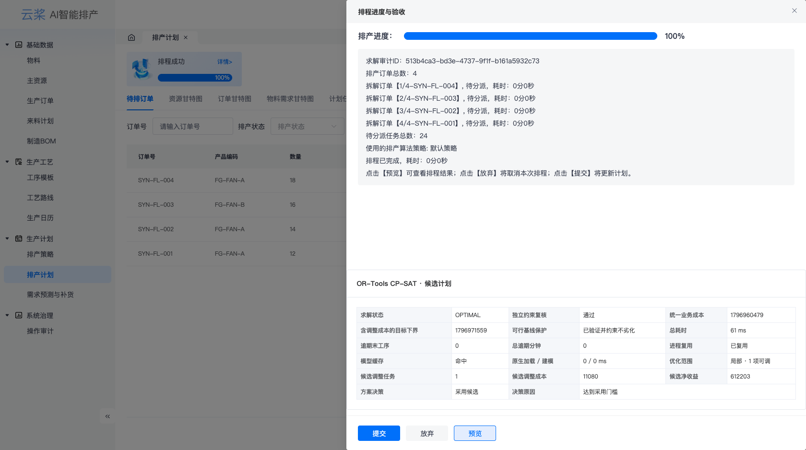
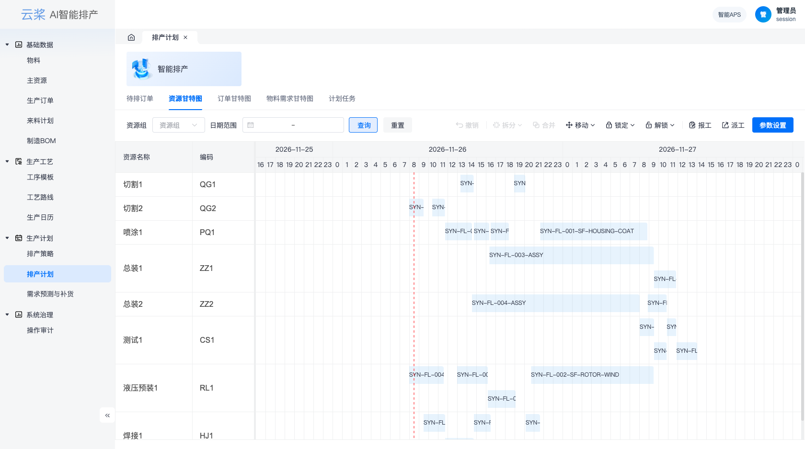

# CP-SAT 复用、局部优化与稳定性验收

日期：2026-11-25。全部为合成离散装配数据，真实 HTTP、MySQL、Redis、OR-Tools JNI 与浏览器页面操作；没有用 mock 替代求解器。

## 完成内容

- 109 项后端测试、5 项前端测试通过，前后端生产构建通过。
- 27 次规模/种子对照：24、48、72 道工序，各 3 个种子；CP-SAT、自适应 Timefold 固定预算、自适应 Timefold 按规模预算各 9 次。
- 进程和模型复用、交期变化失效、局部范围外固定、保留原计划不发布、缺失基线拒绝、取消后新进程恢复，共 6 项真实 HTTP 专项通过。
- 额外构造单末工序延期案例，验证有收益仍被高门槛拒绝、降低门槛后只调整 1 项并生成候选。浏览器确认后的正式数据核对见下方记录。

## 复用开销：同输入与同种子

| 指标 | 首次进程 | 复用进程与模型 |
| --- | ---: | ---: |
| 原生库加载（ms） | 14993 | 0 |
| 模型构造（ms） | 71 | 0 |
| 引擎总耗时（ms） | 18869 | 3556 |
| 业务成本 | 1796960479 | 1796960479 |
| 状态 | OPTIMAL | OPTIMAL |

同一 24 工序样本的引擎耗时从 18.869s 降至 3.556s，减少 81.2%，约 5.31 倍；两次目标值相同并均为 OPTIMAL。主要收益来自消除 JNI 冷启动，原本模型构造只有几十毫秒，不能将全部收益归因于模型缓存。0ms 为整数毫秒记录精度。

[首次请求](pool-first.json) · [重复请求](pool-repeat.json) · [交期变化后的缓存失效](cache-invalidation.json)

## 多规模与多种子结果

每次总预算 30s、单线程、相同六项业务权重；独立生成计划，不带历史基线，因此调整成本为零。输入指纹排除随机生成的数据库 ID，并将工序前置集合规范排序；九组语义输入均一致。实际 HTTP 耗时包含轮询/落库，超过 30s 的少量开销属于监管和业务链路。

| 工序数 | 算法 / 预算 | 可行次数 | HTTP 耗时中位数（s） | 可行结果逾期分钟中位数 |
| ---: | --- | ---: | ---: | ---: |
| 24 | 自适应 Timefold / FIXED | 3/3 | 30.178 | 0 |
| 24 | 自适应 Timefold / SCALE_AWARE | 3/3 | 30.241 | 0 |
| 24 | CP-SAT / 30s | 3/3 | 3.834 | 0 |
| 48 | 自适应 Timefold / FIXED | 3/3 | 30.393 | 4962 |
| 48 | 自适应 Timefold / SCALE_AWARE | 3/3 | 30.346 | 4962 |
| 48 | CP-SAT / 30s | 3/3 | 30.359 | 9790 |
| 72 | 自适应 Timefold / FIXED | 0/3 | 30.308 | —（无可行结果） |
| 72 | 自适应 Timefold / SCALE_AWARE | 3/3 | 30.347 | 20227 |
| 72 | CP-SAT / 30s | 3/3 | 30.576 | 103983 |

失败样本不记为零逾期，不纳入交期中位数。仅三个种子，不构成大规模生产容量或统计显著性结论。固定预算与按规模预算分别汇总，不能挑选各自最好一次合并为虚构的算法结果。

本轮 24 工序 CP-SAT 的三次运行均命中模型缓存，提前证明最优而结束；48 工序的结果说明现有自适应 Timefold 仍有质量优势。72 工序中按规模预算的自适应 Timefold 已达到 3/3 可行，且业务成本和逾期优于这批 CP-SAT 结果；固定候选预算的失败不能解释成 Timefold 缺少求解能力。本轮数据不支持全面替换现有引擎。

原始汇总：[固定预算与 CP-SAT](matrix.json)、[按规模预算补充对照](scale-aware.json)。每行 auditId 对应同目录的完整 HTTP 审计文件。该批次没有调整收益权重来迎合某个引擎；目标下界在有基线的改进模式下属于 B+D，不能直接与只含 B 的另一引擎下界比较。

### 全部种子明细

| 工序 | 种子 | 算法 | 可行 | 业务成本 | 逾期分钟 | HTTP 秒 |
| ---: | ---: | --- | --- | ---: | ---: | ---: |
| 24 | 17 | CP-SAT / 30s | 是 | 1796960479 | 0 | 3.834 |
| 24 | 17 | 自适应 Timefold / FIXED | 是 | 1796962708 | 0 | 30.178 |
| 24 | 17 | 自适应 Timefold / SCALE_AWARE | 是 | 1796962708 | 0 | 30.272 |
| 24 | 29 | CP-SAT / 30s | 是 | 1796960479 | 0 | 3.331 |
| 24 | 29 | 自适应 Timefold / FIXED | 是 | 1796962708 | 0 | 30.149 |
| 24 | 29 | 自适应 Timefold / SCALE_AWARE | 是 | 1796962708 | 0 | 30.196 |
| 24 | 43 | CP-SAT / 30s | 是 | 1796960479 | 0 | 4.859 |
| 24 | 43 | 自适应 Timefold / FIXED | 是 | 1796962708 | 0 | 30.191 |
| 24 | 43 | 自适应 Timefold / SCALE_AWARE | 是 | 1796962708 | 0 | 30.241 |
| 48 | 17 | CP-SAT / 30s | 是 | 1800451861 | 9790 | 30.357 |
| 48 | 17 | 自适应 Timefold / FIXED | 是 | 1800444158 | 4962 | 30.337 |
| 48 | 17 | 自适应 Timefold / SCALE_AWARE | 是 | 1800444883 | 4962 | 30.348 |
| 48 | 29 | CP-SAT / 30s | 是 | 1800452046 | 12319 | 30.775 |
| 48 | 29 | 自适应 Timefold / FIXED | 是 | 1800441916 | 4962 | 30.393 |
| 48 | 29 | 自适应 Timefold / SCALE_AWARE | 是 | 1800444163 | 4962 | 30.345 |
| 48 | 43 | CP-SAT / 30s | 是 | 1800447926 | 9721 | 30.359 |
| 48 | 43 | 自适应 Timefold / FIXED | 是 | 1800443588 | 4962 | 30.473 |
| 48 | 43 | 自适应 Timefold / SCALE_AWARE | 是 | 1800444237 | 4962 | 30.346 |
| 72 | 17 | CP-SAT / 30s | 是 | 1807542938 | 103983 | 30.576 |
| 72 | 17 | 自适应 Timefold / FIXED | 否 | — | — | 30.371 |
| 72 | 17 | 自适应 Timefold / SCALE_AWARE | 是 | 1806726703 | 20227 | 30.378 |
| 72 | 29 | CP-SAT / 30s | 是 | 1807097231 | 68276 | 30.576 |
| 72 | 29 | 自适应 Timefold / FIXED | 否 | — | — | 30.123 |
| 72 | 29 | 自适应 Timefold / SCALE_AWARE | 是 | 1806723605 | 20368 | 30.333 |
| 72 | 43 | CP-SAT / 30s | 是 | 1807681977 | 141259 | 30.443 |
| 72 | 43 | 自适应 Timefold / FIXED | 否 | — | — | 30.308 |
| 72 | 43 | 自适应 Timefold / SCALE_AWARE | 是 | 1806726755 | 20227 | 30.347 |

## 局部优化与门槛闭环

专项结果：[6 项接口验收](acceptance.json)、[页面策略保存回读](browser-strategy.json)。局部模式扩展出 3 项可调任务，范围外设备及起止时间全部固定；未采用时待确认表为空，直接确认接口也拒绝。取消会销毁进程，后续求解由新进程完成。

为确定性验证“收益足够时采用”，先生成并确认一个正常计划，再将最后一道工序人为延后 7 天，保持同一星期和日历；这是一项显式合成扰动，SQL 已归档。之后只允许该任务变化。高净收益门槛拒绝候选，降低门槛后采用；其他 23 项保持不变。该案例不参与上方随机对照统计。

[合成扰动](synthetic-delayed-terminal.sql) · [高门槛拒绝](demo-threshold-rejected.json) · [局部采用结果](demo-local-accepted.json) · [浏览器确认与正式数据校验](browser-confirmation.json)

## 页面截图

### 策略配置


### 采用局部候选


### 正式计划


## 复现

按 [实现与配置手册](../../CP-SAT进程复用、局部优化与方案采用门槛.md) 部署协议 v2 主服务和 worker。仅使用专用 `aps-ade-e2e-mysql` / `aps_e2e` 及 `aps-ade-e2e-redis`，后端 31010、前端 9998；脚本会清空该隔离库 demo 排程数据。

```bash
# 重启隔离后端后先测冷/热请求，避免首个请求已经复用旧进程
python3 aps/scripts/e2e_cpsat_optimization.py --disposable --acceptance-only
python3 aps/scripts/e2e_cpsat_optimization.py --disposable --matrix-only
python3 aps/scripts/e2e_cpsat_optimization.py --disposable --scale-aware-only
python3 aps/scripts/e2e_cpsat_optimization.py --disposable --demo-only
```

本轮对照脚本曾因依赖集合的序列化顺序不同而中断；修正为集合规范排序后，重新核对已完成输入并续跑，保留各次真实结果。后端回归最初因沙箱禁止本地监听导致 7 项既有 HTTP 测试报错，允许本机端口后完整回归通过。最终构建与初次对照运行构建只相差审计长整数显示保护及格式整理，求解模型和预算相同。

页面已完成策略编辑保存、候选采用摘要查看和正式提交；对确认后计划再次发起求解时，界面提示清空未锁定调整，自动审批拒绝该确认操作，随后取消该操作并保留正式计划。未绕过审批，未生成该次“保留原计划”的页面截图；对应行为由前述真实 HTTP 专项与高门槛案例证明。

目前最大实际对照规模为 72 工序。未进行 300 工序容量验收、持续长时间压力测试或原生内存峰值对照；进程复用可能增加空闲驻留内存，不能宣称内存占用也下降。
