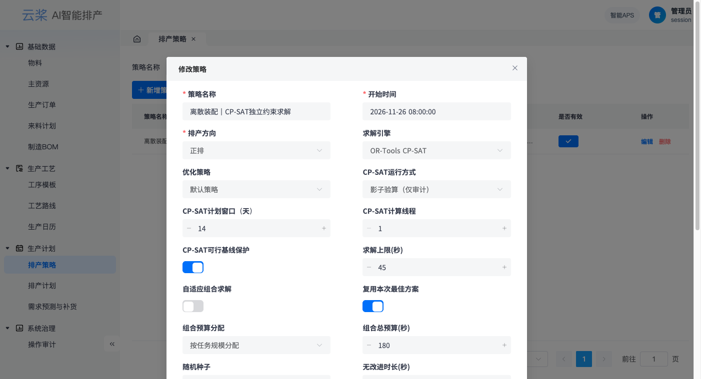
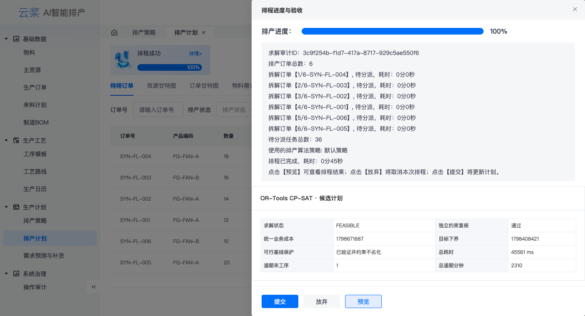
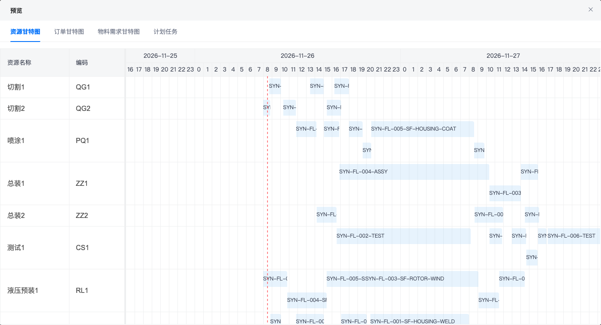
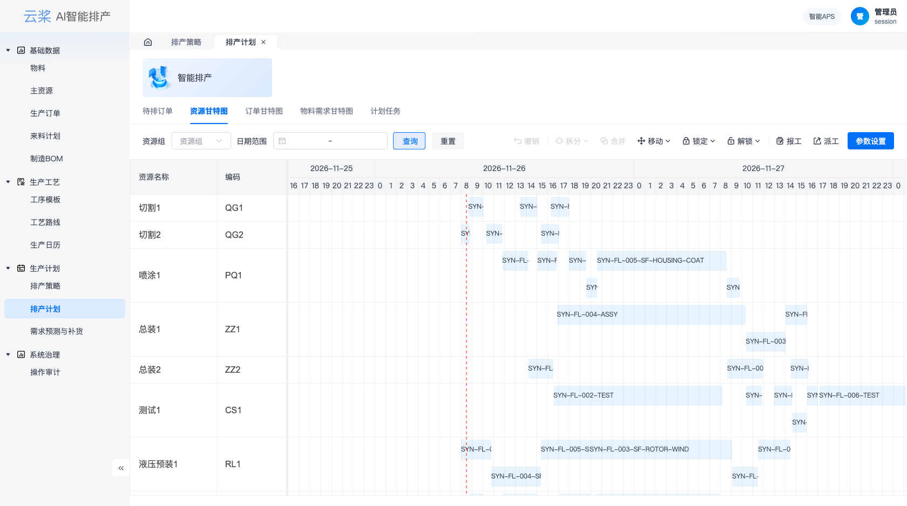

# CP-SAT 端到端验收

验证日期：2026-11-25。使用合成离散装配数据、真实 HTTP、独立 OR-Tools JNI worker、MySQL、Redis 与 BrowserOS neo 页面操作；未使用求解器 mock。

## 环境与结果

- Java 17.0.13，OR-Tools 9.15.6755，Vue/Vite 前端。
- 6 个订单、36 道工序、8 台资源；取消场景扩展为 12 个订单、72 道工序。
- 103 项后端测试通过，5 项前端测试通过，前后端构建通过。具体模块计数与运行 jar 的 SHA-256 见 [构建验证](build-verification.json)。
- 12 项 HTTP 场景通过，逐项结果见 [验收报告](report.json)。
- 页面验证覆盖策略配置、独立验收摘要、候选预览、人工确认和正式计划；截图如下。[浏览器确认记录](browser-confirmation.json)证明 36 项正式任务的开始、结束时间与审计逐项一致（含毫秒），审计为 CONFIRMED，待确认表已清空。

| 场景 | 检查内容 | 证据 |
| --- | --- | --- |
| 原引擎回归 | Timefold 仍能完成相同订单的真实排程 | [原引擎](timefold-baseline.json) |
| 影子验算 | 独立约束校验通过，待确认表保持为空 | [影子结果](shadow.json) |
| 候选计划 | 36 项任务、30 条工序依赖、设备资格、日历工时、毫秒时间入库一致 | [候选结果](candidate.json) |
| 四类预览 | 任务、资源、订单、物料预览接口返回真实结果 | [任务](preview-tasks.json)、[资源](preview-resource-gantt.json)、[订单](preview-order-gantt.json)、[物料](preview-material-gantt.json) |
| 权限与租户 | 无权限账号不能排程，其他租户不能读取本次审计 | [报告](report.json) |
| 确认保护 | 物料数据变化时拒绝确认；恢复原版本后确认成功 | [拒绝响应](stale-rejection.json) |
| 已有可行方案 | 已确认方案重新校验，候选成本不高于基线 | [基线保护](baseline-protection.json) |
| 动态事件 | 停机、物料延期、插单；1 项在制冻结、6 项物料释放约束 | [动态结果](dynamic.json) |
| 不可行冻结 | 停机覆盖冻结工序，禁止生成候选 | [不可行结果](infeasible-frozen.json) |
| 取消 | 终止原生 worker，待确认表为空，审计最终为 CANCELLED | [报告](report.json) |
| 实际在途预约 | 扣减真实来料数量后，36 项任务遵守订单齐套放行时间 | [到料结果](inbound-reservation.json) |
| 未落实供应 | 外购库存和在途不足时拒绝排程 | [缺料拒绝](uncovered-supply.json) |
| 跨引擎择优 | 已确认 Timefold 方案传入 CP-SAT，成本重算一致并约束不劣化 | [Timefold 基线](bridge-timefold.json)、[CP-SAT 候选](bridge-cpsat.json) |

表格按检查点拆分，自动化报告将“四类预览”合并在候选场景内，因此自动化场景数为 12。

## 本次跨引擎对照

同一批合成订单、随机种子 17、单线程、策略预算 45 秒。CP-SAT 先验证已确认的 Timefold 基线，再在同一成本口径下求解。

| 指标 | Timefold 基线 | CP-SAT 候选 |
| --- | ---: | ---: |
| 统一业务成本 | 1,798,674,512 | 1,798,671,687 |
| 逾期末工序数 | 1 | 1 |
| 末工序总逾期分钟 | 2,316 | 2,310 |
| 最晚完成时间 | 11月30日 08:36:00 | 11月30日 08:30:00.001 |
| 硬约束复核 | 通过 | 通过 |

CP-SAT 返回 **FEASIBLE**，目标下界为 1,798,408,421，未证明最优。候选总成本降低 2,825，逾期减少 6 个整分钟；本次结果没有显示逾期末工序数量下降。总成本包含 epoch 完工秒常数，不将成本百分比直接解释为业务收益百分比。

这份对照证明基线能够跨引擎重算和保护，并记录本样本的改善；没有证明所有规模或所有业务目标都能显著改善。独立冷启动场景与热启动场景的结果可能不同，均保留原始审计，不只展示较好一次。

## 真实页面截图

### 策略与影子模式

### 独立验收与基线保护

### 候选资源甘特图

### 确认后的正式计划

## 复现与部署前检查

1. 按 [实现与运行手册](../../OR-Tools%20CP-SAT实现与运行手册.md) 构建主服务和独立 worker。
2. 启动专用 `aps-ade-e2e-mysql`、`aps-ade-e2e-redis` 容器；数据库必须为 `aps_e2e`。配置参考 `aps/scripts/e2e-local.yml`，MySQL 映射端口 3317，Redis 6387。
3. 主服务使用 `aps.cp-sat.enabled=true`、worker jar 绝对路径、`candidate-tenants=demo`；后端 31010，前端 9998。为运行进程复制独立 jar，避免在它运行时覆盖其文件。
4. 执行 `python3 aps/scripts/e2e_cpsat.py --disposable`。脚本会清理隔离库中 demo 租户的排程数据并应用时间精度迁移。
5. 使用页面登录隔离租户，进入排产计划，打开详情、预览，核对后确认。

本轮测试发现并修复了秒级数据库字段丢失毫秒、冻结任务缺失物料，以及冻结替换后依赖集合残留旧对象的问题。首次 12 秒预算不足的 [UNKNOWN 结果](insufficient-budget.json) 也予以保留，验证其没有被当作可行解发布。测试中容器运行时曾中断，恢复后重跑受影响场景；动态阶段在修复后从已确认基线续跑，最终跨引擎阶段重新生成合成数据。

当前验证覆盖上述规模。300 任务是默认准入上限，不是已完成的现场压测规模。共享辅资源容量、工序级分批领料、逆排及跨午夜未拆分班次等边界见运行手册；不满足能力门禁时必须补齐模型或选用已适配流程。
