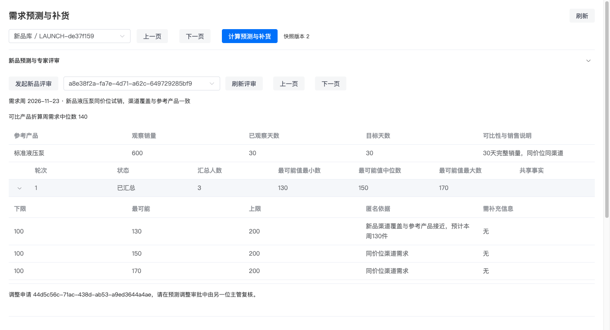

# 新品预测与专家评审实现及验收

2026-11-21，本次根据用户提供的两张书页图片，补齐需求预测与智能补货中的新品评审工作流。实现以现有周计划、版本快照、预测调整复核和采购计算为基础。

## 从图片提炼的业务要求

第一张图片列出类似产品的首批量、30天销量与售罄率、3个月及6个月累计销量，并注明促销、断货和观察期未结束。产品定位、定价、上市计划用于解释可比性。正文提醒采购起订量和报价会影响供应决策，专家容易把起订量当成需求预测。

第二张图片介绍独立填写判断、记录依据、提出补充信息需求、匿名反馈以及多轮修订。结合本项目，需要同时保留专家判断过程与可追溯的生效路径。

| 原有能力 | 本次补齐 |
| --- | --- |
| 自身历史销量回测与周预测 | 类似产品销量证据，观察天数、目标天数、完整性、促销、缺货及可比性说明 |
| 单笔人工覆盖申请及主管复核 | 指定专家、独立提交、轮次封存、匿名统计与依据反馈、多轮修订 |
| 安全库存、MOQ、包装倍数、预算等采购约束 | 专家评审接口仅包含需求证据，评审结论批准后进入既有采购计算 |
| 快照版本及租户隔离 | 评审绑定计划代次，过期和代次变更阻止继续提交或形成申请，参与人访问控制 |

## 已实现的算法与决策规则

完整观察期且无缺货、无促销的参考产品，按“观察销量 × 7 ÷ 观察天数”折算周需求，再取中位数。它是供专家核对的平均周需求参考，上市爬坡和季节分布仍由专家结合目标周判断。所有参考产品须先换算为目标物料的基本单位。

存在缺货、促销或观察期不足的样本保留原值与说明，并提示其可能偏差。缺少合格样本时返回参考不足。当前数据无法识别缺货期间丢失的真实需求，自动补出销量需要额外的可售库存、曝光、丢单等证据。

每次评审针对一个周一开始的需求周。组织者邀请3至20位专家，组织者与专家分离。专家填写需求下限、最可能值、上限、依据和待补充信息，满足下限≤最可能值≤上限。同轮提交固定，完全相同的重试可重放，修订在下一轮完成。

组织者等全部专家提交后关闭本轮。服务端在关闭前只返回调用者自己的判断，关闭后共享最可能值的最小值、中位数、最大值，以及去除账号标识的判断和依据。名单与其他人的账号始终不进入读取响应。自由文本需要专家避免写入姓名和联系方式，表单已给出提示。

下一轮保留全部旧轮次，组织者填写共享事实，专家重新独立判断，最多五轮。组织者明确选择当前轮中位数并填写理由后，创建现有预测调整申请。另一位有复核权限的主管批准后，重算计划才能得到对应采购建议。专家上下限用于复核分歧，数值中位数作为单值预测生效。

## 使用步骤

1. 先导入新品的地点、物料、单位、库存和供应快照，进入“需求预测与补货”。
2. 打开“新品预测与专家评审”，填写需求周、有效期、定位及上市背景，并填写专家账号ID和类似产品资料。
3. 受邀专家使用各自账号选择该物料与评审，提交独立判断。
4. 组织者收齐后关闭本轮，查看统计和展开行中的匿名依据，必要时补充共享事实并发起下一轮。
5. 采用本轮中位数申请预测调整，交由另一位主管复核。
6. 重新计算预测与补货，核对生效预测、订单冲销、库存投影和采购约束。

## 数据与并发

新增表保存租户、物料地点、评审ID、创建和更新时间，以及完整的证据、轮次与申请引用。评审变更在数据库事务内锁定评审行，多个专家并发提交依次合并。形成申请与保存申请引用在同一事务提交，重复请求返回同一申请ID。

读取和变更均校验租户与参与资格。预测申请继续复用原有版本检查和双人复核。生效过程复用原有预测覆盖与库存净算，原有输入结构和算法保持兼容。

先执行数据库迁移，再部署后端与前端。已有数据库需要依次具有基础需求计划表和本次评审表。账号需配置对应权限和默认首页，测试配置提供了组织者、三位专家、主管、无权限账号和另一租户账号。生产账号由部署方账号体系提供。

- [本次数据库迁移](../aps/sql/20261121_launch_review.sql)
- [评审算法](../aps/jvs-aps-common/src/main/java/cn/windwheel/aps/demand/LaunchReview.java)
- [事务与权限实现](../aps/jvs-aps-common/src/main/java/cn/windwheel/aps/demand/LaunchReviewStore.java)
- [前端评审组件](../aps-ui/src/views/aps/demandPlanning/LaunchReview.vue)
- [隔离测试配置](../aps/scripts/e2e-launch.yml)
- [可重复执行的 HTTP 验收](../aps/scripts/e2e_launch_review.py)

## 本次测试

后端使用 Java 17 执行 Maven clean verify，75项测试通过，包括新品评审、生命周期、缺货校正、阶梯报价规则，以及既有MRP、Timefold与小模型服务回归。前端5项测试通过，生产构建成功。

真实HTTP验收使用本机MySQL 8.4、发布JAR和实际登录会话。一个完整参考产品600件/30天，周参考140件。另三条缺货、促销、观察不足证据被标记。首轮判断120、140、300，中位数140；第二轮130、150、170，中位数150。主管批准后生效预测150，MOQ为3000时采购建议为3000。

验收覆盖跨租户隔离、未受邀访问、无权限访问、当轮意见保密、并发提交、相同重放、不同内容重复提交冲突、轮次关闭、旧轮次冲突、匿名依据、申请重放、双人复核、旧代次失效和预测到补货衔接。2026-11-23 真实HTTP新增信号场景验证：首周生命周期基准100；销量50、可售50%、上限80时估计缺货损失30并修正需求80；80件净需求在整单阶梯报价下选择100件，总成本820。原有HTTP脚本再次通过采购并发审批、ERP重复回执和部分收货回归。[运行结果](e2e/launch-review-20261121/evidence.json)

## 生命周期、缺货校正与商业成本扩展

在既有的周计划快照中，新增可选 `signals` 段；缺失该段时，历史预测、库存净算和采购建议保持原有计算结果。该段与快照版本一起存档，因此每次预测和采购建议都能复算和审计，不需要另建一套脱离计划版本的主数据。

### 1. 新品上市日龄曲线

`lifecycle` 用上市周、锚点周销量和按周龄递增的指数曲线描述新品爬坡。第 `w` 个预测周的周龄是 `w - launchWeek`；上市前需求为零，上市后按相邻曲线节点线性插值。`replaceStatisticalBaseline=true` 时，以 `anchorWeeklyDemand × index(age) ÷ index(anchorAgeWeek)` 作为基准预测；否则将该系数乘到既有统计基准上。返回方法名以 `LIFECYCLE_` 开头，结果中的 `baseline` 即已应用曲线后的数值。

这避免把首30天销量直接当作稳定周需求。曲线必须从周龄0开始、包含锚点周、最多260周；模型不会擅自用采购起订量、报价或库存反推消费者需求。

### 2. 缺货损失自动估计

`availability` 对已关闭历史周记录实际销量、可售比例和可选的同类需求上限。计算只在实际销量与对应历史周来源数据一致时执行：

- 可售比例为100%：不修正；
- 20%至不足100%：潜在需求为 `实际销量 ÷ 可售比例`，若给出同类需求上限则取较小者；差额作为估计缺货损失；
- 低于20%：不自动放大，以免由极小分母制造虚假的需求峰值，标记为需要人工复核。

修正后的历史同时用于模型选择、回测和未来预测。结果返回逐周 `lostSales`，含可售比例、估计损失、校正需求及计算方法，供业务复核。这里的“自动”是有边界的估计：渠道曝光、价格变化、断货替代与取消订单尚未被伪装成已知事实，后续可以在具备事件数据和回测样本后扩展为因果模型。

### 3. 阶梯报价总成本优化

`costs` 保留报价条款及成本项，并在现有MOQ、包装倍数、最大订单、库容和预算约束之内比较候选采购量。候选量包含原有短缺取整量及每个阶梯起量；总成本为：

`采购货值 + 固定运费 + 固定加工费 + 加工单位费 × 采购量 + 超额库存 × 持有周数 × 单位周持有费`

支持两种明确的报价口径：`ALL_UNITS` 为达到某档后整单按该档单价计价；`INCREMENTAL` 为每一数量区间分别按所在档单价计价。第一档必须从1件开始，阶梯起量严格递增。系统选择可行候选中的最低总成本，并在采购建议 `cost` 中返回计价方式、命中档位和货值、运费、加工费、持有成本拆分；没有报价信号时，仍沿用原有单位成本与最小采购量逻辑。

### 快照数据契约

以下是可与既有快照一起导入的最小示例（金额和数量均使用物料基本单位，周均为周一）：

```json
{
  "signals": {
    "lifecycle": {
      "launchWeek": "2026-12-07",
      "anchorAgeWeek": 0,
      "anchorWeeklyDemand": 100,
      "replaceStatisticalBaseline": true,
      "points": [{"ageWeek": 0, "index": 1}, {"ageWeek": 1, "index": 2}]
    },
    "availability": [{
      "week": "2026-11-23", "observedDemand": 50,
      "inStockFraction": 0.5, "comparableDemand": 80
    }],
    "costs": {
      "pricingMode": "ALL_UNITS",
      "tiers": [{"fromQuantity": 1, "unitPrice": 12}, {"fromQuantity": 100, "unitPrice": 8}],
      "freightFixedCost": 20, "processingFixedCost": 0,
      "processingUnitCost": 0, "holdingCostPerUnitWeek": 0,
      "excessHoldingWeeks": 0
    }
  }
}
```

导入时服务端拒绝不在关闭历史周内的缺货观察、重复周、无效可售比例、无锚点的生命周期曲线和含糊的报价阶梯。这样数据质量问题在计算前暴露，而不会静默改变计划。

## 持续建设与效果评估

本次能力仍按周计划落地。价格弹性、渠道曝光、相互替代、实际到货时点、税费和呆滞处置成本需要接入相应事实数据并建立专项回测，才可纳入自动决策。上线后应持续记录新品实际需求、专家判断误差、缺货观察和报价履约情况，以真实新品上市后的预测误差、服务水平、采购总成本和资金占用验证收益。

## 浏览器操作证据

BrowserOS neo 使用前端生产构建连接真实后端。组织者在表单中创建新品评审，专家1在浏览器填写100／130／200及依据，另两位测试专家经实际HTTP会话独立提交150和170。组织者在浏览器关闭轮次、展开匿名依据，并采用150形成调整申请。独立主管通过HTTP复核该申请。

[专家独立提交后的页面](e2e/launch-review-20261121/01-sealed-round.png)



浏览器重算后，周预测为150，采购建议页的净缺口为150、采购量为3000。[生效周预测](e2e/launch-review-20261121/03-effective-forecast.png) · [采购建议](e2e/launch-review-20261121/04-replenishment.png)

复现命令使用隔离测试库，后端加载上述测试配置，端口以实际启动参数为准。

```sh
python3 aps/scripts/e2e_launch_review.py --base http://127.0.0.1:31825/mgr/jvs-aps
python3 aps/scripts/e2e_demand_planning.py --base http://127.0.0.1:31825/mgr/jvs-aps --async-worker
```

页面复验还覆盖了页头刷新，当前评审与明细可继续保留。
