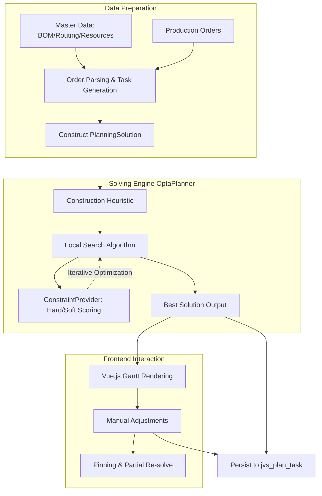

# JVS-APS（智能排产）技术落地架构设计

> **文档类型**: 技术落地设计文档
>
> **状态**: Draft
>
> **涉及代码**: `aps/jvs-aps-common`, `aps/jvs-aps-mgr`, `aps-ui`

---

## 1. 背景与动机 (Background and Motivation)

### 1.1 问题陈述
当前制造企业的生产排程主要依赖人工 Excel 表格，面临以下核心痛点：
- **约束复杂性极高**：人工无法同时兼顾设备产能（Capacity）、物料齐套（Material Availability）、复杂工艺路线（Routing Sequence）等多重硬性约束。
- **响应速度缓慢**：当发生设备故障、紧急插单等异常扰动时，重新排产（Rescheduling）需要耗费数小时甚至数天，导致生产计划与实际脱节。
- **优化目标冲突**："准时交付"与"设备利用率最大化"往往相互矛盾，人工排产难以在多目标之间找到全局最优解。

### 1.2 量化影响
| 场景 | 人工排产方案（Excel） | 理想的 APS 方案 |
|------|----------------------|-----------------|
| 紧急插单 | 牵一发而动全身，通常只能局部调整，导致其他订单延期 | 自动重新评估优先级，毫秒/秒级输出全局重排方案 |
| 资源负载不均 | 瓶颈工序严重堆积，非瓶颈工序闲置 | 基于算法自动均衡负载，最大化吞吐量 |
| 复杂工艺（多级BOM）| 容易发生前后置工序错乱或物料断档 | 严格遵守工序先后依赖和物料齐套约束 |

### 1.3 设计目标
本设计旨在构建一个基于 OptaPlanner 引擎的智能排产系统（JVS-APS），解决以下问题：
1. **自动化建模与求解**：将业务约束映射为数学模型，自动输出满足交期且产能可行的排产方案。
2. **多目标优化**：通过配置不同权重的调度策略（`jvs_planning_strategy`），在准时交货、压缩制造周期、设备均衡等目标间灵活切换。
3. **人机协同闭环**：提供交互式甘特图前端，允许计划员在算法输出的基础上进行微调，且支持局部锁定（Pinning）防止重排导致“蝴蝶效应”。

---

## 2. 约束条件 (Constraints)

### 2.1 架构约束
**C-1: 遵循既有技术栈**
后端必须基于 Java 17 和 Spring Boot 2.7.x 构建，前端必须基于 Vue.js 3 和 Vite 构建。数据库操作依赖 MyBatis Plus 和 MySQL 8.0。

**C-2: 采用 OptaPlanner 作为核心约束求解器**
核心调度逻辑必须基于 OptaPlanner 9.44.0.Final 实现，不得修改 OptaPlanner 内部源码，所有业务约束需通过实现 `ConstraintProvider` 接口来表达。

**C-3: 数据库 Schema 约束**
必须在现有的表结构框架下进行设计，如 `jvs_manufacture_bom`（BOM关系）、`jvs_production_order`（生产订单）、`jvs_plan_task`（排产任务）、`jvs_process_route`（工艺路线）等。

### 2.2 兼容性与性能约束
**C-4: 异步求解与用户反馈**
OptaPlanner 求解 NP-hard 问题耗时较长（分钟级或更长），调度接口不能阻塞。必须采用异步任务模型，并为前端提供进度轮询或 WebSocket 推送机制。

**C-5: 数据规模可扩展性**
在大规模数据集下，构建 `PlanningSolution` 时的内存开销和求解时的 CPU 消耗极高，架构设计需支持求解引擎层的水平扩展或独立的 Worker 节点部署。

---

## 3. 当前状态分析 (Current State Analysis)

根据对现有代码库和表结构的盘点，系统具备以下核心基础模块：

### 3.1 现存基础数据 (Master Data)
| 领域模型 | 数据表 | 状态分析 |
|----------|--------|----------|
| **物料与 BOM** | `jvs_manufacture_bom` | 已具备多层级 BOM 结构支持，用于拆解订单需求。 |
| **生产资源** | `jvs_production_resource` | 定义了机台、产线等资源及基本产能。 |
| **工艺与路线** | `jvs_process` / `jvs_process_route` | 已定义工序间的先后顺序（如前置后置依赖），这是排产的关键输入。 |
| **工作日历** | `jvs_work_calendar` | 定义了资源的可用时间段和班次。 |

### 3.2 现有排产与 UI 组件
| 模块 | 组件/表 | 状态分析 |
|------|---------|----------|
| **调度引擎入口** | `jvs-aps-mgr` / `SolveServiceImpl` | 负责拉取数据、构造实体、启动求解器，并持久化结果到 `jvs_plan_task`。 |
| **调度策略** | `jvs_planning_strategy` | 存储了优化目标的权重配置，但需要映射到 OptaPlanner 的硬/软分数体系。 |
| **前端甘特图** | `aps-ui/src/views/aps/.../component` | 已具备甘特图基础结构，支持任务的可视化与一定的拖拽微调（对应调整记录表 `jvs_plan_task_adjust`）。 |

**核心发现**：基础设施已具雏形，但需要通过精细的域模型映射与约束评分（Score Calculation）机制将静态数据转化为 OptaPlanner 能够高效运算的搜索空间。

---

## 4. 详细设计 (Detailed Design)

### 4.1 整体架构 (Overall Architecture)

系统分为四个生命周期阶段：数据准备（Compile-time）、求解运算（Solving-time）、人工调整（Runtime/Execution-time）和持久化。

### 4.2 领域与约束建模层 (Domain & Constraint Modeling Layer)

这是设计的核心，需将业务模型映射为 OptaPlanner 注解。

#### 4.2.1 实体映射
- **`@PlanningEntity`**: `PlanTask`（基于 `jvs_plan_task`）。任务是排产的最小原子单位。
  - **`@PlanningVariable` (资源)**: 分配给哪个具体的 `ProductionResource`。
  - **`@PlanningVariable` (开始时间)**: 任务的开始时间槽（与资源日历相关）。
- **`@PlanningSolution`**: `ApsSolution`，包含所有的 `ProductionResource` 列表（Planning Fact）和待排产的 `PlanTask` 列表。

#### 4.2.2 约束评分设计 (`ApsHardSoftScoreConstraintProvider`)

**Hard Constraints（硬约束，不可违反）**:
1. **资源冲突约束 (Resource Capacity Constraint)**：同一台设备在同一时刻只能处理一个任务（除非明确建模了多并发产能）。
2. **工艺先后依赖 (Routing Sequence Integrity)**：如果任务 B 依赖任务 A，那么 B 的开始时间必须晚于（或等于）A 的结束时间。
3. **资源资质约束 (Skill/Capability Match)**：任务指定的工序类型必须与所分配设备的加工能力匹配。

**Soft Constraints（软约束，用于优化）**:
1. **最小化逾期 (Minimize Tardiness)**：`score -= (任务结束时间 - 订单要求交期) * penalty_weight`（仅当大于0时）。
2. **最快完工 (Makespan Minimization)**：鼓励所有任务尽早开始，压缩整体生产周期。
3. **负载均衡 (Balance Resource Load)**：对于可替代的同类资源，尽量使得各资源的工作时长方差最小。

### 4.3 调度引擎层 (Scheduling Engine Layer)

#### 4.3.1 求解流程管理 (`SolveServiceImpl`)
由于 OptaPlanner 求解可能耗时数分钟，必须采用异步架构：
1. **接收请求**：API 接收排产请求（包含订单 ID 列表、策略 ID）。
2. **状态标记**：将订单状态更新为“排产中”（Scheduling in progress）。
3. **异步求解**：使用 `@Async` 或提交到专门的线程池。从 DB 提取当前数据快照，构造 `ApsSolution`，调用 `SolverManager.solveAndListen()`。
4. **方向性排产**：
   - **正向排产 (Forward Scheduling)**：从指定的起始日期开始往后推，适用于产能受限情况。
   - **逆向排产 (Backward Scheduling)**：从订单交期往前推，适用于JIT（Just-In-Time）精益生产模式。引擎需支持在构造阶段调整启发式算法。

### 4.4 前端交互层 (Frontend Interaction Layer)

#### 4.4.1 甘特图与人工微调
算法给出的最优解并不总是完美的实际解（因现场可能存在未被系统记录的隐性约束）。
- **Vue.js 渲染**：利用定制化的前端甘特图组件（如 `aps-ui/src/views/aps/component`），以时间轴展示资源占用和任务流转。
- **拖拽调整**：计划员可在甘特图上拖拽调整任务块的所在设备（Y轴）和时间（X轴）。前端将调整事件通过 API 写入 `jvs_plan_task_adjust` 表。

#### 4.4.2 应对“蝴蝶效应”
人工微调可能引发局部约束冲突。系统提供以下机制：
- **Pinning（锁定）机制**：对于人工调整过的任务，将其标记为 `Pinned=true`。
- **增量重排 (Partial Re-solve)**：当引入新插单或调整后重新求解时，求解器将 `Pinned` 的任务视为不可更改的 `Planning Fact`，仅围绕这些固定任务优化其余未锁定任务，防止整个排产计划被算法大面积打乱（蝴蝶效应）。

---

## 5. 权衡与决策记录 (Trade-off and Decision Records)

| ID | 决策点 | 选择 | 理由 | 替代方案 | 风险/劣势 |
|----|-------|------|------|----------|-----------|
| **TD-1** | 核心算法选型 | OptaPlanner 引擎 | 对 NP-hard 问题具备数学证明的全局寻优能力，抽象度高 | 自研启发式贪心脚本 | 学习曲线陡峭，内存消耗较大 |
| **TD-2** | 求解执行模式 | 异步任务 + 轮询/推送 | 排产耗时不可控，同步 HTTP 请求会导致连接超时 | 同步执行并设置超长超时时间 | 用户体验差，系统容错率低 |
| **TD-3** | 分数体系设计 | Hard/Soft Score（带有权重的惩罚分） | 真实制造业中经常需要容忍一定程度的“逾期”以换取产能利用率 | 严格的规则硬性卡死 | 权重难以一次性调优，需业务专家反复介入 |
| **TD-4** | 应对人工微调 | 引入任务 Pinning (锁定)机制 | 解决重排导致的"蝴蝶效应"，尊重计划员的业务经验 | 每次修改后全盘重新计算 | 算法输出结果经常大变样，让业务人员失去信任 |
| **TD-5** | 约束处理范围 | 仅支持资源、工艺前置、交期等核心要素 | 避免初期模型过度庞大导致求解器崩溃 | 一次性引入物料齐套、人员排班等全要素约束 | 无法覆盖 100% 的现场极端情况（需靠人工干预补足） |

---

## 6. 已知问题与风险 (Known Issues and Risks)

1. **大规模数据集下的性能瓶颈 (Performance on large datasets)**：
   - **风险**：当未完成订单量达到数万行，OptaPlanner 的 `Local Search` 内存占用可能触发 JVM OOM，且单次解空间搜索时间呈指数级上升。
   - **缓解**：引入时间窗口（Time Window）机制，仅对未来 1~2 周的任务进行高频精细排产，长远期订单进行粗略产能规划。

2. **前端甘特图渲染卡顿 (UI freezing during massive Gantt renders)**：
   - **风险**：Vue 响应式系统在绑定数万个甘特图 DOM 节点时会导致浏览器失去响应。
   - **缓解**：前端甘特图必须实现虚拟滚动（Virtual Scrolling）和按需加载渲染（Lazy Rendering），脱离响应式数据树管理庞大的只读 DOM。

3. **分数陷阱 (Score Trap)**：
   - **风险**：由于权重配置不合理，求解器可能陷入局部最优，反复横跳而无法提升总体评分。
   - **缓解**：在系统中预设经过标定验证的典型行业策略模板（`jvs_planning_strategy`），限制用户随意修改底层硬编码逻辑。

---

## 7. 实施计划 (Implementation Plan)

本项目建议采用分阶段（Phased approach）交付，降低落地风险。

### 7.1 Phase 1: 核心模型与基础设施构建 (Core Modeling & Infrastructure)
- **目标**：完成基础数据表的 CRUD、打通 Vue 前端到 Spring Boot 后端的全链路、引入 OptaPlanner 依赖并搭建测试框架。
- **关键任务**：
  - 定义并实现 `@PlanningEntity` (`PlanTask`) 和 `@PlanningSolution` (`ApsSolution`)。
  - 完成订单拆分到生产任务（Routing展开）的后台数据流处理。

### 7.2 Phase 2: 求解引擎与核心约束集成 (Engine Integration)
- **目标**：实现最核心的硬约束和软约束，使系统能够跑通一次可行的“正向排产”。
- **关键任务**：
  - 实现 `ApsHardSoftScoreConstraintProvider`，加入产能不重叠约束和工艺先后顺序约束。
  - 编写 `SolveServiceImpl` 的异步调度逻辑和状态机。

### 7.3 Phase 3: 高级约束与交互式 UI (Advanced Constraints & UI)
- **目标**：增强算法以贴近实际，同时开放前端的干预能力。
- **关键任务**：
  - 在软约束中加入多目标的策略权重调优支持（延期惩罚、切换成本等）。
  - 在前端完善基于 Vue 的交互式甘特图，支持任务拖拽。
  - 实现后端的 Pinning 锁定机制和 `jvs_plan_task_adjust` 记录逻辑。

### 7.4 Phase 4: 反馈、调优与性能扩展 (Feedback & Optimization)
- **目标**：达到生产级别的高可用性和大数据量应对能力。
- **关键任务**：
  - 针对大批量订单引入时间窗口分段排产算法。
  - 前端甘特图性能调优（虚拟DOM、Canvas渲染重构等）。
  - 根据试点用户的实际排产结果，微调 Score 权重公式，消除 Score Traps。

---

> **结语**: JVS-APS 的核心在于算法算力与业务经验的平衡。通过 OptaPlanner 提供强大的全局寻优能力，结合 Pinning 和交互式甘特图赋予计划员柔性调整的权利，是该架构走向成功的关键。